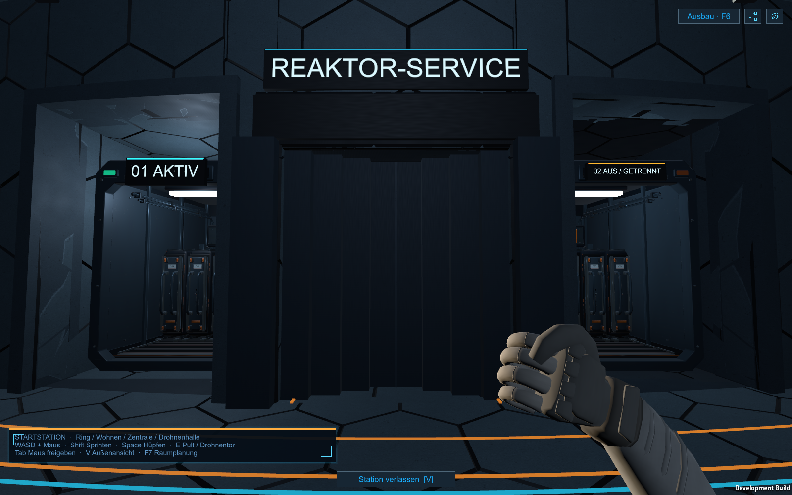
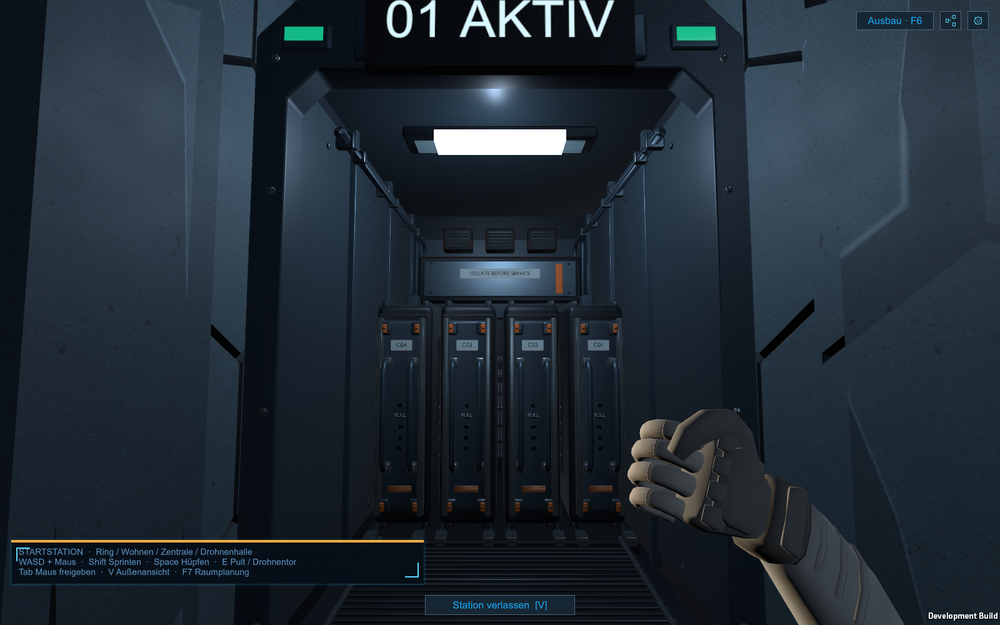
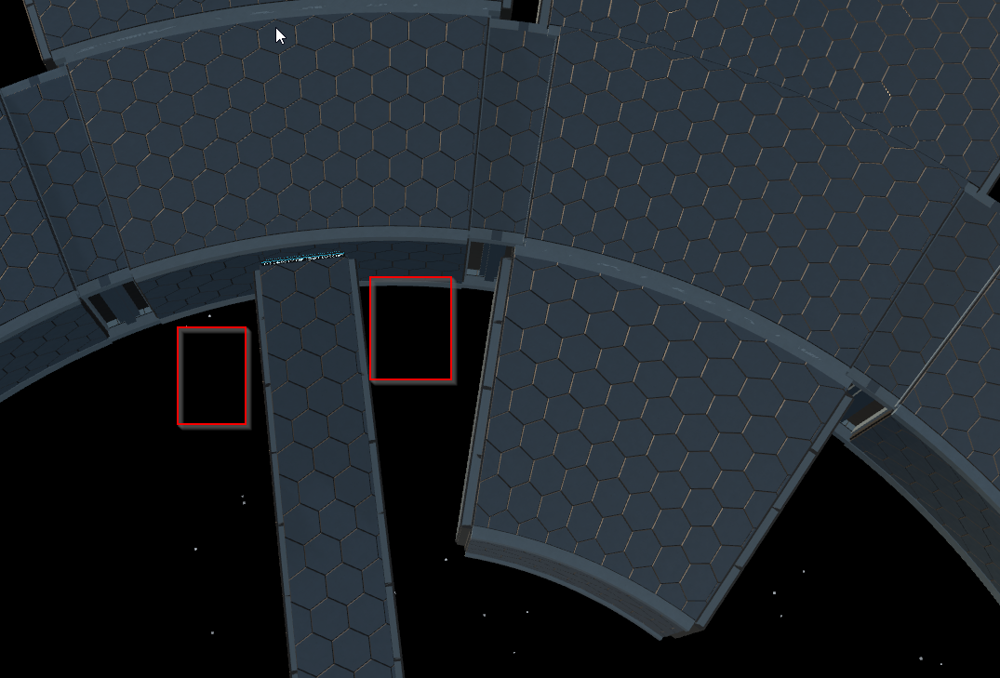
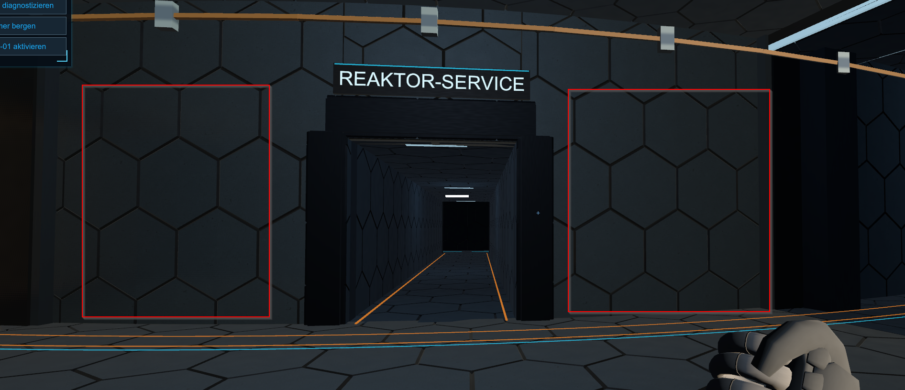
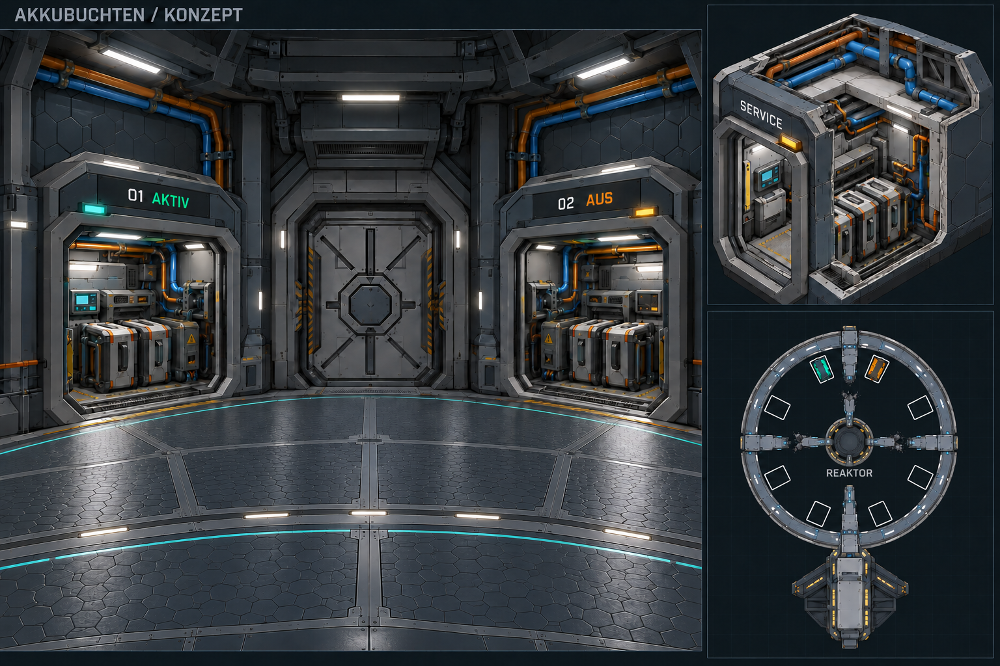

# Akkubuchten neben den Reaktorgängen

**Aktuelle Platzierungskorrektur — 25.10.2026:** Bestücktes Paar jetzt **0°, Index 0/1**, direkt gegenüber dem Eingang der Kommandozentrale über den Ringgang hinweg. Links 01 aktiv, rechts 02 ausgeschaltet; Index 4/5 auf der anderen Stationsseite ist leer. Gemeinsame 24 kWh unverändert. Telemetrie, physische Kassetten und R-01-Serviceziel folgen `StationBatteryPlacement`. [Umsetzung und aktuelle Prüfung](Innendrohnen-Fahrprobe-2026-10-25.md). Die älteren Texte und Bilder darunter beschreiben die vorherige Bestückung bei 180°.

**Strompult und echte Solarwinkel — 25.10.2026:** Bestücktes Paar unverändert180° gegenüber der Zentrale. Die aktive Beschriftung zeigt nun echte Ladeprozente; Reserve 02 bleibt ausgeschaltet und meldet keine erfundene Ladung. Zusätzliche Stromsteuerung ersetzt den Akku-Platzhalter in der Zentrale. [Aktueller Funktionsumfang](Stromversorgung-Steuerpult-2026-10-25.md), [aktueller Prüfnachweis](Pruefungen/Strompult-2026-10-25.json). Die folgenden Modell-/Buchtennachweise dokumentieren die vorherige Geometriestufe.

**Stand 25.10.2026: Im Spiel umgesetzt und im Development-Player geprüft.** Der Nutzer hat die Positionen links und rechts der vier Reaktorgänge anhand der unten verlinkten Screenshots festgelegt. Acht echte Nischen schneiden die bestehende innere Ringdruckwand auf; Rahmen, Druckhülle und Schutzhaut verbinden sie mit dem Ring. Nur das Paar bei 180° ist mit je vier Kassetten bestückt. Die gemeinsame Stationskapazität bleibt unverändert 24 kWh.

`battery-bays-build-07` unter `Builds/Windows`, Start `Start-Aufbauphase-01.cmd`; Vorgänger `Builds/Windows-before-battery-bays-20261025` erhalten. Quelle Unity 6000.4.7f1, getrennte Buildkopie 6000.6.4f1. Kein Commit/Push. Sieben grafische Prüfläufe derselben finalen Development-Binärdatei bestanden: 1925 Assertions / alle Exit 0, 39 gesicherte Bilder; darin 550 gezielte Buchtenprüfungen. 313 Quellen-/Metadateien und 247 ausgelieferte Dateien SHA256-abgeglichen. Alle drei gespeicherten Nutzerraumpläne unverändert. Automatisierte Controller-/API-/Framebufferprüfung; keine neue native OS-Eingabe-, manuelle Komfort-, Release-, Headset-, 100k-Render- oder FPS-Abnahme. [Prüfnachweis](Pruefungen/Akkubuchten-2026-10-25.json).

## Bestätigte Platzierung und aktueller Bau

Die roten Markierungen in den Nutzerbildern legen die ringseitigen Fronten neben den Reaktorgängen fest:

Je Achse 0°/90°/180°/270° entstehen zwei Buchten. Vom Ring zum Reaktor gesehen bedeutet links positives Speichen-u. Index und Darstellung sind fest zugeordnet:

| Achse | Links / rechts | Bestückung |
| --- | --- | --- |
| 0° | Index 0 / 1 | Links Akku 01 aktiv; rechts Akku 02 ausgeschaltet und getrennt |
| 90° | Index 2 / 3 | Beide leer; Havarie-Ringbereich bleibt gesperrt |
| 180° | Index 4 / 5 | Beide leer |
| 270° | Index 6 / 7 | Beide leer |

Jede Bucht hat eine eigene Front vom Ring. Der zentrale Reaktordurchgang bleibt davon unabhängig; beschädigte Gänge bleiben durch ihre Schotten gesperrt. Auch die neuen Nischen reparieren weder den fehlenden Ringboden bei 90° noch einen Reaktorgang.

## Umgesetzte Maße und Konstruktion

Im jeweiligen Speichenkoordinatensystem ist +z vom Reaktor zum Ring gerichtet; u verläuft seitlich. Die folgenden Maße ersetzen die ursprüngliche 2,8-m-Höhe des Bildkonzepts:

| Teil | Maß / Lage im Quellstand |
| --- | --- |
| Freier Buchtenkörper | Betrag u = 2,2–4,8 m, `z = 23,8–28,3 m`, Boden `y = 0`, lichte Höhe **3,8 m** |
| Körperbreite / -tiefe | 2,6 m / 4,5 m, jeweils lichte beziehungsweise innere Bezugsmaße |
| Wände | Drucklage, Abstandstragwerk und äußere Schutzlage; seitlich zusammen 0,22 m außerhalb der freien Breite |
| Anschluss | Kurzer gekrümmter Boden-/Dachkragen bis r29,1; massive Zargen überbrücken die Ringwand bis r29,28 |
| Detaileinsatz | 2,30 × 3,22 × 3,169 m inklusive 2,9 cm Displayvorstand |
| Modellanker | Speichenlokal `(u = ±3,5; y = 0,06; z = 28,10) m`, um 180° zur Achse gedreht; Modellfront −Z zeigt zum Ring |

Die Öffnungskanten werden für jede gekrümmte Wandlage aus `asin(u/r)` berechnet. So bleiben keine schmalen Wandreste vor dem rechteckigen Zugang stehen. Durchgehende Collider bilden Boden, Dach, Seiten- und Rückwand sowie Zargen; die zweite Haut sitzt auf verbundenen Rahmen. Der erste Ringlaufstreifen beginnt bei r30,05 und wird nicht als Abstellfläche verwendet. Die tatsächliche Kapsel-/Torfreigängigkeit gehört zur noch ausstehenden Laufabnahme.

Die zentralen Reaktortore verwenden kompakte Teleskopblätter mit **2,9 m freier Breite**. Ihre seitlichen Taschen bleiben innerhalb `|u| ≤ 1,95 m`; die Nischen beginnen bei `|u| = 2,2 m`. Das Schott an der beschädigten 90°-Achse bleibt verriegelt. Andere breite Ringtore erhalten dadurch keine neue Mechanik.

## Modelle und Bedienung

Das neue Modellpaket stammt aus dem projektspezifischen Blender-Generator, nicht aus dem Konzeptbild. Es besitzt drei FBX-Detailstufen mit **19.841 / 12.264 / 2.612 Dreiecken** für die vollständig bestückte Bucht. Die sechs leeren Plätze behalten `Frame` und `Housing`; die Gruppe `Rack` mit den vier Kassetten ist dort ausgeblendet. Leitungen, Griffe, Verriegelungen und Servicefläche sind modellierte Bauteile. Ein gemeinsamer PBR-Atlas und eigene Display-/Linsenmaterialien ermöglichen unterschiedliche Zustandsanzeigen. [Quelldatei, Gruppen, Maße, Texturen und Reproduktion](../Design/Models/BatteryBay/README.md).

Die Buchten sind als `battery-bay-0` bis `battery-bay-7` auswählbare Kontakte in der taktischen Außenübersicht. Dort sind Fokus und Statusansicht möglich. Akku 01 zeigt den bestehenden globalen Energiespeicher, Netzanschluss und Zustand; Akku 02 zeigt den getrennten Zustand. Außen werden weiterhin keine Arbeitsaufträge vergeben.

Der bestehende **24-kWh-Stationsakku** bleibt der einzige Energiespeicher. Der sichtbare aktive Einbau stellt diesen gemeinsamen Speicher dar; er ist kein zweiter Vorratsbehälter. Es gibt durch diesen Schritt weder zusätzliche Kapazität noch Gratisenergie, neue Einzelbank-Speicherstände, Reserveaktivierung oder eine festgelegte Zellchemie. Die vorhandene Reparatur-/Versorgungslogik bleibt maßgeblich. Der ausgeschaltete Akku ist nicht automatisch zerstört.

Die Innenlayoutrevision steigt auf **15**, damit alte Fußpositionen gegen die geänderte physische Geometrie geprüft werden. Raumplan-JSON-Schema und gespeicherte Nutzerpläne werden nicht durch den Buchtenbau umgeschrieben. Der Prüfnachweis belegt deren unveränderte SHA256-Werte sowie den Save-Roundtrip und die echte Geometrie-/Kollisionsprüfung.

## Quellen und Prüfstand

- Ringöffnungen und Hüllen: `Assets/SpaceMiner/Scripts/RingWalkthrough.BatteryBays.cs`, Einbindung in `RingWalkthrough.cs` und `RingWalkthrough.Expansion.cs`.
- Modell-/Zustandsdarstellung: `StationBatteryBay.cs`; Kontaktintegration: `StationOperations.Batteries.cs` und taktische Übersicht.
- Native Modellquelle: `Design/Models/BatteryBay/BatteryBay.blend`; Generator: `tools/CreateBatteryBay.py`; Unity-Assets: `Assets/SpaceMiner/Resources/BatteryBay/` samt `.meta`-Dateien.
- Gezielte Development-Abnahme: `-stationBatteryBayCheck`, mit Grafik; 550 bestandene Prüfungen und vier normale Spielkamera-Framebuffer. Weitere sechs Regressionen auf derselben finalen Binärdatei: Stationsgeometrie, Raumplanung, Vitalwerte/Sprung, Kameravertikalbewegung, Taktik und natürlicher erster Wasserauftrag. [Prüfnachweis](Pruefungen/Akkubuchten-2026-10-25.json).

Die beiden tatsächlichen Laufzeitkorrekturen waren das Anlegen von MaterialPropertyBlock erst bei der Initialisierung sowie offene MeshCollider an Frame/Housing. Der neue Akzeptanztest wartet nach dem Schließen von Pulten auf den normalen Eingabefreigabeframe und prüft die wirkliche Türblattposition; bestehende äußere Versorgungsanbauten werden nicht als freie Laufbahn behauptet. Blender-Renders bleiben separate Studiovorschauen. Keine neue manuelle Komfort-, Headset-, Release- oder FPS-Abnahme. Die Reserve-Inbetriebnahme und individuelle Bank-Speicherlogik sind weiterhin zukünftige Arbeit.

## Historischer Bildentwurf

Die folgende Gestaltung war vor der Screenshotfestlegung entstanden. Bild, Prompts und Geometrie-JSON bleiben unverändert erhalten; insbesondere deren 2,8-m-Höhe und damalige Außenmaßbeschreibung sind keine aktuellen Bauparameter.

Das Bild wurde mit dem eingebauten Imagegen erstellt. [Vollständiges Promptset](Art/Station/Akkubuchten-Konzept-2026-10-25-v1.prompt.txt) · [Historischer Maß- und Platzierungsvorschlag](Art/Station/Akkubuchten-Konzept-2026-10-25-v1.geometry.json). Bild-SHA256: `C95FC342676CE1BD078A321092E156D1DFF2A0E3112F9F1A2BFE4974AD4891E3`. Das generierte Bild ist eine Gestaltungsansicht, kein maßhaltiger Unity-Screenshot.

Gezielte Bildkorrekturen: [Grundriss/geschlossener Boden](Art/Station/Akkubuchten-Konzept-2026-10-25-v1.refinement.prompt.txt), [innere Buchtanordnung](Art/Station/Akkubuchten-Konzept-2026-10-25-v1.plan-refinement.prompt.txt), [unterer Servicegang](Art/Station/Akkubuchten-Konzept-2026-10-25-v1.bottom-spoke.prompt.txt). Verbleibende Bildgrenze: Im kleinen schematischen Grundriss unterbricht der Schriftzug den eigentlich intakten 0°-Gang optisch. Für den Bau bleibt dieser Gang durchgehend; nur die drei anderen Achsen sind beschädigt.
