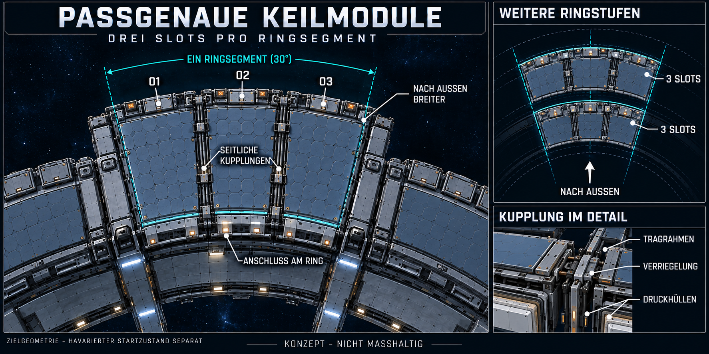

# Passgenaue Keilmodule mit seitlichen Verbindungen

Nutzerbestätigung25.10.2026: Keilform gefällt; nun im [Gesamtkonzept V5](Stationskonzept-Keilmodule-V5-2026-10-25.md) mit Modul01 intakt und02/03 beschädigt in die bestehende Startstation eingebunden. V4 bleibt die Form-/Kupplungsreferenz, noch keine neue Unity-Umsetzung.

Stand25.10.2026. Nutzerentscheidung: Die drei Slots sollen jeweils von einem nach außen breiter werdenden Modul belegt sein. Die Module sollen sich sowohl am Ring als auch aneinander befestigen lassen, um den Raum besser auszunutzen und einen stabileren Verbund zu erhalten. Das sind verbindliche Gestaltungsziele; die konkrete Tragfähigkeit ist nicht berechnet. Die drei benachbarten Slots pro Ringsegment und Wiederholung an weiteren Außenringstufen bleiben bestehen.

[Vollständiger Bildprompt](Art/Station/Ringsegment-Verbundene-Keilmodule-2026-10-25-v4.prompt.txt) · [Vorheriger Dreier-Slot-Entwurf V3](Anbauslots-Konzept-V3-2026-10-25.md)

## Geometrie

Jedes Modul ist im Grundriss ein Ringsektorkeil: schmaler gebogener Anschluss innen, breitere gebogene Stirnseite außen und zwei radiale Seitenflächen. Drei Keile bilden gemeinsam ein vollständiges übergeordnetes Ringsegment. Zwischen Nachbarn bleibt nur eine schmale geschlossene Montagefuge; breite ungenutzte Dreieckslücken entfallen. Ein Deck; der Entwurf zeigt die vollständige Zielgeometrie ohne verdeckende Schäden. Der havarierte Wasserlager-Startzustand mit einem intakten und zwei verschieden beschädigten Nachbarn bleibt davon getrennt erhalten.

Als konkrete Rasterausarbeitung wird der bestehende30°-Sektor in **dreimal nominal10°** geteilt. Slotachsen relativ zur Segmentmitte−10°/0°/+10°, Grenzen−15°/−5°/+5°/+15°. Gemeinsame Seitenebenen sind damit deckungsgleich. Fugen und Wandstärken werden innerhalb der nominalen Zellgrenzen berücksichtigt; keine überlappenden Druckwände.

Bei vorläufig16m radialer Tiefe ergibt sich für die erste Außenstufe r38–54m eine nominale Sehnenbreite je Keil von etwa6,624m innen und9,413m außen (`2*r*sin(5°)`). Eine folgende Stufe r54–70m beginnt mit derselben9,413m-Anschlussbreite und endet bei12,202m. Das sind eigene Raster-/Bildmaße, keine vom Nutzer bestätigten lichten Raummaße. Das frühere V3-Raster−9°/0°/+9° mit offenen Zwischenräumen wird damit ersetzt. Jede weitere Ringstufe behält drei Keile pro übergeordnetem Segment; keine automatische Verdreifachung der Slotzahl.

## Verbindung und Nutzung

Vorgeschlagen werden umlaufende Tragrahmen mit radialer Verbindung an Ring oder voriger Stufe und mehreren seitlichen Verriegelungspunkten zu den Nachbarkeilen. Kupplungen verbinden die Rahmen. Druckhüllen bleiben eigenständige Grenzen, ebenso die getrennte Außenschutzlage. Ein mechanischer Anschluss bedeutet nicht automatisch eine offene Tür; optionale seitliche Durchgänge wären eigene abschottbare Verbindungen und sind noch nicht beschlossen.

Die Befestigung soll beim Bau nacheinander möglich sein: erstes Modul am Ring sichern, Nachbarmodul radial ansetzen, seitliche Rahmen ausrichten und verriegeln. Der eigenständig montierte Zustand darf im späteren Baukonzept nicht von einem bereits vorhandenen Nachbarn abhängen. Belastbarkeit, Kupplungsanzahl und Materialstärken sind noch auszuarbeiten; keine neue statische oder Drucksimulation.

Die bisherigen seitlichen Drohnen-Entladeanschlüsse dürfen nicht zwischen den nun anliegenden Modulen verschwinden. Die Grafik verlegt die sichtbaren Materialanschlüsse an die freie äußere Stirnseite. Für spätere Außenstufen muss deren Zugänglichkeit erneut geplant werden, beispielsweise an der dann freien Außenfront oder Unterseite. Noch keine neue Spielmechanik oder Flugroute.

## Prüfung und Grenzen

Finale PNG1774×887 Pixel, SHA256 `42281C483572F077F01E2E11D80B86884349C84BD3A1AE052B14F15C99E12CCB`. Sehnenbreiten für r38/54/70m rechnerisch geprüft; lokale Konzeptlinks vorhanden, Dokumentdiff ohne Leerraumfehler.

Mit eingebautem ImageGen aus V3 bearbeitet. Visuell auf drei anliegende, nach außen breiter werdende Keile, sichtbare gemeinsame Fugen/Kupplungen, radiale Anschlüsse, wiederholtes Dreier-Raster und getrennte Druckhüllen im Detail geprüft. Bild dient der Form- und Anschlussabstimmung; keine maßhaltige CAD-Zeichnung oder Tragfähigkeitsprüfung. PNG im Projekt gespeichert, lokale Dokumentlinks und Rasterarithmetik geprüft. Keine Unity-Quellen geändert, kein neuer Build/Laufzeittest, kein Commit/Push; bestehender Build und fremde Arbeit erhalten.
