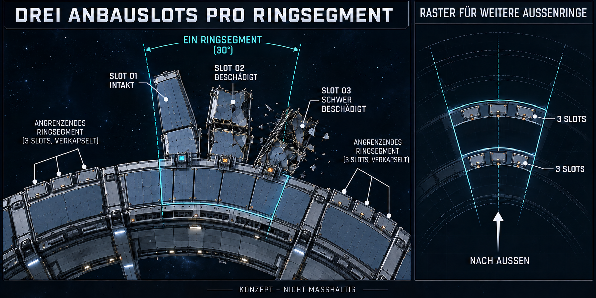

# Drei Anbauslots pro Ringsegment

**Form weiter präzisiert:** [V4 mit passgenauen Keilmodulen](Anbauslots-Keilmodule-V4-2026-10-25.md) ersetzt die freistehenden Finger/Zwischenräume: nach außen breitere Module mit gemeinsamen radialen Seitenfugen und seitlichen Kupplungen. Drei Slots pro Segment bleiben. Die nachfolgenden9°-/Abstandsangaben sind der historische V3-Vorschlag.

Stand25.10.2026. Aktuelle Nutzerentscheidung: **„So angeordnet … in den Aussenringen … in einem Ringsegment dann noch drei Anbauslots“**, mit beigefügter Draufsicht als maßgeblicher Anordnungsreferenz. Drei benachbarte Anbauten entlang des Ringbogens, jeder mit eigenem direkten Ringanschluss und nach außen gerichtet. Die frühere Interpretation als drei Räume hintereinander in V2 war falsch und ist überholt. Der laufende Konzeptschritt wird entsprechend korrigiert; noch keine Änderung der Unity-Geometrie.

[Nutzerreferenz](Art/Station/Anbauslots-Nutzerreferenz-2026-10-25.png) · [Vollständiges ImageGen-Promptset](Art/Station/Ringsegment-Drei-Anbauslots-2026-10-25-v3.prompt.txt)

## Verbindliche Anordnung und konkrete Ausarbeitung

Jedes Ringsegment erhält drei nebeneinanderliegende Anbauslots auf seiner äußeren Bogenkante. Alle drei beginnen auf derselben radialen Ringgrenze. Jeder Anbau wächst in seiner eigenen radialen Richtung nach außen; so entsteht eine leicht auffächernde Gruppe länglicher Module. Im Wasserlager sind Slot01 intakt und Slot02/03 unterschiedlich stark beschädigt. Jeder hat seinen eigenen Anschluss und eine kleine Material-Andockstelle.

Die drei Slotpositionen werden je Ringsegment auch an weiteren äußeren Ringstufen vorgesehen. Das Konzept verwendet durchgehende übergeordnete Sektorgrenzen: drei Slots pro Segment und Ringstufe. Es schlägt keine automatische Verdreifachung auf9/27 Slots pro ursprünglichem Segment vor. Das genaue Anschlusssystem zwischen ausgebauten Außenstufen ist vor Umsetzung noch auszuarbeiten.

Als technische Ausarbeitung im bestehenden30°-Sektorraster: Slotachsen bei Segmentmitte−9°, Mitte und Mitte+9°, jeweils etwa9° Teilraster einschließlich Fugen. Bei r38m entspricht9° etwa5,96m Sehnenbreite; bei r54m etwa8,47m. Tatsächliche Hüllenbreiten müssen wegen Fugen darunter liegen. Etwa16m Anbautiefe bleibt für das Bild ein Vorschlag, keine neu bestätigte Maßvorgabe. Die alten5,33m-Drittel in radialer Tiefe beschreiben ausschließlich den zuvor gebauten Stand. Eine vollständige Belegung aller zwölf Sektoren hätte rechnerisch36 Slots je Ringstufe; das ist ein Rasterwert, kein Auftrag, alle Räume sofort zu bauen.

Ein freier Slot erhält als Vorschlag eine geschlossene Druckgrenze mit Anschlussrahmen und gekappten Versorgungsanschlüssen. Der strukturelle Anbauslot ist vom kleineren Drohnen-Entladeanschluss zu unterscheiden. Ringdurchgänge und bestehende große Halle/Kommandozentrale nicht ungeprüft zerteilen: breite Sondermodule könnten mehrere Slots belegen. Dies ist eine noch offene Umsetzungsregel.

## Hülle und Schaden

Zweilagige Wabenhülle bleibt. Intaktes Lager vollständig geschlossen; Wrackbereiche jeweils vom Ring abgeschottet. Große noch befestigte Hüllenreste, verbogene kräftige Rahmen, eingerissene Tankhüllen, versetzte Risse in beiden Lagen und wenige Trümmer. Slot02 und03 haben eigene zusammenhängende Bruchformen. Keine neue Druck-, Kapazitäts-, Bau- oder Reparaturmechanik im Konzeptschritt.

## Prüfung und Grenzen

Gesicherte finale PNG:1774×887 Pixel, SHA256 `4ED01E035B866A944E3DD032C715BACDA87D60ACD8ADA4F947A6474D1AC6B491`. Lokale Links der drei Konzeptfassungen und Dokumentdiff auf Leerraumfehler geprüft.

Mit eingebautem ImageGen aus der Nutzerreferenz erstellt. Grafik visuell auf genau drei benachbarte Anbauten innerhalb eines markierten Segments, eigene Ringanschlüsse, drei freie Anschlüsse in Nachbarsegmenten und wiederholte Dreiergruppen an äußeren Ringstufen geprüft. Falsch gerichteten Pfeil rechts gezielt korrigiert. Maßhaltigkeit und Freiraum sind nicht durch das Bild nachgewiesen. PNG-Abmessungen/Hash und lokale Dokumentlinks separat geprüft. Keine Unity-Änderung, kein Build/Laufzeittest, kein Commit/Push; bestehender Build und fremde Arbeit erhalten.
