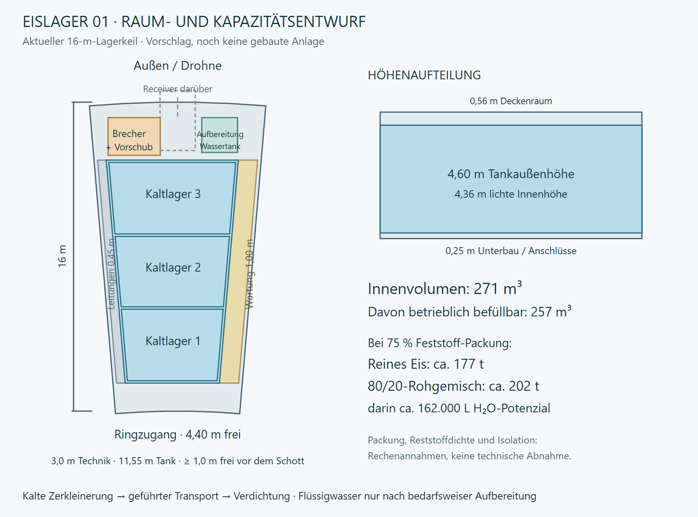

# Eisannahme und großer Speicher im Lagerkeil 01 — 25.10.2026

## Bestätigte Umsetzung: Drohne und vollständige Lagerkette

Der Nutzer hat anschließend ausdrücklich **Drohne und komplette Eisannahme/Kaltlager/Wasseraufbereitung zusammen** beauftragt. Die folgenden konkreten Startgrößen ersetzen den früheren reinen Entwurfsstatus. Die Runtime ist implementiert und im finalen `ice-plant-build-07` geprüft. Neun Prüfläufe derselben finalen Development-Binärdatei: **4335 Assertions, alle Exit 0**, 59 gesicherte Bilder; 268 Quellen-/Metadateien und 247 ausgelieferte Dateien SHA256-abgeglichen. Alle drei gespeicherten Nutzerraumpläne unverändert. Quelle Unity 6000.4.7f1, separate Buildkopie 6000.6.4f1, Innenlayout 14; Raumplan-JSON-Schema 1 und gespeicherte Pläne unverändert. Keine neue Release-, VR-, 100k-, Langzeit-, manuelle Komfort- oder FPS-Abnahme. Kein Commit/Push. [Prüfbericht](Pruefungen/Eisannahme-und-Kaltlager-2026-10-25.json). Start: `Start-Aufbauphase-01.cmd`.

**Stofffluss:** Die gescannte Quelle liefert eine einzelne Roh-Eisladung bis zum 90-%-Volumenziel der Drohne. Der 200-L-Verbrauchswassertank begrenzt diesen Auftrag nicht mehr. Am vorhandenen Receiver wird dicht angedockt, erst danach öffnet die Heckluke. Ein begrenzter echter Massenstrom füllt die Annahmekammer; die Fracht nimmt tatsächlich ab. Volle/gestoppte Annahme behält die Restladung an Bord. Der kalte Brecher speist einen Zwischenpuffer, der Verdichter die drei Kaltzellen. Erst der separate Aufbereiter wandelt eine kleine bedarfsgesteuerte Menge in Flüssigwasser um. Sämtliche unbekannte Restmasse bleibt im lokalen Reststoffbehälter; kein freies Verwerfen oder Umdeuten in Eisen/Kohlenstoff.

| Teil | Anfangsauslegung |
| --- | ---: |
| Rohannahme / zerkleinerter Zwischenpuffer | jeweils 1500 kg |
| Drei Kaltzellen, nutzbares Schüttvolumen | 76,258 / 84,774 / 96,077 m³ |
| Gesamtes betriebliches Schüttvolumen | 257,110 m³ |
| Reineis-Kapazität bei 75 % Packung | rund 176,8 t |
| 80/20-Rohgemisch bei angenommenen Dichten | rund 202,5 t; darin 162.000 L Wasserpotenzial |
| Lokaler unbekannter Rückstand | 45 t |
| Sauberer Verbrauchswasserpuffer | zunächst vorhandene 200 L, anfänglich 20 L |
| Brecher / Verdichter | jeweils 0,2 kW und 0,0025 kWh/kg; 80 kg/h als Pipeline |
| Aufbereiter | 1,5 kW und 0,20 kWh/L; maximal 7,5 L/h |

Die Zellenkapazitäten ergeben sich einzeln aus der wachsenden Keilbreite, innerer Höhe und den wirklichen Trennwandpositionen. 95 % Freigabe im Stationsspeicher, 90 % in der Drohne und jeweils 75 % Feststoffpackung bleiben getrennte Abzüge. Ein volles 80/20-Kaltlager entspräche rund 196 vollständigen Drohnenladungen bei 1033 kg. Die vorhandenen Startvorkommen sind weiterhin endliche erreichbare Proben, keine automatisch erzeugten 200 t Rohmaterial.

Eine volle 1033-kg-Ladung kostet beim Brechen/Verdichten zusammen rund **5,17 kWh** und benötigt im eingeschwungenen Betrieb rund **12,9 Spielstunden** Durchsatzzeit; beide Stufen laufen als Pipeline. Alle enthaltenen rund 826,7 L Wasser aufzubereiten würde zusätzlich rund 165,3 kWh und 110,2 Betriebsstunden brauchen. Für die ersten 180 L Ergänzung zum 200-L-Puffer genügen ideal 36 kWh bzw. 24 Aufbereiterstunden. Die Anlage hält bei vollem Flüssigwasserpuffer an. Anlauf, Bordverbrauch, unterbrochene Leitungen, Stationsstrom und zwischenzeitliche Verbraucher verlängern reale Zeiten. Das frühe Aufbauziel bleibt erste Lieferung plus 40 L Flüssigwasserreserve; der riesige Rohspeicher muss dafür nicht voll werden.

**Energieannahme:** 0,20 kWh/L ist eine erklärte erste Spielauslegung für Auftauen, Trennung und Reinigung, keine Verdampfung des kompletten Lagers. Eine konservative einfache Referenz mit 150 K Eis, konstant 2,1 kJ/(kg K), 333,5 kJ/kg Schmelzwärme und 5 °C Flüssigwasser ergibt rund 0,170 kWh/kg vor Verlusten/Reststofferwärmung. Die Differenz ist nur ein angenommener Sammelzuschlag. Materialabhängige Temperaturen, gelöste Verunreinigungen, Sterilisation und Wärmeabfuhr sind nicht einzeln simuliert. [Reproduzierbare Prozess-/Zeitrechnung](Pruefungen/Eisprozess-Rechnung-2026-10-25.json), Skript `tools/AssessIceProcess.py`. Der [NASA-Kalttrennungsentwurf](https://www.nasa.gov/general/aqua-factorem-ultra-low-energy-lunar-water-extraction/) und die [UK-Space-Agency-Übersicht](https://www.gov.uk/government/publications/uk-in-situ-resource-utilisation-isru-technology-review/uk-isru-technology-review) stützen die Trennung dieser Prozessschritte, nicht die Leistung dieser konkreten Spielanlage.

**Geometrie und Bedienung:** Keiltank z 39,45–51 m, 4,60 m hoch, zweilagige vorhandene Modulhülle erhalten. Rechts bleibt der Wartungsgang; links liegen Medienführung und außen die Technikzone. E-Pult im Gang öffnet **Eisannahme / Wasser** im Produktionsfenster. Dort Rohannahme/Kaltmaschinen und Aufbereiter getrennt pausieren, Füllmengen/Leistung/Prozessenergie ansehen. Dynamische Zellenfüllung, Druckanzeigen und langsame Wellen-/Kolben-/Pumpenbewegung lesen den wirklichen Simulationszustand. HUD trennt Flüssigwasser und gesamten Rohbestand. Der Restbehälter misst außen 3,15 × 2,30 × 4,60 m; nach 12-cm-Wänden, 95 % Belegung und 75 % Packung passen rechnerisch mehr als 45 t hinein. Die 200-L-Pufferhülle berücksichtigt Wand/Deckel und Betriebsfreiraum. 02/03 bleiben anfangs kaputt und liefern keine Kaltkapazität; ihre vorhandene spätere Reparatur kann weiterhin kleine 100-L-Flüssigwasserpuffer installieren.

**Startversorgung bedienen:** Die beschädigte Station erzeugt zunächst nur rund 1,84 kW. Lebenserhaltung, Kaltmaschinen, Aufbereiter und Drohnenladen können zusammen deutlich mehr benötigen. Nach der ersten vollständigen Rohlieferung lässt sich der Aufbereiter am Pult ausdrücklich pausieren, damit die Drohne zuerst nachlädt; die Rohannahme und mechanischen Stufen können dabei weiterlaufen. Danach Wasser nach Bedarf aufbereiten beziehungsweise die Energieversorgung reparieren. Die Anlagenprüfung testet die strombezahlte Aufbereitung; der bestehende Aufbauablauf prüft diese konkrete Prioritätsentscheidung statt kostenloser Zusatzenergie.

**Architektur und Speicherung:** `StationIcePlant` ist der reine Chargen-/Prozesskern mit getrennten Wasserpotenzial-/Restmassen und Double-Bilanzen. `StationOperations` bindet ihn an den vorhandenen Stationsstrom und das Wassernetz; `WaterScenario` übergibt nur tatsächlich darstellbare Massen an Float-Verbrauchsbehälter. `DroneAgent` trägt und übergibt echte Teilmengen. `StationOperations.IcePlantGeometry` und `.IcePlantUi` sind reine Darstellung/Bedienung. Ein optionaler versionierter Anlagenzustand ergänzt alte Saves leer; vorhandenes Wasser, Drohnenhardware, Ladung und laufende Phasen bleiben erhalten. Alte LIVE-Transitladungen gehen bei ihrer nächsten Entladung durch die neue Rohannahme. Alte Bestandsfracht kann ausdrücklich ohne neue Gewinnung/Mining-XP zur Annahme geflogen werden. Innenlayoutrevision 14 prüft alte v13-Fußpositionen gegen die neuen Tankcollider; sichere Positionen und alle Raumplan-Dateien bleiben erhalten. Die separate Nicht-Live-Modellprobe behält ihre direkte Legacy-Entladung.

**Offene technische Tiefe:** Geschlossener Kältespeicher ist ein idealisiertes Modell ohne berechnete Wärmelecks, Kühlschleife oder Sublimationsverlust. Unbekannter Rest gilt vorläufig als abtrennbarer Feststoff. Interner Drohnentransport und Identifikation dieser neuen Rückstände sind ein späterer Logistikauftrag; es gibt keinen UI-Teleport zum Analyselager. Strukturfestigkeit, Behälterdruck und vollständige Thermik sind nicht zertifiziert. Die nachfolgenden Abschnitte bewahren den ursprünglichen Entwurfs- und Analysestand.

## Ursprünglicher Entwurfsstand

**Nutzerentscheidung:** An der Drohnenübergabe soll ein System Eis mechanisch verkleinern und kompakt lagern können; vollständiges Erwärmen vor der Lagerung ist nicht erforderlich. Der Speicher soll den intakten Slot weitgehend nutzen und Platz für Anschlüsse und Wartung lassen. Die folgenden Maße, Verdichtungswerte und Kapazitäten sind eine konkrete Rechenvariante, noch keine bestätigte oder gebaute Hardwareauslegung.

## Ausgangsstand vor dieser Umsetzung

Der aktuelle intakte S08-Keil liegt auf 200°, r38–54 m, Winkel 9,7°. Er ist 16 m tief, zwischen den inneren Paneelflächen ungefähr 6,08–8,79 m breit und sichtbar rund 5,41 m hoch. Die nominale Bodenfläche beträgt 124,60 m². Die früheren drei radialen 5,33-m-Abschnitte sind überholt; heute liegen drei 16-m-Keile nebeneinander, nur 01 ist intakt.

Der vorhandene Receiver sitzt außen bei r54,8 m/y3,3 m und reicht nach innen bis etwa r51,5 m. Er ist ungefähr 1,82 m breit, sein Tunnel innen etwa 1,58 × 1,04 m. Die alte Verbindung zum sichtbaren Zylindertank ist deaktiviert; Brecher, Verdichter und Eisprozess fehlen. Der derzeit sichtbare Zylinder hat bereits etwa 17,5 m³ äußeres Volumen, die Spielkapazität beträgt trotzdem nur 200 L. Zwei kleine Eiscontainer sind reine Geometrie.

Aktuell bucht `DroneAgent.Unloading` nach 240 s `CargoKg × waterFraction` direkt als Liter Flüssigwasser. Bei 50 kg/80 % werden daraus 40 L; 10 kg unbekannter Rest erhalten keinen eigenen Bestand. Diese Abkürzung muss für eine echte Prozesskette ersetzt werden. Die heutige Abnahme bestätigt nur das bisherige Spielverhalten.

## Vorgeschlagene Prozesskette

1. **Dicht andocken und verriegeln:** vorhandene Heckkupplung verwenden; Annahmekammer gegen freien Weltraum und Stationsraum schließen. Eingehende Chargen wiegen und bekannte Zusammensetzung übernehmen.
2. **Kalt zerkleinern:** langsamer Doppelwellenbrecher erzeugt handhabbare Körnung. Er entfernt keine unbekannten Mineralien und produziert kein sauberes Flüssigwasser. Gezielte Fremdkörperprüfung und Rückwärtslauf gegen Blockaden vorbereiten.
3. **Geführt zuführen:** innerhalb der Maschine geschlossene Schnecke, Greifschieber oder Kolben. Kein Förderbandnetz zwischen Stationsanlagen; reguläre Logistik bleibt drohnenbasiert. Unter Schwerelosigkeit darf die Maschine nicht auf Falltrichter oder frei fallende Brocken angewiesen sein.
4. **Verdichten und halten:** Druckplatte/Schieber drücken die Körnung in drei getrennte Zellen, Rückhalter verhindern freies Umhertreiben. Poren reduzieren, nicht willkürlich die Dichte von kompaktem Eis erhöhen. Detaillierte Kräfte und mögliche Verblockung noch auslegen.
5. **Kalt speichern:** isolierte, geschlossene Zellen; Temperaturüberwachung, Wärmeabfuhr/Kühlung und Erfassung von sublimierendem Wasser. Offen liegendes Eis kann im Vakuum verloren gehen. Zerkleinern vergrößert die Oberfläche und macht Rückhaltung besonders wichtig.
6. **Nur Bedarf aufbereiten:** kleine Chargen aus dem Kaltlager entnehmen, auftauen beziehungsweise thermisch trennen und reinigen, anschließend in einen separaten Verbrauchswassertank führen. Als Rechenvorschlag etwa 1000–2000 L Flüssigwasserpuffer, nicht das gesamte Lager flüssig halten. Trinken, Nahrung und Drohnentreibwasser erhalten weiterhin sauberes Flüssigwasser.

NASA beschreibt im Forschungskonzept [Aqua Factorem](https://www.nasa.gov/general/aqua-factorem-ultra-low-energy-lunar-water-extraction/) eine kalte Körnersortierung ohne vorherigen Phasenwechsel. Das stützt die Untersuchungsrichtung; es ist kein Nachweis, dass beliebige Asteroidenbrocken allein durch Brechen rein werden. [DLR-Sublimationsversuche](https://www.dlr.de/en/images/2021/1/sample-container-before-and-after-the-experiment) zeigen Wasserverlust aus Eisgemischen bei Hochvakuum. Konkrete Speicherverluste und Kühlleistung müssen aus Temperatur, Isolierung und Wärmeeintrag berechnet werden; hier keine erfundene Leistungszahl.

## Raumaufteilung der Rechenvariante

Der vorhandene kleine Zylinder und die zwei dekorativen Eisboxen werden in diesem Entwurf durch einen größeren keilförmigen Eisspeicher ersetzt. Der Speicher folgt der nach außen breiteren Raumform und benötigt kein großes Flüssigkeits-Druckgefäß. Abteilwände und Rückhalter begrenzen die bewegliche Schüttung; alle Serviceanschlüsse sollen vom Wartungsgang erreichbar sein.

| Bereich | Angesetzt |
| --- | --- |
| Ringseitiger Vorraum | 1,45 m nominale Achstiefe, z38–39,45 m; mindestens 1,01 m hinter den bis z38,44 reichenden Schottschultern |
| Speicher | 11,55 m Achstiefe, z39,45–51 m; äußere Breite 4,87–6,83 m |
| Annahme/Brecher/Aufbereitung außen | 3,0 m Achstiefe, z51–54 m |
| Durchgehender Wartungsgang | 1,0 m wandnormal auf einer Seite |
| Medien-/Inspektionsspalt | 0,45 m wandnormal auf der anderen Seite, kein menschlicher Durchgang |
| Tankunterbau | 0,25 m für Lagerung und Anschlüsse |
| Tankhöhe außen | 4,60 m, Oberkante y4,85 m |
| Deckenraum | etwa 0,56 m, kein menschlicher Wartungsgang |
| Wand/Isolierung | pauschal 0,12 m pro Seite, noch keine Wärme-/Festigkeitsauslegung |
| Innere Abteilung | zwei Querwände à 0,12 m, drei getrennte Kaltzellen |

Die maßstäbliche Draufsicht ist in lokalen Lateral-/Achstiefenkoordinaten gerechnet. z ist die Projektion entlang der 200°-Achse, nicht der Radius jedes Eckpunkts. Die Tankseiten haben parallel zu den echten Seitenwänden konstante Abstände; die Ecken bleiben innerhalb des vorhandenen Keils. Der Receiver liegt über der Technikzone; der Stoff muss mit einem geschlossenen geführten Umlenker zum darunter/seitlich angeordneten Brecher gelangen. Der eingezeichnete Aufbereiter-/Pufferbereich ist ein Platzhalter, noch kein vollständiger Maschinenaufstellungsplan.

Der 1-m-Gang ist ein Planungsmaß, kein bereits nachgewiesener Zugang mit ausgebauten Pumpen oder Werkzeug. Für große Reparaturen müssen Zellen leer und freigeschaltet sein; einzelne Aggregate können als herausnehmbare Kassetten vorgesehen werden. Die drei Kammern im Tank sind keine neuen Außen-Anbauslots.

## Volumen und Kapazität

Aus schrägen Seitenflächen, Innenhöhe und Abzug der zwei Trennwände ergeben sich:

- **270,64 m³ innerer geometrischer Zellenraum**;
- bei 95 % betrieblicher Füllfreigabe **257,11 m³ Materialraum**;
- darin zusätzlich Poren zwischen den Körnern: beispielhaft 65/75/85 % Feststoffpackung.

Die 5 % betriebliche Freigabe und die Kornporen sind verschiedene Abzüge und werden nicht verwechselt. [USACE, Ice Engineering](https://www.publications.usace.army.mil/Portals/76/Publications/EngineerManuals/EM_1110-2-1612.pdf) nennt für kompaktes Süßwassereis bei 0 °C rund 916,8 kg/m³; hier gerundet 917 kg/m³. Kaltes Eis unterscheidet sich etwas. Die angesetzte 75-%-Packung ist eine eigene Entwurfsannahme, keine Messung eines Kryo-Verdichters.

| Feststoffpackung | Reines Eis | Rohgemisch, 80 % H₂O | Darin H₂O-Potenzial |
| --- | ---: | ---: | ---: |
| 65 % | 153 t | 175 t | 140.000 L |
| **75 % Entwurfsfall** | **177 t** | **202 t** | **162.000 L** |
| 85 % | 200 t | 229 t | 184.000 L |

Beim Rohgemisch wird der unbekannte 20-%-Anteil ausdrücklich nur für diese Sensitivitätsrechnung als Mineral mit 2500 kg/m³ angenommen. Die tatsächliche Dichte und Zusammensetzung sind unbekannt. Das Mischvolumen folgt `1/rhoMix = fWater/rhoIce + (1-fWater)/rhoRest`; nicht einfach 80 % der Eiskapazität nehmen. Eine kompaktere mineralische Fraktion verändert die Schüttdichte. Später müssen Mess-/Scandaten oder ehrliche Bereiche diese Annahme ersetzen.

**Rechnerisches Ziel für den gezeichneten Entwurf: rund 180 t reines Eis oder rund 200 t Roh-Eisgemisch, darin etwa 160.000 L potenziell gewinnbares Wasser.** Diese Liter sind weder Tankvolumen noch sofort verfügbares Trink-/Treibwasser. Bei vollständiger Aufbereitung des 75-%-Falls bleiben zusätzlich rund 40 t nichtwässriger Rückstand; tatsächliche Wasserverluste und Rückgewinnungseffizienz kommen hinzu. Die hohe Masse verlangt passende Träger, Kupplungen und Stationsmanöver; aus dem Raumvolumen folgt noch keine Tragfähigkeitsfreigabe.

Gezählt ist ausschließlich der intakte Slot 01. Reparierte 02/03 könnten später eigene gleichartige Anlagen aufnehmen; ihre Kapazität ist heute null. Aktuelle Erhöhungen um je 100 L in `StationOperations.Building.cs` sind ebenfalls bisherige Testwerte.

## Architektur und Spielziele

Die vorhandenen `SolidStore`-/`FluidTank`-Abstraktionen passen zur Trennung: Roh-Eisgemisch als Chargen mit Masse, Zusammensetzung und belegtem Volumen; bestehender gemeinsamer Flüssigwasserbestand für Verbraucher. Annahme, Brechen, Verdichten und Aufbereitung als reservierende, persistierbare Prozesse mit Energiebedarf und Ausfallzustand. Der unbekannte Anteil darf nicht mehr beim Entladen verschwinden. Keine kostenlose Phasenumwandlung und keine doppelte Verbuchung zwischen Drohne, Rohspeicher und Wassertank.

Ein großer leerer Speicher macht den Start nicht automatisch versorgt. Das frühe Missionsziel sollte eine konkrete Flüssigwasserreserve bleiben, beispielsweise die bisherigen 200 L, statt den riesigen Rohspeicher vollmachen zu müssen. Diese Trennung ist eine Folge der neuen Kapazitätsplanung; konkrete Quest-/Balanceänderungen sind noch nicht umgesetzt.

## Prüfung des ursprünglichen Entwurfs

Codegeometrie: `RingWalkthrough.Expansion.cs`, `RingWalkthrough.cs`, `HoneycombHull.cs`, `StationVisual.cs`, `CampaignDroneFleet.cs`, `MaintenanceLaserVisual.cs`, `StationPressureGate.cs`. Stofffluss: `DroneAgent.cs`, `WaterScenario.cs`, `StationResources.cs`, `StationOperations.Building.cs`. Eigene Rechnung und maßstäblicher SVG-Grundriss: `tools/AssessIceStorage.py`; [Parameter und Sensitivität](Pruefungen/Eislager-Slot01-Auslegung-2026-10-25.json). PNG aus dem SVG gerendert und visuell kontrolliert. Quellen am 25.10.2026 gelesen.

Keine Unity-Geometrie, Ressourcenwerte, gespeicherten Pläne oder Aufgaben verändert; kein neuer Build/Laufzeittest. Noch offen: detaillierte Maschinenhüllen, Revisionszugang, Verdichterkräfte/Packung, Kaltlagerthermik, Durchsatz/Energie, Struktur und Save-Migration.
