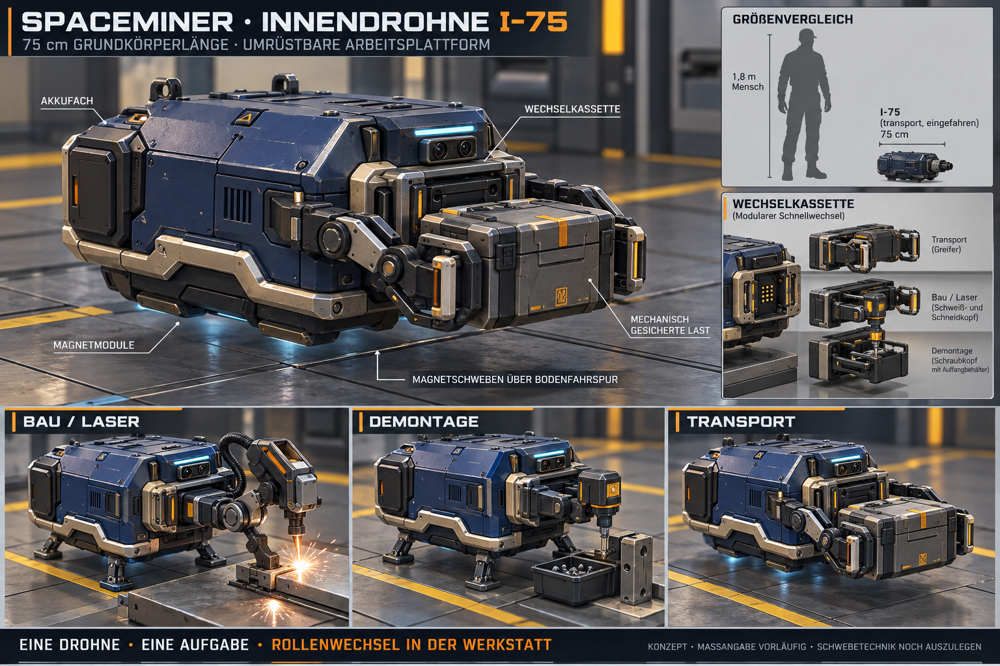

# Innendrohne I-75 – erster Bildentwurf

**Aktueller Arbeitsstand — 26.10.2026:** [R02-Modellgestaltung freigegeben](Innendrohne-I75-Textur-R02-2026-10-26.md). Als Nächstes auf Nutzerauftrag Docking-/Ladeplätze und die separaten Werkzeugmodule ausarbeiten; [offene Aufgaben und Ladeoptionen](I75-Naechste-Schritte-2026-10-26.md). Induktive Versorgung während der Bewegung ist eine zu prüfende Option, noch keine beschlossene Ausstattung. [Modell interaktiv ansehen](I75-3D-Vorschau-2026-10-26.md). Die folgenden Bild-/Maßannahmen beschreiben den ursprünglichen Konzeptstand.

Stand 25.10.2026. Nutzer beauftragt ausdrücklich ein Konzeptbild einer wesentlich kleineren, etwa75cm großen Innendrohne. Sie soll magnetisch schweben und durch Umbau für Bauen/Lasern, Demontieren oder Halten/Transportieren von A nach B eingesetzt werden können. **Eine konkrete Drohne erfüllt innen jeweils nur eine Aufgabenrolle; Rollenwechsel erfordert Umrüstung.** Die spätere Mira-Integration ist zurückgestellt.

[Vollständiger Bildprompt](Art/Drohnen/Innendrohne-I75-2026-10-25-v1.prompt.txt) · [Dateinachweis und Prüfgrenzen](Pruefungen/Innendrohne-I75-Konzept-2026-10-25.json)

Zusätzlicher Nutzerauftrag: [Transport von drei großen Wabenpaneelen mit Größenvergleich](Innendrohne-I75-Wabentransport-2026-10-25.md). Neueste Präzisierung: Paneele senkrecht aufsetzen; V2 zeigt den dafür geänderten Transportträger, nicht eine neue Drohnenrolle.

## Gestaltungs- und Maßannahmen

75cm als **Grundkörperlänge mit eingefahrenen Werkzeugen** interpretiert; nicht als verbindlich geklärte Höhe oder Arbeitsreichweite. Ergänzender Formvorschlag: etwa0,75m lang ×0,55m breit ×0,45m hoch. Ausgefahrene Arme, Last und Arbeitsbereich reichen darüber hinaus. Die generierten Ansichten sind illustrativ, keine maßhaltige Konstruktion; ein0,75-m-Gesamtmaß jeder beladenen/ausgefahrenen Pose ist nicht zugesagt.

Kleines kompaktes Chassis, gefaste dunkelblaue Metallpaneele, helle Schutzbügel, geschützte Gelenke, Schrauben und leichte Lackabnutzung aus der Familie der vorhandenen Außendrohne. Kleine cyanfarbene Sensor-/Statusanzeige, gelbe Funktionsmarkierungen. Große Außenfrachtbox, Außenantrieb und Bergbaubohrer werden nicht übernommen. I-75 ist eine vorgeschlagene Modellfamilienbezeichnung, keine zusätzliche bereits aktivierte Einheit.

Getrennt modellierbare Baugruppen: Chassis und Verkleidung; vier untere Magnetmodule; Park-/Arbeitsstützen; hinteres Akkufach; vordere gemeinsame Werkzeugaufnahme mit Führung, Verriegelung und Strom-/Datenkontakten; austauschbare aufgabenspezifische Kassette mit eigenen beweglichen Gelenken. Akkukapazität, Masse, Leistung, Nutzlast und Reichweite sind noch nicht festgelegt.

## Jeweils eine Rolle

| Eingebaute Kassette | Aufgabe im Konzept | Erkennbare Ausrüstung |
| --- | --- | --- |
| Bau / Laser | Bauteile positionieren und fügen; lokale Laserbearbeitung | Gelenkarm mit Laser-/Fügekopf und kleiner Arbeitsklemmung, aufgesetzte Stützen |
| Demontage | Verschraubungen lösen, Bauteile zerlegen, Kleinteile aufnehmen | Drehmomentwerkzeug, Gegenhalter, Auffangbehälter |
| Transport | Gegenstand aufnehmen, halten, nach A/B bringen und ablegen | Zwei gepolsterte Greifer mit tiefer mechanischer Lastauflage; keine schwebende Last |

Die Varianten unten und die Kassetten im rechten Einsatz sind Alternativen derselben Plattform. Sie stellen keine gleichzeitig montierten Aufgabenmodule dar. Greifen als Teil einer Montage/Demontage ist Hilfsfunktion dieser Rolle; ein zusätzlicher unabhängiger Transportauftrag wird dadurch nicht parallel freigegeben. Umrüstung findet in der Werkstatt statt; Wechselzeit, Werkzeugbestände, Kosten und Forschungsvoraussetzungen bleiben auszuarbeiten. Bauen setzt reale Teile voraus, keine freie Materialerzeugung. Rückstoß-/Arbeitskräfte und gesicherte Arbeitsposition später technisch prüfen.

## Magnetschweben und Stationsbezug

Als realitätsnahe Gestaltungsrichtung **oberflächennahes, geregeltes Schweben über ausgerüsteten Bodenfahrspuren** vorgeschlagen. Reale Planarmotoren kombinieren aktive Spulen in Boden-/Maschinenkacheln mit Magneten am bewegten Träger; Beispiel: [Beckhoff XPlanar, Funktionsprinzip](https://www.beckhoff.com/en-us/products/motion/xplanar-planar-motor-system/). Das ist eine Referenz für das Prinzip, kein Nachweis für die Tragfähigkeit einer75cm-Stationsdrohne mit Werkzeug und Last.

Bild zeigt einen schmalen symbolischen Schwebespalt und Magnetmodule über passenden Bodenkacheln. Cyanlicht dient der Statusdarstellung. Weder freie Raumfahrt beliebig weit vom Boden noch Schweben über jeder gewöhnlichen Metallplatte wird als technisch gelöst angenommen. Die heutigen gemalten Fahrspuren im Spiel sind dadurch noch keine implementierten Magnetbahnen. Spalt, Regelung, Versorgung des Bodens, Übergänge/Schotten, Verhalten bei Stromausfall und tatsächliche Trag-/Arbeitskräfte bleiben offen. Park-/Stützfüße dienen dem Bildentwurf für Stillstand und Kraftübertragung; genaue Funktion noch auszulegen. Höher gelegene Arbeiten könnten später passende Arbeitsplätze/Hubhilfen benötigen, ohne hier eine zusätzliche Fortbewegungsart festzulegen.

Die vorhandene interne R-01 und ihre aktuellen Produktions-/Reparaturaufträge bleiben unverändert. Ob und wie sie auf dieses Modell beziehungsweise diese Rollenregeln umgestellt wird, ist ein späterer Umsetzungsauftrag. Der Entwurf ersetzt weder die Außendrohnen noch deren aktuelle Fracht-/Energieauslegung.

## Erzeugung und Prüfung

Eingebautes ImageGen, keine CLI: vorhandene Außendrohnenansicht `Pruefungen/Wartungsmodul-2026-10-11/09-stowed-cassette.png` als Form-/Materialreferenz und Hallenansicht `Pruefungen/Drohnenhalle-Station-2026-10-19/14-detailhalle-arbeitsplatz.png` als Stationsstil. Referenzbilder vor der Generierung angesehen. Finale PNG und vollständiger Prompt unter docs/Art/Drohnen gesichert.

Sichtprüfung auf kleine Grundplattform, menschlichen Größenvergleich, mechanische Lastaufnahme, drei getrennte Ausrüstungen, Umrüstaufnahme und Bodenbezug. PNG-Signatur, tatsächliche1536×1024 Pixel, SHA256 und lokale Links geprüft. Beckhoff-Primärquelle zum Prinzip gelesen. Kein Blender-/Unity-Modell, keine Magnetschwebe-/Last-/Energieauslegung, keine Implementierung, Builds oder Laufzeittests in diesem Konzeptauftrag. Bestehende Änderungen anderer Chats erhalten; kein Commit/Push. Bild und ergänzende Formmaße warten auf Nutzerfeedback.
