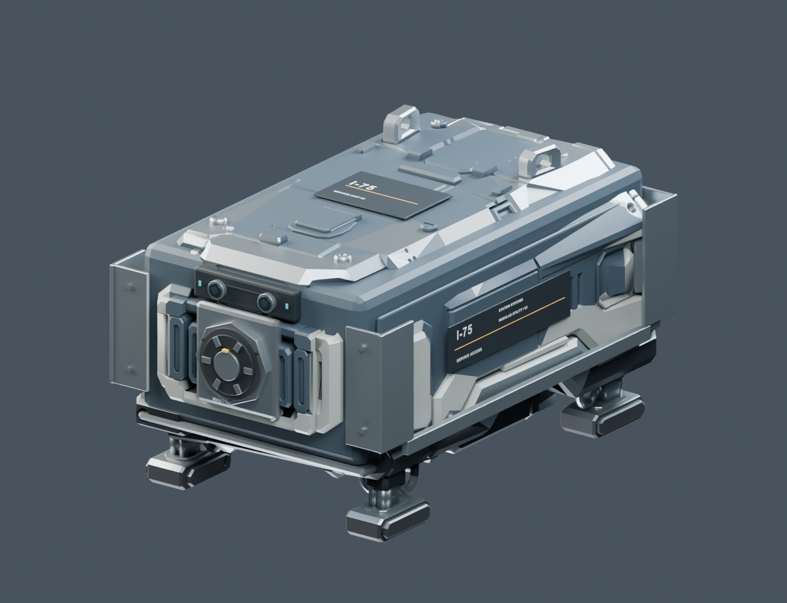

# I75 R03: geschlossene Hülle, Schrift und Werkzeugaufnahme

26.10.2026. Umsetzung der sechs Nutzerscreenshots plus Ergänzung zu seitlichen Lücken. R01, R02 und Tripo-V02 bleiben als Quellen erhalten. **R03 anschließend vom Nutzer bestätigt und ins Unity-Spiel übernommen.** [Spielintegration und Prüfgrenzen](Innendrohne-I75-R03-Spielintegration-2026-10-26.md).

## Geändertes Modell

- Das zufällige Punkt-/Kratzerbild und die grobe über mehrere Bauteile projizierte Schrift entfallen. Neun ruhige PBR-Materialien mit getrenntem Lack, Metall, Dichtungen, Optik und kleinen Statuslampen. Keine aus der R02 übernommenen Albedo-/Normal-/Emissionskarten im neuen GLB.
- Zwei seitliche Serviceschilder und eine Dachplakette tragen tatsächliche Schriftgeometrie. Text bleibt beim Heranzoomen scharf, wird nicht gespiegelt oder auf die Unterseite projiziert. Weniger und größere Informationen, klare Amber-Trennlinie.
- Die ursprüngliche Außenhaut besitzt2.648 offene Randkanten.123 kleine planare Öffnungen geschlossen, nahe doppelte Punkte verschweißt und reale1,2-mm-Paneelstärke mit Randflächen ergänzt. Die komplexe alte Dekorhaut besitzt danach noch69 Randkanten und nicht-manifold Überschneidungen; sie wird ausdrücklich **nicht als vollständig wasserdicht repariertes CAD-Mesh** ausgegeben.
- Eine separate geschlossene innere Chassishülle, geschlossene Bauch-/Wartungsabdeckung, durchgehende Seitenhinterlagen, Heckabschluss und hintere Geräteabdeckung verhindern die in den Screenshots sichtbaren Durchblicke ins Modell. Diese geschlossenen Bauteile sind als eigene Meshes prüfbar; kein zweiseitiger Shader als Ersatz für Geometrie.
- Vorne mittig eine magnetische Werkzeugaufnahme mit achteckigem Flansch, sechs sichtbaren Polflächen, geschlossener Andockfläche, Zentrieransatz, Verdrehsicherung und Flanschschrauben. Position folgt Bild2; konkrete Maße sind die Ausarbeitung dieser Vorschau. Zwei echte eingefasste Kameralinsen und kleine Statusleuchten ersetzen die großen türkisen Flecken.

Der bisherige Grundkörper bleibt48,2cm breit und43,71cm hoch. Mit neuer Werkzeugaufnahme beträgt die Gesamtlänge **78,3cm**, statt75cm für den bisherigen Körper.87.564 Dreiecke,60 exportierte Meshobjekte, neun Materialien. Schrift, Halterungen und Abdeckungen bleiben einzeln bearbeitbar. Für die Spielübernahme nach Material gebündelt und drei Detailstufen erstellt; genaue Unity-Zahlen und Laufzeitprüfungen im Spielintegrationsbericht. Kein FPS-Benchmark.

## Dateien und Bedienung

- [Native Blenderquelle](../Design/Models/IndoorDroneI75/Surface-R03-2026-10-26/I75_V02_Surface_R03.blend)
- [GLB für den Viewer](../Design/Models/IndoorDroneI75/Surface-R03-2026-10-26/I75_V02_Surface_R03.glb)
- [FBX](../Design/Models/IndoorDroneI75/Surface-R03-2026-10-26/I75_V02_Surface_R03.fbx)
- [Generator](../tools/RepairIndoorDroneI75R03.py), [Modellbericht](../Design/Models/IndoorDroneI75/Surface-R03-2026-10-26/surface-report.json)
- [Lokaler Viewer](http://127.0.0.1:8769/I75Viewer/) startet mitR03; R02/R01 weiter auswählbar. Neuer Knopf **Unten**, daneben Vorne/Hinten/Seite/Oben. Länge wird aus den tatsächlichen Modellmaßen ermittelt. `Start-I75-3D-Vorschau.cmd` startet den vorhandenen lokalen Server.

Reproduktion mit Blender4.5.14: `blender.exe --background --threads 6 --python-exit-code 1 --python tools/RepairIndoorDroneI75R03.py`. Optional `-- --skip-render` für Modell/Exporte ohne die acht Produktbilder. Der Generator schreibt nur die eigene R03-Ausgabe und die zugehörigen neuen Bilder; Vorstufen werden nur gelesen.

## Prüfung und Grenzen

Blender-Erzeugung und getrennte GLB-/FBX-Wiederimporte geprüft. Beide Exporte besitzen60 Meshes, neun Materialien, zwei seitliche Kennzeichnungen, sechs Magnetpole und übereinstimmende Maße. Geschlossene Chassis-, Bauch- und Heck-Meshes besitzen nach Zusammenführen importbedingter Normalen-/UV-Splits keine Rand- oder nicht-manifold Kanten.54 Strahlproben gegen den geschlossenen Kern aus allen sechs Richtungen treffen vor der gegenüberliegenden Seite auf Geometrie. R02-Quelldatei per SHA256 unverändert.

Im BrowserR03 tatsächlich geladen; Übersicht, Unterseite, Heck und rechte Seite visuell kontrolliert, anschließend Übersicht wiederhergestellt. Schrift und Punktfreiheit zusätzlich anhand neuer echter Blender-Produktbilder beurteilt. Technischer Nachweis und Bildliste: [Prüfbericht](Pruefungen/I75-R03-2026-10-26.json).

Keine Kräfte-/Halteleistungsberechnung, simulierte Magnetkupplung, verwendbare Werkzeuge oder Werkzeugwechselanimation. Keine neue Energie-/Massenentscheidung. **SP-01 durch bestätigte R03 und anschließende geprüfte Spielübernahme abgeschlossen.** [Spielintegration und Prüfgrenzen](Innendrohne-I75-R03-Spielintegration-2026-10-26.md). Keine manuelle Gesamt-/FPS-Abnahme, kein Commit/Push.