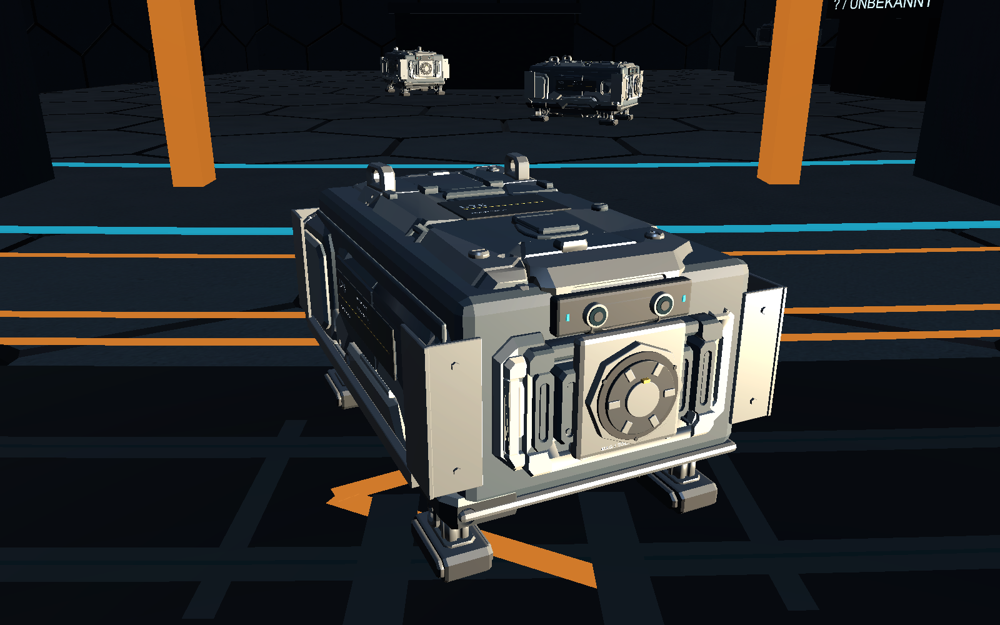

# I75 R03 im Spiel – 26.10.2026

R03 vom Nutzer mit „sehr gut“ bestätigt und anschließend ausdrücklich zur Spielintegration beauftragt. Im normalen Spiel verwendet Arbeitshelfer R-01 jetzt R03; die zehn optionalen Fahrprobenakteure ebenfalls. Development und Release mit der festgelegten Unity6000.6.5f1 gebaut; 1523 Playerprüfungen (949 Verkehr, 477 Strom/R-01, 97 Kampagne), alle drei finalen Läufe Exit0.

## Start und tatsächliche Zuweisung

`Start-Startstation.cmd` verwendet den neuen Release-Player unter `Builds/WindowsRelease`; `Start-Startstation-Dev.cmd` und `Start-Innendrohnen-Fahrprobe.cmd` den geprüften Development-Player unter `Builds/Windows`. Die Fahrprobe aktiviert zehn optische Testakteure; im normalen Kampagnenstart bleibt R-01 zunächst ausgeschaltet und muss wie bisher aktiviert werden. Die zehn Fahrprobenakteure werden dadurch keine zusätzlichen produktiven Kampagnendrohnen. Separate Mira-/TechTree-/Mining-Showcases wurden nicht ausgetauscht.

Die bestehenden Buildordner sind vor Austausch vollständig umbenannt, nicht gelöscht. Die ausgelieferten Dateien wurden einzeln gegen die Prüfbuilds gehasht; Dateizahlen und Sicherungsordner stehen im [Prüfbericht](Pruefungen/I75-R03-Spielintegration-2026-10-26.json).

## Modell und Laufzeit

Die bestätigte [R03-Blender-/FBX-/GLB-Quelle](Innendrohne-I75-R03-2026-10-26.md) bleibt erhalten. Bytegleiches FBX unter `Assets/SpaceMiner/Art/IndoorDroneI75/R03`, explizite neun PBR-Materialdefinitionen in `materials.json`. `IndoorDroneTrafficBuild.Prepare` prüft Projektversion, Front nach+Z, Metermaß, Bodenpivot und importierte Topologie; erhält die GUID von `Resources/IndoorDroneI75/I75Traffic.prefab` und schreibt wiederverwendbare Material-/Meshassets.

Mit Magnetaufnahme78,3cm lang,48,2cm breit,43,71cm hoch. Unity importiert87.556 Dreiecke gegenüber87.564 im Blenderbericht; diese konkrete Importzahl ist ausdrücklich geprüft, die genaue Ursache der acht entfallenden Dreiecke wurde nicht als neue Geometrieaussage bestätigt. LOD0/1/2: **87.556 /19.869 /10.424 Dreiecke**, jeweils zwei Renderer mit mehreren Material-Submeshes; das sind ausdrücklich keine zwei Drawcalls. Kleine Schrift entfällt in den beiden entfernten Detailstufen. Keine Pixel-/Punkttextur für die Beschriftung.

`IndoorDroneVisual.cs` schaltet die echten kleinen Statuslampen über PropertyBlocks. `StationInteriorLayout.cs` verwendet dasselbe Modell für R-01 und gleicht den bisherigen Körpermittelpunkt-Pivot aus. `StationOperations.Geometry.cs` bindet die Beleuchtung an die vorhandene Aktivierung und positioniert den bestehenden Transportbehälter1cm oberhalb des Gehäuses. Aufgaben, Ressourcen, Außendrohnen und Speicherformat bleiben im bestehenden System. Die zehn Fahrprobenmodelle verwenden unveränderte0,48m Navigationsradien, welche die volle Modellhülle einschließen.

## Fahrprüfung und behobene Blockade

Ein erster kreisförmiger Mindestabstand von0,93m war als Nachweis einer tatsächlichen Gehäusekollision zu grob. Die neue Prüfung verwendet nach einer Kreis-Vorprüfung die vier Trennachsen der beiden gedrehten48,2×78,3cm-Hüllen mit jeweils5mm Sicherheitsrand. Individueller Fortschritt, Routenrunden, Boden-/Geometrie-/Türprüfungen und Zeitgrenzen wurden nicht abgeschwächt.

Der verlängerte Lauf fand außerdem eine Warteschleife an der30°-Kreuzung: Eine beim Übergang zwischen freier Navigation und Spurführung bereits innerhalb der Zone stehende, noch nicht zugelassene Drohne hielt selbst an und verhinderte zugleich die nächste Zulassung. `StationIndoorTraffic.Crossings.cs` lässt diesen bereits anwesenden Akteur zuerst ausfahren; anschließend gilt wieder FIFO. Keine Teleportation oder zeitgesteuerte Aufhebung einer belegten Reservierung im Spielbetrieb.

Final: **949 Verkehrschecks**, 5116 Positionssamples, 331 abgeschlossene Kreuzungen, 11 Überholvorgänge, mindestens drei vollständige Routenrunden aller zehn Drohnen. Kleinster Mittelpunktabstand0.954m; 0 zusätzliche Prüfungen naher gedrehter Hüllen. Laufdauer802.7 simulierte Sekunden; kein Beweis unbegrenzter Deadlockfreiheit oder normaler FPS.

Im finalen Lauf genügte der konservative0,94m-Kreisvorfilter bereits für alle Paare; der engere Trennachsenpfad wurde dort nicht benötigt. R-01 absolvierte im Stromtest einen360s-Reparaturauftrag mit81,74m tatsächlichem Weg und648 Bewegungssamples. Die vorhandene Kampagnensuite erzeugt zusätzlich eine feste Offscreen-Renderdiagnose mit GPU-Readback; dies ist kein Nachweis spielbarer FPS.

## Tatsächlich geprüft

- Beide finalen Builds erfolgreich, dieselbe vorhandene Szene ohne Setup-Neuerzeugung, Unity6000.6.5f1.
- 1523 Playerprüfungen (949 Verkehr, 477 Strom/R-01, 97 Kampagne); drei finale grafische Development-Läufe mit isolierten Saves/Einstellungen und Kopien der drei Nutzerraumpläne, alle Exit0. R-01 fährt im Stromtest einen echten Batterie-Reparaturauftrag; Kampagnenprüfung umfasst reale Aufträge, Ressourcen und Speicher-Roundtrip mit ausgewiesenen Fixtures.
- Sieben Verkehrsaufnahmen: vier native Spielkamera-Framebuffer und drei ausdrücklich getrennte Nahaufnahmen per zusätzlicher Kamera aus derselben unveränderten Spielszene. Front, Seite und Heck visuell geprüft; keine zusätzlichen Lampen oder neu inszeniertes Ersatzmodell für diese Nahaufnahmen.
- 378 C#-/Meta-Dateien gegen eingefrorenen Buildstand verglichen; alle drei Originalraumpläne SHA256-unverändert, FBX bytegleich und Prefab-GUID erhalten. Fehlversuche bleiben im Nachweis sichtbar.

SP-01 ist mit bestätigter R03 und dieser Spielübernahme abgeschlossen. Docking, neue Lade-/Energiewerte und verwendbare Wechselwerkzeuge bleiben SP-02/03/04/10. Die Magnetaufnahme ist zunächst die sichtbare Schnittstelle. Keine vollständige manuelle Kampagnen-, Hör-, Headset- oder FPS-Abnahme, kein gesonderter Release-Lauf und kein Commit/Push.
