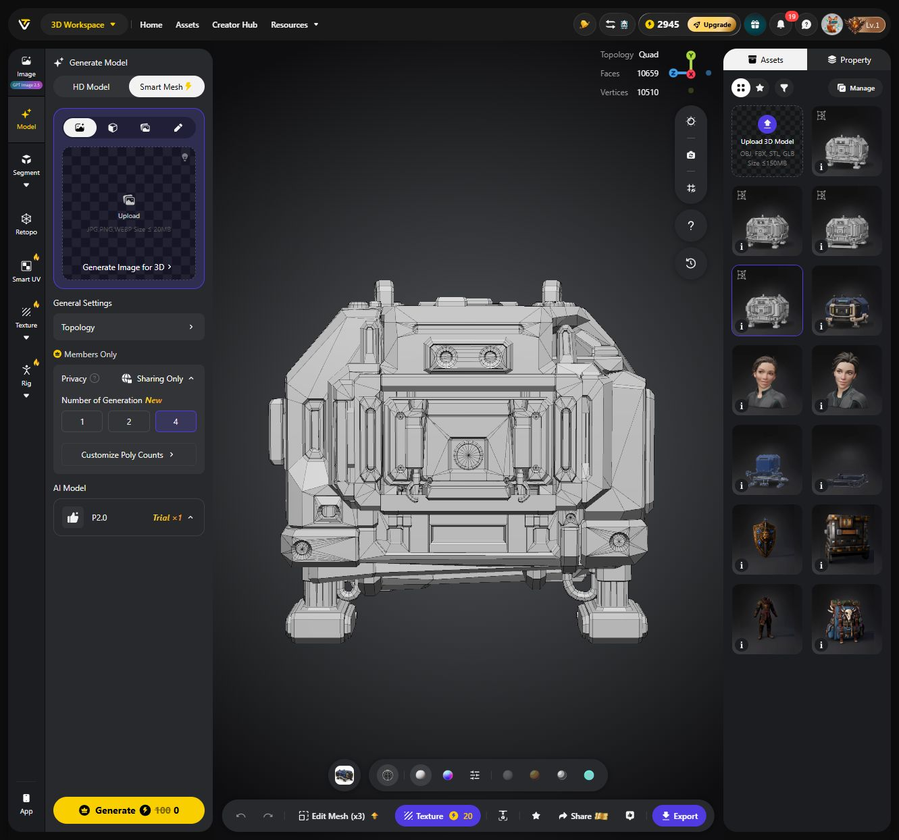

# I-75: Smart-Mesh-Vergleich mit HD Model

**Folgestand — 26.10.2026:** Nutzer bevorzugt V02 ausdrücklich. [Blender-Texturvorschau R01](Innendrohne-I75-Textur-R01-2026-10-26.md) erstellt, Originalgeometrie und Roh-FBX erhalten. Die unten genannte noch fehlende Nutzerfreigabe und UV-/Texturlosigkeit beschreiben den früheren Rohmodellvergleich; das unveränderte Original bleibt weiterhin texturlos.

Stand 25.10.2026. Nutzer möchte Smart Mesh ausdrücklich ausprobieren und Erfahrungen sammeln. **Vier P2.0-Varianten fertig und als unveränderte FBX-Dateien gesichert; kein Creditabzug in diesem kostenlosen Test.** Vorhandenes [H3.1-Modell](Innendrohne-I75-Tripo-Generierung01-2026-10-25.md) bleibt erhalten. Smart Mesh P2.0 mit denselben vier Eingabebildern Front/Left/Right/Back gestartet; kein erneuter Upload, vorhandene Referenzen im Workspace übernommen und vor Start visuell kontrolliert.

## Versuch

Quad-Topologie, vier Varianten in einem Auftrag, individuelle Zielzahlen **5000 / 7500 / 10000 / 15000 Polygone** statt vier gleicher Zielzahlen. Einstellungen nach Neuladen unverändert im [Budgetnachweis](Pruefungen/Innendrohne-I75-SmartMesh-2026-10-25/09-budget-einstellungen.jpg) sichtbar. Die tatsächlichen Zählwerte unterscheiden sich; die UI wies die Zuordnung der vier Budgetplätze zu den asynchron erzeugten UUIDs nicht eindeutig aus. Daher bezeichnet V01–V04 unten unsere Sichtungs-/Exportreihenfolge, nicht eine behauptete eindeutige Budgetplatznummer. Keine Textur-/Rigging-/Segmentierungsaufträge ausgelöst.

Kosten vor Start **100 durchgestrichen, 0 Credits** im P2.0-Test. Zähler Trial ×2 vor Start, ×1 danach und im finalen neu geladenen Zustand; Kontostand **2945 Credits** vor Start, nach Generierung und nach allen vier Exporten unverändert. Ein kostenloser Testlauf mit vier Geometrievarianten, kein Abokauf. [Browser vor Start](Pruefungen/Innendrohne-I75-SmartMesh-2026-10-25/01-vor-start-kostenlos.jpg). Keine Aussage, dass spätere Smart-Mesh-Läufe oder Texturierung ebenfalls kostenlos wären; sichtbarer separater Texture-Schritt 20 Credits wurde nicht gestartet.

Erzeugte Modell-IDs in Sichtungs-/Exportreihenfolge:

- `7b918240-7781-43be-bd45-15a7dbc76b76`
- `fe09d747-9c5c-49ba-9298-428a3ec35f2f`
- `1c636772-a525-4517-8672-6a2e0b5b06ce`
- `b271060b-0161-4dd6-a70c-e401fc53dac1`

## Vergleichsmaßstab

H3.1: 45.859 Vertices, 45.725 gemischte Polygone, 91.388 Dreiecke bei Fächertriangulierung, ein Meshobjekt/Material, vier 4096er-PBR-Texturen. Smart Mesh zunächst reine Geometrie; Farb-/Materialwirkung daher nicht als Formqualitätsvorteil oder -nachteil bewerten. Silhouette, Front-/Heckzuordnung, vier Füße, Werkzeugaufnahme, zusätzliche/falsche Gehäusedetails und Bearbeitbarkeit betrachten. Polygonzahlen erst nach Umrechnung auf Dreiecke vergleichen. Weniger Dreiecke allein sind noch kein gemessener FPS-Gewinn.

## Aktueller Stand

Alle vier Originale liegen unter `docs/Art/Drohnen/Tripo-I75-P20-2026-10-25`; direkter FBX/Blender-Export, kein ZIP, keine Texturen. Downloadquelle jeweils `U:\Downloads\SpaceMiner_I75_P20_V0N_2026-10-25.fbx`.

| Modell | Gemessene Vertices | Gemessene Polygone | Dreiecke nach Triangulierung | Weniger Dreiecke als HD |
| --- | ---: | ---: | ---: | ---: |
| H3.1, bisheriger Export | 45.859 | 45.725 | 91.388 | – |
| [V01](Art/Drohnen/Tripo-I75-P20-2026-10-25/SpaceMiner_I75_P20_V01_2026-10-25.fbx) | 5.279 | 5.868 | 10.093 | 89,0 % |
| [V04](Art/Drohnen/Tripo-I75-P20-2026-10-25/SpaceMiner_I75_P20_V04_2026-10-25.fbx) | 7.999 | 7.963 | 13.470 | 85,3 % |
| [V02](Art/Drohnen/Tripo-I75-P20-2026-10-25/SpaceMiner_I75_P20_V02_2026-10-25.fbx) | 10.510 | 10.659 | 18.312 | 80,0 % |
| [V03](Art/Drohnen/Tripo-I75-P20-2026-10-25/SpaceMiner_I75_P20_V03_2026-10-25.fbx) | 15.903 | 16.219 | 27.688 | 69,7 % |

FBX7400 mit vorhandener offizieller Blender-Parserbibliothek gelesen, Zählwerte mit Browseranzeige abgeglichen. P2-Dateien enthalten ausschließlich Dreiecke/Vierecke, daher ist `Dreiecke + 2 × Vierecke` hier exakt; beim H3.1-Vergleich Fächertriangulierung der wenigen größeren Polygone. Trotz Quad-Einstellung sind die P2-Ergebnisse gemischt, rund 69–72 % der Polygone Vierecke. **Alle vier haben ein Meshobjekt und ein Material, keine UV-Schicht, keine Texture-/Skelett-/Animationsobjekte.** Keine separat steuerbaren Füße. Die Polygonzahl allein sagt nichts über benötigte Texturarbeit, Draw Calls oder gemessene Spielleistung aus.

## Sichtprüfung und Schlussfolgerung für die nächste Bearbeitung

Frontansichten aller vier Varianten mit Drahtgitter angesehen und gesichert: [V01](Pruefungen/Innendrohne-I75-SmartMesh-2026-10-25/02-variante-5000-front.jpg), [V02](Pruefungen/Innendrohne-I75-SmartMesh-2026-10-25/03-variante-02-front.jpg), [V03](Pruefungen/Innendrohne-I75-SmartMesh-2026-10-25/04-variante-03-front.jpg), [V04](Pruefungen/Innendrohne-I75-SmartMesh-2026-10-25/05-variante-04-front.jpg). Der V01-Bilddateiname nennt den grob passenden 5000er-Zielbereich, keine bestätigte Budgetplatzzuordnung. Auch bei kleinen Meshes bleiben Doppelsensor, Frontdock und die kurze Fußfamilie erkennbar; Rundungen und kleine Aussparungen sind stärker vereinfacht. Varianten unterscheiden sich außerdem in Details und Unterbodenform: neue Generierungen, keine garantierten identischen LOD-Stufen desselben Modells.

**V02 ist der vorläufig interessante mittlere Kandidat**, keine Nutzerfreigabe. Seine [Front ohne Drahtgitter](Pruefungen/Innendrohne-I75-SmartMesh-2026-10-25/06-variante-02-solid-front.jpg), [Seite](Pruefungen/Innendrohne-I75-SmartMesh-2026-10-25/07-variante-02-solid-seite.jpg) und [Heck](Pruefungen/Innendrohne-I75-SmartMesh-2026-10-25/08-variante-02-solid-heck.jpg) wurden tatsächlich angesehen. Heck bleibt eine geschlossene Akku-/Wartungsfläche ohne wiederholtes Sensorpaar; lange Seitenform näher an der Referenz als die auffällig verdoppelten Details des HD-Versuchs. Gleichzeitig kantige Rundungen, dünne/fragmentierte Unterbodendetails und vereinfachte Gehäusekanten sichtbar. Mehr Polygone garantieren in dieser Stichprobe keine automatisch richtigere Konstruktion. Keine vollständige Rundumprüfung aller vier Varianten behaupten.

Die ergänzende Indexprüfung findet bei V01/V02/V03/V04 jeweils 496/2648/4211/2555 Randkanten sowie 45/126/282/80 Kanten mit mehr als zwei anliegenden Polygonen. Das sind Befunde am exportierten Vertexindexnetz; unverschweißte, geometrisch zusammenfallende Nähte können Randkanten mit verursachen. **Keine ungeprüfte Behauptung eines wasserdichten oder direkt produktionsfertigen Modells.** Am konkreten Mesh bereinigen und prüfen; kein automatisches Verschweißen ausgeführt.

Die Erfahrung aus diesem Versuch: Smart Mesh liefert hier wesentlich weniger Geometrie bei brauchbarer Grundform. Für unsere mechanische Drohne bleiben UV-/Materialarbeit, saubere bewegliche Baugruppen, genaue Maße und Formkorrekturen nötig. Der HD-Export bleibt als Farb-/Detailreferenz erhalten; dessen Texturen passen ohne passende UVs/Baking nicht automatisch auf die neuen Netze. Kein Texture-, Edit-Mesh-, Smart-UV- oder Segmentierungsschritt als nächster Auftrag vorweggenommen.

## Tatsächlich geprüft und offene Arbeit

Vier Downloads unverändert gesichert und SHA256 mit Quellen verglichen; FBX-Version/Objekte/Polygone/UV-Abwesenheit geprüft, Indexkanten gezählt. Temporäre Auswertung `work/I75Tripo/inspect_smartmesh.py` lokal ignoriert; dauerhafte Messwerte/Hashes/Bilder im [Prüfbericht](Pruefungen/Innendrohne-I75-SmartMesh-2026-10-25.json). PNG/JPEG-Dateien und lokale Dokumentlinks geprüft. Beim Umschalten/Neuladen springt der linke Generator teils auf HD zurück, obwohl ein P2-Modell betrachtet wird; Modell-ID und ausgelesene FBX-Zählwerte zur Zuordnung benutzt. Final V02 mit Smart-Mesh-Generator offen gelassen.

Keine 75-cm-Skalierung, Blender-Ansichts-/Materialimport-/Unity-Integration, beweglichen Fußbaugruppen, Spieländerung, Build, Laufzeit- oder FPS-Prüfung. Ursprüngliche Referenzbilder enthalten weiterhin voneinander abweichende Details; dieser Versuch prüft den Generierungsmodus, beseitigt diese Eingabeabweichungen nicht automatisch. Kein Commit/Push; fremde Änderungen bewahrt.
