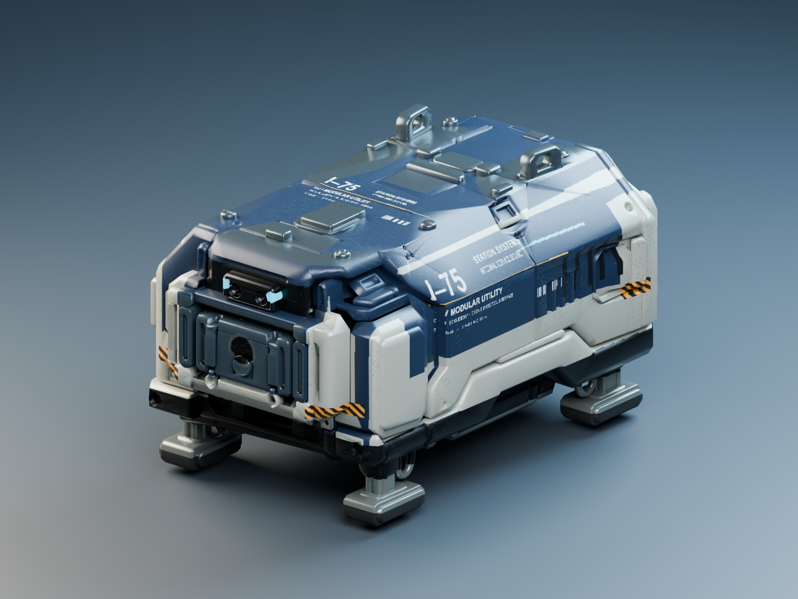

# I75 V02: Texturvorschau R01

**Folgevariante:** Nutzer wünscht härtere Kanten und mehr gebrauchte Metallwirkung. [R02 mit neuen Schutzwinkeln, härteren Normalen und matterer Oberfläche](Innendrohne-I75-Textur-R02-2026-10-26.md) liegt separat vor; R01 bleibt zum Vergleich erhalten.

26.10.2026: Nutzer bevorzugt Smart Mesh V02 und beauftragt die Texturierung in Blender samt Vorschau rechts. Bearbeitet wurde das tatsächliche V02-FBX aus der Fahrprobe. Die Bilder sind Blender-Renderings dieser Geometrie.

## Gestaltung und Modell

Blaue Lackierung, helle Schutzrahmen, dunkle Unterbodenmechanik und metallische Füße/Hebeösen. Kleine cyanfarbene Sensor-/Statusflächen und gelb-schwarze Wartungsmarkierungen; auflackierte I75-Bezeichnung, Serviceinformationen und Barcode. Dezente Kratzer, vereinzelte Lackabplatzer und gebackene Eigenverschattung. Beschriftungen sind Teil der Textur. Die Kennung02 ist eine feste Vorschaukennung, keine individuelle Spiel-ID.

Die Originalgeometrie bleibt erhalten: **10.510 Vertices, 10.659 Polygone, 18.312 Dreiecke**, ein Mesh und ein Material. Normiert auf **0,48034 m Breite × 0,75000 m Länge × 0,43710 m Höhe**, Bodenpivot mittig. Blender: Z oben, Front −Y. FBX: Y oben/−Z vorwärts exportiert; bei späterem Unity-Einbau Achsenzuordnung am Sensorpaar kontrollieren. Keine zusätzliche Bodenfreiheit in das Asset eingebaut.

Eine neue Smart-UV-Belegung nutzt rund46,8% des 2048²-Atlas für tatsächliche Oberflächenpixel. Der Rest entfällt auf Inselabstände und Packlücken. Das rohe Netz besteht teilweise aus kleinen/unverbundenen Bereichen; keine Topologiereparatur, neue Retopologie, zusätzliche Baugruppen oder Rigging vorgenommen.

## Dateien

Quelle und Exporte: [Surface-R01](../Design/Models/IndoorDroneI75/Surface-R01-2026-10-26/).

- [Blender-Datei](../Design/Models/IndoorDroneI75/Surface-R01-2026-10-26/I75_V02_Surface_R01.blend): Modell, Material, vier verwendete Bildtexturen gepackt, Kamera und separates Studioset.
- [GLB](../Design/Models/IndoorDroneI75/Surface-R01-2026-10-26/I75_V02_Surface_R01.glb): nur das Drohnenmodell, ein Material, vier eingebettete Texturen; keine Präsentationsfläche oder Studiolichter.
- [FBX](../Design/Models/IndoorDroneI75/Surface-R01-2026-10-26/I75_V02_Surface_R01.fbx): Originalpolygone mit neuer UV-Belegung. Texturen liegen daneben im Unterordner `Textures`.

Sieben 2048²-PNGs:

| Karte | Verwendung |
| --- | --- |
| BaseColor | Farbe, Lack, Verschleiß und Beschriftung; sRGB |
| ORM | R Eigenverschattung, G Roughness, B Metallic; linear |
| UnityMetalSmooth | RGB Metallic, Alpha Smoothness; linear, für Unity Standard Metallic |
| Normal | gebackene Tangenten-Normalmap; als Normalmap importieren |
| Emission | kleine cyanfarbene Statusflächen; sRGB |
| Occlusion | separate Graustufen-Eigenverschattung; linear |
| Height | Quellkarte für den bereits in Normal gebackenen feinen Lack-Bump |

Reproduzierbare Erstellung mit [MakeI75Stencils.py](../tools/MakeI75Stencils.py) und [TextureIndoorDroneI75.py](../tools/TextureIndoorDroneI75.py). Ersteres benötigt lokales Python/Pillow und die Windows-Schriften; es speichert die gerasterte Schablone, keine Schriftdateien. Zweites läuft im vorhandenen portablen Blender4.5.14LTS mit `--background --factory-startup --threads 10 --python-exit-code 1 --python tools/TextureIndoorDroneI75.py`. Keine Tripo-Aufträge, Downloads oder Creditkosten.

## Vorschau und tatsächlich erfolgte Prüfung

Drei native Cycles-Renderings, je1800×1350 und48 Samples mit Entrauschung, visuell gesichtet:

[Rückansicht](Art/Drohnen/I75-Textur-R01-2026-10-26/02-I75-R01-rear.png), [Seitenansicht](Art/Drohnen/I75-Textur-R01-2026-10-26/03-I75-R01-side.png).

Blender-Datei erneut geöffnet, gepackte verwendete Bilder kontrolliert. FBX separat erneut importiert: ein Mesh, eine UV-Ebene,10.659 Polygone/18.312 Dreiecke und75cm Länge bestätigt. GLB-Struktur geprüft:18.312 Dreiecke, UVs, ein Material und vier eingebettete Texturen mit Farb-/Metall-Rauheits-/Normal-/Emissionsbelegung. Alle sieben externen Bildkarten2048². Original-FBX und acht bestehende Fahrproben-Assetdateien mit vorherigem Quellenmanifest SHA256-identisch.

[Prüfnachweis und Manifest](Pruefungen/Innendrohne-I75-Textur-R01-2026-10-26.json). Der erste Bildentwurf wurde wegen zu geringer UV-Ausnutzung und zu starker Fleckigkeit überarbeitet; die drei verlinkten Bilder zeigen den finalen Stand.

**Noch Modellvorschau:** Fahrproben-Prefab und Spielbuild wurden nicht ersetzt. Unity-Materialzuweisung, Darstellung bei Stationsbeleuchtung und Performance sind hier nicht neu geprüft. Bestehende Netzfehler und zusammenhängende Magnetfüße bleiben spätere Modellarbeit. Kein Commit/Push; Änderungen anderer Chats erhalten.
