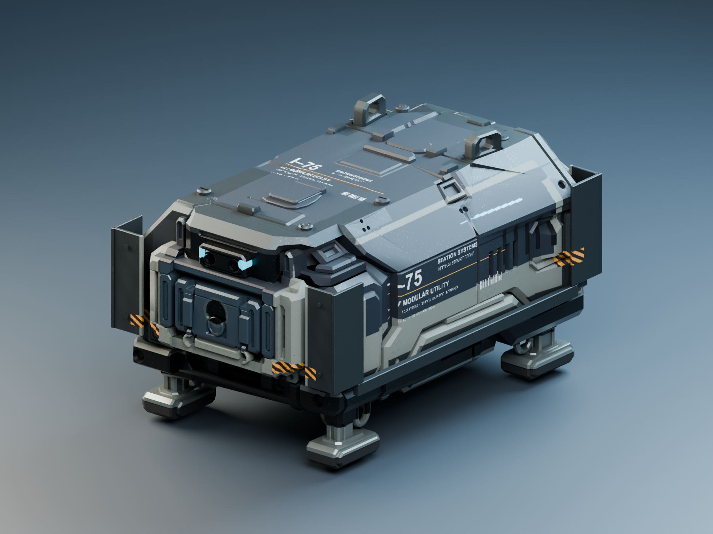

# I75 V02: kantigere Metallvariante R02

**Gestaltung freigegeben am26.10.2026:** Nutzer: „Viel besser, die Drohne gefällt mir“. R02 ist die bestätigte Grundlage für die weitere Ausarbeitung der Innendrohne. Die Unity-Übernahme bleibt ein eigener Arbeitsschritt.

26.10.2026: Nutzer kritisiert die abgerundeten Kanten und den Kunststoff-/Spielzeugeindruck der [ersten Texturvorschau R01](Innendrohne-I75-Textur-R01-2026-10-26.md). Auftrag: zweite Variante mit kantigerer Wirkung und gebrauchten Metallösen/Befestigungen.

## Änderungen

- Weiche importierte Kantennormalen entfernt; Glättung nach22° und flächengewichtete Normalen für deutlichere Paneel-/Fasenübergänge. Der vorhandene V02-Grundkörper bleibt geometrisch erhalten.
- Vier dünne L-förmige Eckschutz-Sätze, zwei gerade untere Schutzschienen und acht sichtbare Sechskant-Befestigungen ergänzt. Jeder Eckschutz besteht aus zwei6mm dicken Platten;1mm Fasen. Diese Teile ändern auch die Silhouette. Keine bloße nachgeschärfte Bilddatei.
- Dunklere, mattere blaue Lackierung und gedämpfte helle Rahmen. Weniger metallischer Anteil und höhere Rauheit der Lackschicht.
- Ösen, obere Befestigungen und Schutzwinkel mit gebürstetem Stahl, hoher Metallizität, wechselnder Rauheit, einzelnen blanken Abriebstellen und dunkleren Ablagerungen in Vertiefungen. Regelmäßige grobe Muster des ersten R02-Entwurfs zurückgenommen.
- Seitliche Beschriftung etwas tiefer auf das Paneel gesetzt. Kamerapositionen, Studiobeleuchtung und Bildgröße entsprechen R01;40 Cycles-Samples statt48.

Die Winkel ersetzen die alten Teile nicht als fertig bereinigte Konstruktion, sondern bilden einen zusätzlichen statischen Schutzaufsatz. Beide Varianten und das ursprüngliche Roh-FBX bleiben erhalten. Die großen Rundungen des vorhandenen Grundnetzes sind nicht vollständig neu modelliert.

## Dateien und Vorschau

Modell und Texturkarten: [Surface-R02](../Design/Models/IndoorDroneI75/Surface-R02-2026-10-26/), erstellt mit [TextureIndoorDroneI75R02.py](../tools/TextureIndoorDroneI75R02.py). Der Autorenschritt nutzt die vorhandene gerasterte R01-Schablone; keine Tripo-Aufträge oder Creditkosten.

[Blender](../Design/Models/IndoorDroneI75/Surface-R02-2026-10-26/I75_V02_Surface_R02.blend), [FBX](../Design/Models/IndoorDroneI75/Surface-R02-2026-10-26/I75_V02_Surface_R02.fbx), [GLB](../Design/Models/IndoorDroneI75/Surface-R02-2026-10-26/I75_V02_Surface_R02.glb). Gleiche sieben2048²-Kartentypen und Unity-Kanalbelegung wie in R01; vier tatsächlich verwendete Bildtexturen in Blender/GLB gepackt.

[Rückansicht](Art/Drohnen/I75-Textur-R02-2026-10-26/02-I75-R02-rear.png), [Seitenansicht](Art/Drohnen/I75-Textur-R02-2026-10-26/03-I75-R02-side.png), [direkter R01/R02-Vergleich](Art/Drohnen/I75-Textur-R02-2026-10-26/04-I75-R01-R02-Vergleich.png), [Metall-/Ösendetail](Art/Drohnen/I75-Textur-R02-2026-10-26/05-I75-R02-Stahldetail.png).

## Prüfung und Grenzen

Tatsächlich geprüft: **10.846 Vertices,10.983 Polygone,18.912 Dreiecke** einschließlich der Schutzteile (+600 gegenüber dem Rohkörper), ein zusammengefasstes Mesh/ein Material. Maße0,482m Breite ×0,750m Länge ×0,43710m Höhe. UV-Flächennutzung rund47,2%. Die ersten10.510 Vertexpositionen stimmen nach erneutem Öffnen beider Blender-Dateien mit R01 überein (Toleranz1µm); die Kantenwirkung des Grundkörpers kommt somit aus den geänderten Normalen, die zusätzliche kantige Silhouette aus den Schutzteilen.

FBX separat erneut importiert: Polygone, Dreiecke, UVs und75cm Länge bestätigt. GLB-Struktur geprüft: ein Mesh/ein Material,18.912 Dreiecke und vier eingebettete PBR-Texturen. Sieben2048²-Bildkarten, drei Hauptansichten und ein separater Metall-Detailrender geprüft und gesichtet. Der Vergleich kombiniert die beiden tatsächlichen Hero-Renderings. R01 sowie die ursprünglichen Fahrprobenassets bleiben erhalten.

[Prüfnachweis und Dateimanifest](Pruefungen/Innendrohne-I75-Textur-R02-2026-10-26.json). Keine neue Animation, separat gesteuerten Füße oder Unity-Buildübernahme. Die Darstellung im Spiel und Performance werden mit dieser Modellvorschau nicht abgenommen. Kein Commit/Push.
