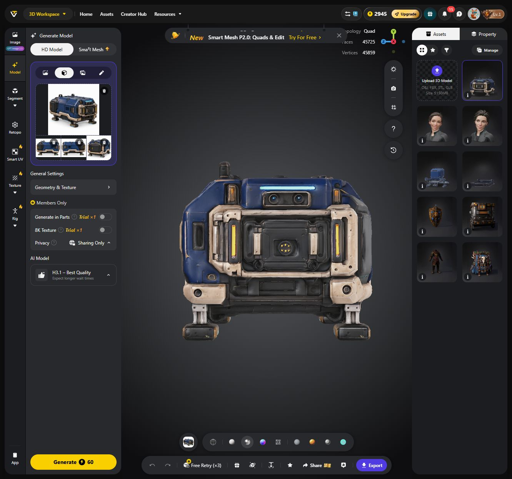

# I-75: erster Tripo-3D-Versuch

Folgeversuch auf Nutzerauftrag: [Smart Mesh P2.0 mit vier Geometrievarianten](Innendrohne-I75-SmartMesh-Vergleich-2026-10-25.md), kostenloser Test, 10.093–27.688 Dreiecke; H3.1-Original unverändert erhalten. Eigene Rohmodelle ohne UVs/Texturen, keine automatische Ablösung dieses HD-Entwurfs.

Stand 25.10.2026. Nutzer beauftragt nach Betrachtung der vier Bildvorlagen ausdrücklich den Versuch. Erneute Uploadaktion diesmal freigegeben. **H3.1-Modell fertig und als FBX/4K heruntergeladen**, Rohquellen im Projekt gesichert. Sichtprüfung zeigt brauchbare Front-/Materialidentität, aber doppelte Gehäusedetails und zusätzliche Hebeösen. Noch keine Gestaltungsabnahme oder Spielintegration.

## Tatsächliche Eingaben

Tripo stellt im Mehransichtenmodus **Front / Left / Right / Back** bereit. Daher die Unteransicht nicht falsch einem Seitenplatz zugeordnet. Ergänzende rechte Seitenansicht mit eingebautem ImageGen aus der linken Ansicht erzeugt; symmetrische Seitenverkleidung als vorläufige Designannahme. Unteransicht bleibt zusätzliche Modellierreferenz, ging nicht in diesen Auftrag ein.

| Tripo-Platz | Datei |
| --- | --- |
| Front | [01-vorne.png](Art/Drohnen/I75-Tripo-Set01/01-vorne.png) |
| Left | [04-seite.png](Art/Drohnen/I75-Tripo-Set01/04-seite.png) |
| Right | [05-rechte-seite.png](Art/Drohnen/I75-Tripo-Set01/05-rechte-seite.png), [Bildprompt](Art/Drohnen/I75-Tripo-Set01/05-rechte-seite.prompt.txt) |
| Back | [03-hinten.png](Art/Drohnen/I75-Tripo-Set01/03-hinten.png) |

Der zunächst noch leere Back-Platz nach asynchroner Verarbeitung wurde vor dem Start erneut befüllt. Alle vier Vorschaubilder im Seitenpanel visuell kontrolliert; [Zustand vor Generierung](Pruefungen/Innendrohne-I75-Tripo-2026-10-25/02-vier-ansichten-vor-start.jpg). Nur Grundchassis, keine Rollenwerkzeuge, Transportträger oder Fracht. Bilder sind generierte Ansichten mit bekannten Detailabweichungen, keine gemeinsame CAD-Geometrie.

## Auftrag und Einstellungen

- Modell-ID: `82186324-c59e-4f69-a811-f1020096b63c`.
- [Tripo-Auftrag](https://studio.tripo3d.ai/workspace/generate/female-character-with-futuristic-cyber-suit-gray-armor-with-cyan-glow-82186324-c59e-4f69-a811-f1020096b63c). Der URL-Namensteil wurde vom zuvor geöffneten Mira-Arbeitsplatz übernommen; die neue UUID bezeichnet den Drohnenauftrag.
- HD Model / H3.1 Best Quality, Ultra Mesh Quality an.
- Texture an, 4K, Remove Lighting an, PBR an; Quad, Polycount-Einstellung 50000.
- Generate in Parts aus, 8K aus; keine zusätzlichen Werkzeuge oder Animationen erzeugt.
- Angezeigter Kontostand vor Start **3005**, danach **2945 Credits**; Differenz **60 Credits**, wie vor dem Start angezeigt. Kein Abokauf/Upgrade.

## Ergebnis und gesicherte Originale

Die [Front](Pruefungen/Innendrohne-I75-Tripo-2026-10-25/03-modell-front.jpg) ist mit Doppelsensor, Cyanleiste und leerem Werkzeugdock erkennbar, Magnetfüße und geschlossene Heckfläche vorhanden. Beim [Drehen zur Heck-/Seitenansicht](Pruefungen/Innendrohne-I75-Tripo-2026-10-25/04-modell-heck-seite.jpg) fallen zusätzlich wiederholte Gehäuse-/Wartungsdetails und Hebeösen auf; mehrere Kanten wirken weich/verzogen. Die voneinander abweichenden Bildansichten wurden sichtbar vermischt. Das Ergebnis ist eine Rohform für weitere Bereinigung, keine genaue technische Rekonstruktion und keine bereits passende Spielfigur.

- Download: `U:\Downloads\SpaceMiner_I75_Base_H31_4K_2026-10-25.zip`, **10.006.741 Bytes**.
- Identische lokale ZIP-Sicherung unter `Imports/Tripo/SpaceMiner_I75_Base_H31_4K_2026-10-25.zip` (ignorierter Backupbereich).
- Versionierbare unveränderte Rohquellen unter `docs/Art/Drohnen/Tripo-I75-H31-2026-10-25`: [FBX](Art/Drohnen/Tripo-I75-H31-2026-10-25/tripo_convert_7a0e0706-77f2-4c94-a49f-65c490a4a6e2.fbx) und zugehöriges `.fbm`-Verzeichnis mit Color, Normal, Metallic und Roughness.
- Export FBX / Blender / 4K Current; nach Export weiterhin **2945 Credits**, kein zusätzlicher beobachteter Creditabzug.
- Offizieller vorhandener Blender-FBX-Parser: **ein Meshobjekt, ein Material, 45.859 Vertices, 45.725 Polygone**. Davon 45.641 Vierecke, 74 Dreiecke, neun Fünfecke und ein Siebeneck; rechnerisch 91.388 Dreiecke bei Fächertriangulierung. UI-Zählwerte stimmen mit dem FBX überein.
- Vier Bildtexturen jeweils **4096 × 4096**, vollständig lesbar. Keine Skelett-/Deformer-/Animationsobjekte im FBX; Füße/Halter nicht als eigene bewegliche Objekte exportiert. Ein Meshobjekt bedeutet hier nicht den Nachweis einer geschlossenen/manifold Geometrie.

Keine weitere Generierung, kein Free Retry, keine Segmentierung oder andere kostenpflichtige Nachbearbeitung ausgelöst. Modell im Browser offen gelassen. Der von Tripo automatisch gewählte Assetname lautet „futuristic cargo pod 3d model“; Modell-ID und oben verlinkter Auftrag sind maßgeblich.

## Maßstab und weitere Arbeit

Grundkörperlänge weiterhin 0,75 m als Ziel für spätere Blender-/Unity-Skalierung; kein verlässlicher Metermaßstab allein aus den Referenzbildern. Bewegliche Magnetfüße/Halter und deren Gelenke müssen später am tatsächlichen Mesh geprüft und gegebenenfalls getrennt aufgebaut werden. Keine Nutzerabnahme des generierten Modells vorwegnehmen. Werkzeuge bleiben separate spätere Aufträge. Bestehende R-01 und sämtliche Spielwerte unverändert.

## Prüfstand

Vier Eingabebilder im passenden Slot, Auftrag, vollständiges Modell, UI-Meshzählwerte und Creditstand im Browser geprüft; Front und Heck/Seite tatsächlich angesehen. Download-ZIP CRC/Pfade auf sichere Extraktion geprüft, Original-/Backuphash identisch, FBX7400 mit vorhandener offizieller Blender-Parserbibliothek gelesen, alle Texturen vollständig geprüft. Die temporäre Prüfdatei `work/I75Tripo/inspect_export.py` und ihr Zwischenbericht bleiben lokal ignoriert; dauerhafte Fakten, Pfade und SHA256 stehen im [Nachweis](Pruefungen/Innendrohne-I75-Tripo-Generierung01-2026-10-25.json). Keine Blender-Ansichts-/Materialimportprüfung, keine garantierte Unity-Material-/Normalkartenkorrektheit, keine CAD-/Topologie-/Lastprüfung; kein Unity-/Blender-Einbau, Build oder Laufzeittest. Frühere abgelehnte Uploadaktion und Bildhistorie bleiben in der [Grundform-Dokumentation](Innendrohne-I75-Tripo-Grundform-2026-10-25.md) erhalten. Kein Commit/Push; fremde Änderungen bewahrt.
