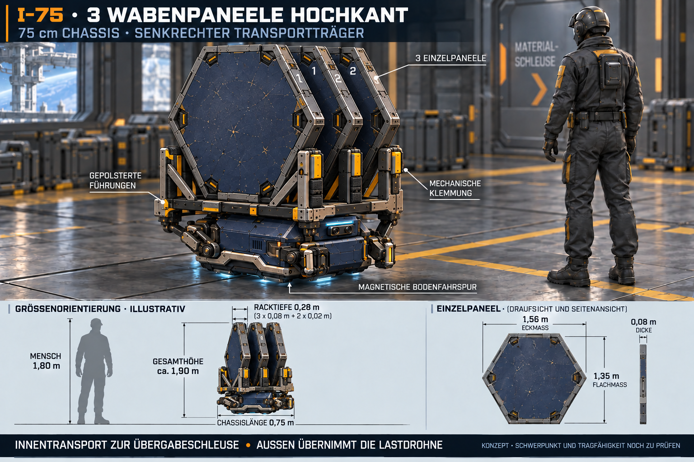

# I-75: drei Wabenpaneele transportieren

Stand 25.10.2026. Ergänzung zum [ersten Innendrohnenkonzept](Innendrohne-I75-Konzept-2026-10-25.md). Nutzer möchte drei vorhandene Bauteile einer neuen Außenerweiterung im Größenvergleich sehen und präzisiert danach ausdrücklich: **senkrecht auf der Drohne transportieren**. Die aufrechte Anordnung V2 wurde anschließend als Gestaltungsrichtung bestätigt („aufrecht passt mir das sehr“); V1 bleibt als frühere Alternative erhalten. Tragfähigkeit und Detailmaße bleiben offen; keine Gameplayänderung.

[V2-Bildprompt](Art/Drohnen/Innendrohne-I75-Wabentransport-2026-10-25-v2-hochkant.prompt.txt) · [Vorherige flache Beladung V1](Art/Drohnen/Innendrohne-I75-Wabentransport-2026-10-25-v1.png) · [Ausgangsprompt V1](Art/Drohnen/Innendrohne-I75-Wabentransport-2026-10-25-v1.prompt.txt) · [V1-Bereinigung](Art/Drohnen/Innendrohne-I75-Wabentransport-2026-10-25-v1-korrektur.prompt.txt) · [Datei-/Maßnachweis](Pruefungen/Innendrohne-I75-Wabentransport-2026-10-25.json)

## Bauteilmaß aus dem vorhandenen Modell

`HoneycombHull.cs` setzt Radius0,78m und geometrische Dicke0,08m. Für eine volle regelmäßige Wabe folgen **1,56m Eckmaß** und **1,351m Flachmaß** (`2*r` beziehungsweise `sqrt(3)*r`). Das ist ein geschlossenes einzelnes Hüllpaneel, kein ganzer Raum und kein offener Wabenring. Zugeschnittene Randteile im tatsächlichen Bauablauf sind kleiner/anders geformt. Modellstärke bedeutet keine bestätigte Werkstoff-/Druckfestigkeit. Die [Bauprobe](Stationsbau-Zeitraffer.md) hält Herstellung, interne Bereitstellung, Außenlasttransport und Außenmontage getrennt.

| Vergleich | Maß / Annahme |
| --- | --- |
| Unverändertes I-75-Chassis | 0,75m Länge; ergänzender Vorschlag0,55m Breite/0,45m Höhe |
| Einzelpaneel, auf einer flachen Kante stehend | 1,56m breit × etwa1,351m hoch ×0,08m dick |
| Drei parallele Paneele | 3×0,08m +2×0,02m Zwischenlage =0,28m nominale Packtiefe |
| Untere Auflage über Boden | etwa0,55m, neuer Trägervorschlag |
| Lastoberkante | etwa1,901m über Boden, ohne zusätzliche obere Beschläge |
| Menschliche Größenreferenz | 1,80m |

Die beiden0,02m-Zwischenräume und die Auflagehöhe sind Gestaltungsannahmen. **0,28m bezeichnet nur die Packtiefe der drei Teile**, nicht die vollständige äußere Trägertiefe samt U-Profilen, Klemmen und Rahmen. Zusätzliche Beschläge können die Hülle vergrößern. Das Bild ist eine perspektivische Größenorientierung, keine maßhaltige CAD-Abnahme; insbesondere Paneelabstände, Perspektive und kleine Maßpfeile nicht als Vermessungsquelle benutzen. Zahlen/Quellparameter sind für späteres Modellieren maßgeblich.

## Senkrechter Träger V2

Drei identische geschlossene Paneele stehen parallel wie Bücher, nicht nebeneinander zu einer Wand verbunden und nicht auf einer Spitze. Je eine gepolsterte untere U-Führung und seitliche mechanische Klemmen sichern sie. Rahmen und Diagonalstreben führen die Last mittig in die Chassisträger; die empfindlichen Greiferspitzen allein tragen nicht den hohen Aufbau. Ausfahrbarer Lastträger ist Teil der Transportausrüstung, das Grundchassis wird nicht zur1,56m-Drohne vergrößert. Keine zusätzliche kleine Transportkiste. Sensorfront und Magnetmodule bleiben sichtbar, Bau-/Laser-/Demontagewerkzeuge sind nicht montiert.

Die Innendrohne bringt die Teile über ausgerüstete Bodenfahrspuren zur Materialschleuse; außen übernimmt eine andere Lastdrohne. Der hochkant beladene Entwurf benötigt bei den Zahlen oben ungefähr4,2-mal die Chassishöhe bis zur Lastoberkante und hat einen höheren Schwerpunkt als V1. Tragfähigkeit des Magnetantriebs, Kippmomente, Schwerpunktlage, Beschleunigung/Bremsen, freie Durchgänge, Kurven, Ausfallverhalten und Übergabe müssen am tatsächlichen Modell ausgelegt werden. Keine belastbare Nutzlast oder sichere Manöver aus dem Bild ableiten. Die aktuelle interne R-01-/Bauprobenlogik wurde nicht geändert.

V1 zeigte drei flach übereinanderliegende Paneele, mit2cm-Trennlagen0,28m Stapelhöhe, auf einem verbreiterten Lastträger. Eine missverständliche senkrechte0,75m-Beschriftung und eine überflüssige kleine Transportkiste wurden vor Sicherung korrigiert. Nach Nutzerpräzisierung V2 gezielt aus V1 mit vollständig hochkant gedrehten Paneelen und neuem Halterahmen erzeugt.

## Erzeugung und Prüfung

Eingebautes ImageGen: I-75-Ausgangsbild als Identitäts-/Stilreferenz, tatsächlicher Waben-Bildbeleg `Pruefungen/Wabenhuelle-Baudrohnen-2026-10-24/Construction/09-wabenhuelle-detail.png` als Bauteilreferenz. Beide vorher angesehen; V2 aus der gesicherten V1 weiterentwickelt. Sämtliche ausgewählten Bilder/Prompts im Projekt.

Sichtprüfung: drei einzeln erkennbare senkrechte Paneele, kleine unveränderte Chassisfamilie, mechanische Führungen/Klemmung, menschlicher Vergleich und reine Transportrolle. Quelle/Radius/Dicke und Eck-/Flachmaß/Packtiefe/Lastoberkante rechnerisch geprüft; PNG-Signatur/Pixelmaße/SHA256 und lokale Links geprüft. Kein Blender-/Unity-Modell, keine Last-/Magnetschwebe-/Energie-/Festigkeitsrechnung, kein Build oder Laufzeittest. Bestehende Arbeit anderer Chats erhalten, kein Commit/Push.
