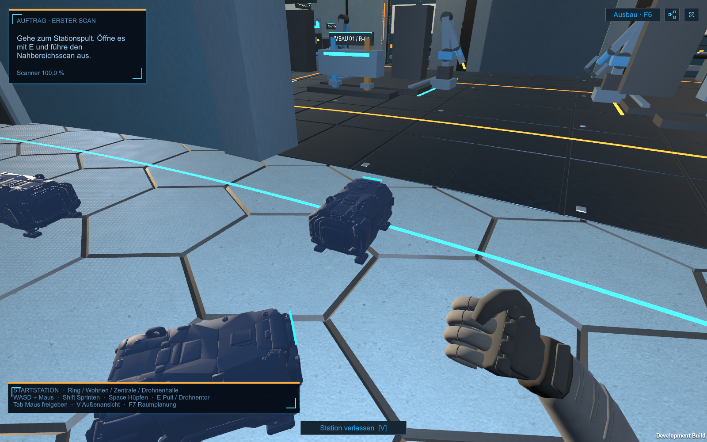
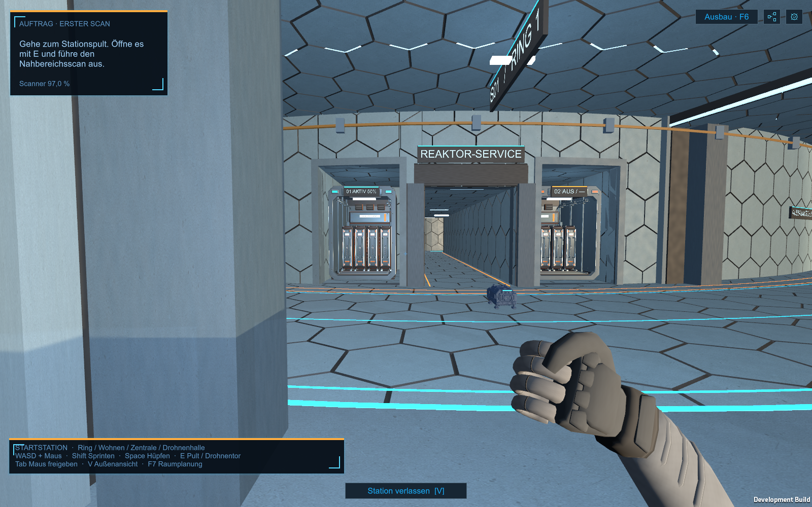

# I75: erste Fahrprobe im Stationsinneren

**Aktueller Verkehrsstand — 25.10.2026:** Build16 behebt die gemeldete Blockadesituation mit zentralen Wechselzonen-Freigaben und verzögertem Rückwechsel wartender Überholer. 905 Checks, mindestens drei Runden aller zehn Drohnen. [Umsetzung, Prüfumfang und Start](Innendrohnen-Deadlock-2026-10-25.md). Folgende Buildangaben sind historisch.

**Aktueller Folgestand — 25.10.2026:** Vier je 1,5 m breite Magnetspuren im Ring, je zwei pro Richtung, orange Trennung und an die I75-Fußabstände angepasste flache Leiter. Direkte Spurführung mit Überholen und markierten Wechselzonen ersetzt dort die freie seitliche Ausweichbewegung. `indoor-traffic-build-14`; Start weiterhin über denselben Launcher. [Aktuelle Umsetzung und Prüfung](Vier-Magnetspuren-2026-10-25.md). Die nachfolgenden Build-07-Nachweise dokumentieren die erste Fahrprobenstufe.

Nutzerauftrag vom 25.10.2026: zehn kleine Innendrohnen auf dem befahrbaren Stationsboden, mit Fahrten zur Außenwerkstatt, zur internen Drohnenwerkstatt und zur Kommandozentrale. Das bestückte Akkupaar soll direkt gegenüber dem Eingang der Kommandozentrale stehen.

[Nutzerscreenshot zur Platzierungskorrektur](Art/Station/Akkubuchten-Nutzerkorrektur-2026-10-25.png).

## Bedienung und Umfang

`Start-Innendrohnen-Fahrprobe.cmd` startet die eigene Vorschau. Der Spieler beginnt in der Kommandozentrale und schaut zum Akkupaar. Die normale Laufsteuerung bleibt erhalten. Ohne `-indoorTrafficPreview` werden diese zehn Testfahrzeuge nicht angelegt.

| Route | Anzahl | Bereich |
| --- | --- | --- |
| Außenwerkstatt | 3 | Ringgang und mittlere Fahrgasse der Außen-Drohnenwerkstatt |
| Interne Werkstatt | 2 | Ringgang und interne Drohnenwerkstatt |
| Kommandozentrale | 2 | Ringgang und vorderer Bereich der Zentrale |
| Ringgang | 3 | Hin- und Rückfahrten zwischen −60° und +60° |

Die Fahrzeuge wiederholen ihre Wege. Sie benutzen ein zur Laufzeit aus den tatsächlichen Layer-25-Collidern erzeugtes Unity-NavMesh, mit gegenseitiger Ausweichsteuerung. Intakte Schotten werden angefordert; bis zum vollständigen Öffnen halten die Fahrzeuge davor. Verriegelte Schotten bleiben Teil der Navigationshindernisse. Nahe am Spieler halten sie an. Simulationstempo und Pausen werden berücksichtigt. Änderungen der Raumpläne lösen einen Neuaufbau der Navigation aus. Bei ungültigen Wegen wird angehalten und ein Fehler protokolliert.

Der Fahrtest fand an der inneren Werkstatttür eine kleine physische Naht zwischen den unterschiedlich unterteilten Ring-/Modulböden. Die vorhandenen sichtbaren Modulschwellen besitzen nun einen tragfähigen MeshCollider mit 12 cm Unterbau und 1,5 cm Oberkante. Das schließt die Naht innerhalb des bestehenden Durchgangs.

Die zehn Fahrzeuge sind reine Fahrprobenakteure. Sie erhöhen weder den produktiven Drohnenbestand noch Aufträge, Ressourcen oder die Kampagnen-Helferzahl. Magnetführung, Akkuladen, Nutzlasten und Werkzeugwechsel sind noch nicht simuliert. Die kleine Bodenfreiheit ist eine visuelle Annahme.

## Verwendetes Modell

Original Smart-Mesh-V02 aus [dem Variantenvergleich](Innendrohne-I75-SmartMesh-Vergleich-2026-10-25.md), unverändertes Roh-FBX unter `Resources/IndoorDroneI75/I75_P20_V02.fbx`. Das Editorwerkzeug `IndoorDroneTrafficBuild.Prepare` richtet das Modell auf +Z aus, skaliert seine Gesamtlänge auf **0,75 m** und setzt die Unterkante auf lokales y=0. Aktuelle Gesamtmaße: **0,48 m breit × 0,44 m hoch × 0,75 m lang**, zuzüglich 8 cm Fahrbodenfreiheit. Ein Unity-Meter entspricht einem realen Meter.

Vorläufiges dunkelblaues Metall und ein kleiner cyanfarbener Statusbalken ersetzen die im Rohmodell fehlenden Texturen/UVs. Das Modell bleibt ein zusammenhängendes Mesh ohne Rig und ohne einzeln animierte Magnetfüße. Rund 18.312 Dreiecke pro Rohmodell; der zusätzliche Statusbalken ist separat. Keine neue Tripo-Generierung.

## Akkukorrektur

Das bestückte Paar wechselt von Achse 180° (Index 4/5) auf **Achse 0° (Index 0/1)**: links 01 aktiv, rechts 02 ausgeschaltet. Gemeint ist die Sichtachse vom Eingang der Zentrale **über den Ringgang hinweg** zu den beiden Buchten links und rechts des Reaktor-Servicegangs. Die acht vorhandenen Gehäuse bleiben an ihren Positionen; sechs sind leer. Telemetrie, taktische Anzeige, Reparaturziel und physische Kassetten verwenden dieselbe Zuordnung in `StationBatteryPlacement`.

Bestehende gemeinsame Kapazität **24 kWh**, gespeicherte Energie und Saveformat bleiben erhalten. Der R-01-Reparaturweg führt von der internen Werkstatt über das intakte Ringstück zur nun näheren Bucht. Frühere Berichte mit 180° und rund 284 m Reparaturweg beschreiben den vorherigen Stand.

## Technische Dateien und Prüfung

`StationIndoorTraffic.cs`, `StationIndoorTrafficCheck.cs`, `StationBatteryPlacement.cs`, `IndoorDroneTrafficBuild.cs`, `Resources/IndoorDroneI75`, Launcher. Das eingebaute Unity-Paket `com.unity.modules.ai` wird zusätzlich aktiviert; kein externes Navigationspaket. Änderungen integrieren sich in die vorhandene Layout-, Raumplan-, Batterie- und Vorschauverwaltung.

**Geprüft und ausgeliefert:** `indoor-traffic-build-07` unter `Builds/Windows`. Vorgänger unverändert in `Builds/Windows-before-indoor-traffic-20261025`. Drei grafische Development-Player-Läufe derselben finalen Binärdatei bestanden: **852 Assertions**, alle Exit 0, **14 Spielbilder**. Fahrprobe: 749 Navigationsquellen, 2.600 Bewegungssamples, jede Drohne mindestens eine vollständige Routenrunde einschließlich Rückweg; rund 163–197 m pro Fahrzeug, kleinster gemessener Abstand 0,859 m. Unterstützter Boden, Kollisionsfreiheit, Pausen, Raumaufenthalte und das Wiederöffnen eines tatsächlich geschlossenen intakten Hallenschotts wurden geprüft. Verriegelte Schotten blieben geschlossen. Testlauf zur Beschleunigung mit `Time.timeScale=6`; keine Aussage zu normaler Spiel-FPS oder realen Fahrzeiten daraus ableiten.

550 Akkuprüfungen und 253 Strompultprüfungen sichern physische Platzierung/Kollisionen, alte Saves, Ladungsanzeige, Solarbilanz und echten R-01-Reparaturauftrag ab. Reparaturfixture mit aktiviertem Helfer, Forschung, drei Teilen und 50% Akkuzustand: **360 Spielsekunden, 75,22 m**, zwei Teile verbraucht, echte Wartungsfront erreicht und Heimkehr; ursprüngliche Kampagne anschließend vollständig restauriert. Die zehn Fahrprobenakteure selbst erzeugen keine Arbeitsaufträge.

[Prüfnachweis](Pruefungen/Innendrohnen-Fahrprobe-2026-10-25.json), [Modell- und Spielansichten](Pruefungen/Innendrohnen-Fahrprobe-2026-10-25/). 370 getestete Quellen-/Metadateien im Snapshot dokumentiert; 364 mit dem Arbeitsstand identisch. Sechs parallele Mira-Dateiänderungen bleiben im Arbeitsstand erhalten; der Fahrprobenbuild benutzt hierfür den vorherigen Snapshot. Dazu gehört ausschließlich die Mira-Testmodus-Erweiterung in `PlayerSettings.cs`; die Drohnen-Testisolation ist in beiden Ständen vorhanden. Keine laufende Mira-Arbeit zurückkopiert oder überschrieben. Alle 247 ausgelieferten Builddateien SHA256-abgeglichen, alle drei Nutzerraumpläne unverändert. Automatisierte Szenen-/API-Prüfung mit isolierten Standard-Raumplänen; keine manuelle Abnahme der gespeicherten Nutzeranordnung.

Quellprojekt Unity 6000.4.7f1, getrennte Buildkopie mit lokal installiertem Unity 6000.6.4f1. Keine manuelle Komfort-, Headset- oder FPS-Abnahme und kein Commit/Push.

