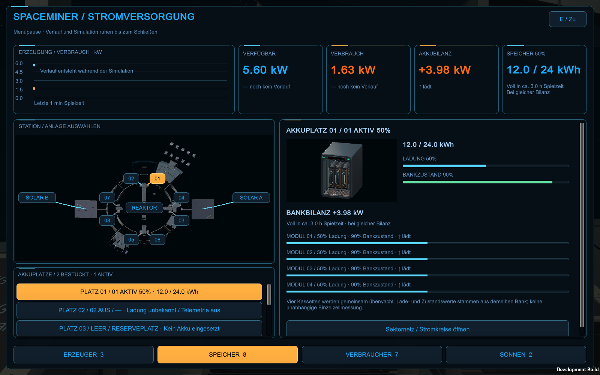

# Gemeinsamer Interface-Stil – 26.10.2026

Auf Nutzerauftrag wird die Spieloberfläche futuristischer und bleibt praktisch bedienbar. Grundlage sind die [freigegebenen Stromdisplay-Konzepte](Stromversorgung-UI-Konzept-2026-10-25.md): dunkle Navy-Flächen, Cyan für Systeminformationen, Amber für Auswahl und Aktionen sowie leicht gerundete Bereiche.

## Gestaltung und Umfang

- Panels und Karten erhalten ungefähr10 logische Pixel Eckenradius, feine Konturen, einen kurzen beleuchteten Kopfstrich und einen dezenten Schatten. Die Flächen bleiben ruhig und kontrastreich.
- Buttons und Reiter verwenden ungefähr8 Pixel Radius mit klar unterscheidbaren normalen, Hover-/Fokus-, gedrückten und ausgewählten Zuständen. Aktive Auswahl bleibt Amber; die Beschriftung ist dunkel. Andere Buttons verwenden Cyan auf dunklem Grund.
- Schmale Ladebalken und Regler erhalten kleinere Rundungen, damit an kurzen Höhen keine überlappenden Kanten entstehen. Ein leerer Balken bleibt leer; Füllbreiten beruhen auf den bisherigen echten Werten.
- Derselbe Stil wirkt über `SpaceMinerUi` in Startmenü, Konfiguration, Speichern-/Beenden-Dialogen, Forschung/Techtree-Rahmen, Stations-HUD und mehreren Konsolen. Strom- und Drohnenleitstand sowie die ältere HUD-Paneldarstellung verwenden ebenfalls diese Flächen. Das Konsolenstudio nutzt den gemeinsamen Stromrenderer und denselben Rahmenstil.

Inhalt, Positionsberechnung, rechteckige Klickbereiche, Scrollbereiche, Schrift-/UI-Skalierung und Bedienabläufe bleiben erhalten. Die Rundung betrifft die Darstellung; sie verkleinert keine Trefferflächen. Hoher Kontrast verwendet weiterhin einen deckenden dunklen Hintergrund und helle Rahmen/Texte. Kartengeometrie, Diagrammlinien, technische Raster und Texteingaben behalten ihre jeweils notwendige Form.

## Technische Umsetzung

`Assets/SpaceMiner/Scripts/UiChrome.cs` erzeugt kleine geglättete Texturen einmalig und zeichnet sie über Nine-Slicing. Die Ecke wird bei einer breiteren Karte nicht gestreckt. Feste gemeinsame Masken werden wiederverwendet und beim Laufzeitneustart/Beenden freigegeben. Buttontexturen gehören weiterhin der jeweiligen `SpaceMinerUi`-Instanz und werden mit ihr freigegeben. Die Zeichnung verwendet vorhandene IMGUI-Gruppen/Clipping und verändert keine GUI-Matrix. Neue Bilddateien, Fonts oder Shader sind dafür nicht erforderlich.

Betroffene Bestandsdateien: `SpaceMinerUi.cs`, `PowerConsoleView.cs`, `StationOperations.PowerConsole.cs`, `StationOperations.DroneConsole.cs`, `WaterScenarioHud.cs` und `ConsoleStudio.cs`. Energiekern, Lastberechnung, Saveformat, Raumpläne und Modelle sind durch diesen Stilauftrag nicht geändert.

## Wiederaufbau und Prüfung

`SpaceMiner.Editor.InterfaceBuild.Build` baut mit der Version aus `ProjectSettings/ProjectVersion.txt` die vorhandene Hauptspielszene als Development/Release sowie die vorhandene Konsolenstudio-Szene. Kein Setup zur Neugenerierung. Zielordner sind `Builds/InterfaceDevelopment`, `Builds/InterfaceRelease` und `Builds/InterfaceStudio`.

Der endgültige Build-, Sicht- und Auslieferungsnachweis wird nach den tatsächlichen Läufen unter [Prüfungen](Pruefungen/Interface-Stil-2026-10-26.json) festgehalten. Die erste eingeschränkte Editor-Ausführung stürzte vor dem Projektbuild bei Lizenzierungs-/Systemzugriffsproblemen ab. Der reguläre lokale Build lief durch. Eine erste grafische Fassung bestand die Funktionsprüfungen, zeigte aber Nahtlinien in sehr schmalen Ladebalken; diese wurden vor der endgültigen Abnahme korrigiert. Zwischenstände bleiben in `Logs/UiChrome-20261026` nachvollziehbar.

## Tatsächlich abgeschlossene Abnahme

Endgültiger gemeinsamer Stand: Unity6000.6.5f1, Development/Release/Studio erfolgreich gebaut. Fünf grafische Läufe mit Exit0: **507 Strom-/Sonnen-/R-01-Prüfungen**, **28 vorhandene Stations-UI-Prüfungen** einschliesslich echter Terminalöffnungen und Displaycontroller-Vollbild/Fensterrückkehr, **36 Studioaufnahmen**, vorhandene Settings-Vorschau mit Cancel-/Eingabefreigabe sowie Startmenüprüfung. Insgesamt74 native Aufnahmen in den lokalen Prüfläufen. Ausgewählte Bilder und Resultate im versionierbaren Nachweisordner, vollständige lokale Logs unter `Logs/UiChrome-20261026/Final`.

Die finalen in `visual-review.json` genannten Bilder wurden tatsächlich angesehen, darunter Stromübersicht/Ladebalken, Drohnenleitstand, HUD, grosse Schrift, hoher Kontrast und Studio. Alle422 eingefrorenen C#-/Meta-Dateien sind nach den Läufen hashgleich; genau sechs vorhandene Rendering-Dateien wurden durch diesen Auftrag geändert. Drei originale Nutzerraumpläne unverändert. Geprüfte Player nach `Builds/Windows`, `Builds/WindowsRelease` und `Builds/ConsoleStudio` übernommen; vorige Fassungen `before-ui-chrome` gesichert, sämtliche650 ausgelieferten Dateien SHA256-identisch.

Keine neue native OS-Eingabe-, natürliche Gesamtkampagnen-, FPS- oder Headsetabnahme. Die Rahmen-/Balkenänderungen sind visuell und mit vorhandenen Abläufen geprüft; dies ist keine neue Ergonomiestudie. Release gebaut und dateigeprüft; Laufzeitsichtprüfung auf Development. Kein Commit/Push.

