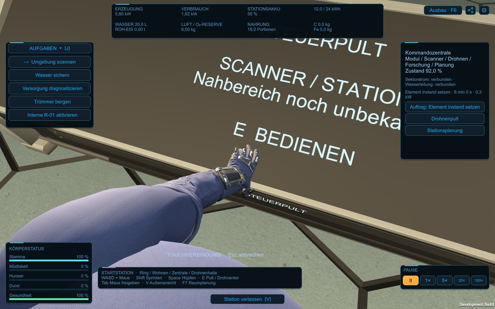

# R03-Arm und Berührung der Stationspulte

**Spätere Nutzerkorrektur vom selben Tag:** Die aktuelle Spielfassung zeigt nur den **rechten Arm**, eine schmale Ärmelverlängerung und metallisch blaue Pulte. Der nachfolgende Bericht bewahrt die ursprüngliche linke Fassung mit Torso und deren damalige 616 Prüfungen. [Aktueller Stand und gesonderter Nachweis](Pult-Metallblau-und-Rechtsarm-2026-10-26.md).

Nutzerauftrag26.10.2026: den ausgewählten Arm ins Spiel übernehmen und beim Aktivieren einer Konsole mit **E** die Touchfläche mit drei Fingern berühren. Grundlage ist der freigegebene **linke R03-Arm**. R04 bleibt eine separate, noch nicht bestätigte Modellvariante.

## Bedienung

In der First-Person-Ansicht nah vor das Pult treten und zur Touchfläche schauen. Der Hinweis unterscheidet zwischen **E – … berühren** und **näher herantreten und ansehen**. E beginnt eine kurze Bewegung aus der Ruhehaltung zur tatsächlichen Glasfläche; Zeige-, Mittel- und Ringfinger berühren das Display. Nach dem kurzen Zurückziehen öffnet sich die bestehende Bedienansicht.

Die Blickrichtung folgt währenddessen kurz der Hand; die Spielerposition bleibt fest. Gehen, Springen und manuelles Drehen pausieren während der Geste. Erneutes E löst keine zweite Aktion aus. **Esc** bricht ab; Außenansicht, Menüs, Dialoge und das Entfernen des Ziels verwerfen die ausstehende Aktion ebenfalls. Die Geste verwendet Echtzeit und funktioniert auch bei pausierter Stationssimulation. `ReducedMotion` verkürzt die Bewegung; es gibt dafür weiterhin keinen neuen Einstellungsmenüpunkt.

## Modell und Architektur

[Game-R03](../Design/Models/OperatorArm/Game-R03/README.md) enthält die reproduzierbare Blender-/FBX-Fassung:45.000 Dreiecke statt1.876.704,31.464 Unity-Vertices,17 Hautknochen und2K-PBR-Karten. Das R03-Original ist per SHA256 erhalten. Die vereinfachte Oberfläche besitzt normalisierte Gewichte für Oberarm, Ellenbogen, Handgelenk und alle Finger. Die Vereinfachung ist keine vollständige manuelle Retopologie.

Eine separat modellierte Anzugfortsetzung verbindet den ursprünglichen oberen Ärmelabschluss mit Schulter und angedeutetem Oberkörper. Sie benutzt dieselbe Stoffoberfläche,4.506 zusätzliche Dreiecke und zwei Gelenkbezüge; die R03-Armgeometrie und ihre17 Knochen bleiben erhalten. Insgesamt49.506 Dreiecke mit zwei SkinnedMeshRenderern. Dies ist ein First-Person-Anschluss, noch keine vollständige Spielfigur. Der körperseitige Anschluss folgt dem Körperwinkel; das kurze Nachführen des Blicks zieht ihn nicht mit dem Kopf mit.

- `tools/BuildOperatorArmR03.py` erzeugt den abgeleiteten Blender-/FBX-Stand, explizite Meshdaten und den Modellbericht.
- `OperatorArmR03Importer.Prepare()` erzeugt native Unity-Mesh-/Material-/Prefabassets unter `Assets/SpaceMiner/Resources/OperatorArmR03`, ohne Blender beim Spielstart vorauszusetzen.
- `StationFirstPersonHands` lädt dieses Prefab, führt die begrenzte Ruhe-/Gehbewegung und die unterbrechbare Touchsequenz aus. Die Armlängen bleiben fest; Ober-/Unterarm werden über IK ausgerichtet, die Finger einzeln an die Fläche angepasst.
- `StationConsoleTouchSurface` beschreibt die reale Glasfläche im lokalen Koordinatensystem des jeweiligen Pults. `TouchConsoleVisual` bindet die schräge R04-Fläche an; die übrigen älteren Anlagenpulte erhalten ebenfalls eine lokale Kontaktfläche. Verschieben und Drehen im Raumplaner werden so übernommen.
- `StationInteriorMode.TryActivateConsole()` ist der gemeinsame Eintritt für E und die isolierte Interaktionsprüfung. Erst die abgeschlossene Berührung ruft die vorhandenen `OpenConsole`-/`OpenTerminal`-APIs auf. Diese APIs bleiben für programmgesteuerte Aufrufe unmittelbar verwendbar.

Die Handkamera empfängt keine automatischen Mausereignisse (`eventMask=0`). In Ruhe rendert sie die Hand mit eigenem kurzem Tiefenbereich. Während des Kontakts verwendet sie die Weltprojektion und den vorhandenen Tiefenpuffer, damit Pult und Wände die Hand korrekt verdecken können. Kamera-/Layerbesitz wird beim Deaktivieren wiederhergestellt. Gemeinsam geladene Mesh-/Texturassets werden beim Entfernen eines Armexemplars nicht zerstört. `ToolMount` bleibt ein leerer Anschluss; benutzbare Werkzeuge gehören zu späterer Arbeit.

## Wiederaufbau und Prüfung

Verbindlicher Editor ist `ProjectSettings/ProjectVersion.txt`: **6000.6.5f1 /3ff58d469c8a**. Diese Version wurde auf diesem Rechner zusätzlich installiert. `SpaceMiner.Editor.OperatorArmBuild.Build()` bereitet die Armassets vor und baut die vorhandene Kampagnenszene als Development und Release nach `Builds/OperatorArmDevelopment` beziehungsweise `Builds/OperatorArmRelease`; keine Szenenneugenerierung.

Gezielte Development-Playerprüfungen: **`-stationHandsCheck`** und **`-stationConsoleTouchCheck`**, mit Grafik. Einstellungen, Spielstände und Raumpläne liegen getrennt unter `Logs/StationHands` und `Logs/StationConsoleTouch`.

## Ergebnis auf diesem Rechner

Beide finalen Builds mit Unity6000.6.5f1 erfolgreich/Exit0. Drei grafische Prüfläufe derselben finalen Development-Binärdatei bestanden: **232 Arm-/Schulterprüfungen,356 Touchprüfungen und28 vorhandene UI-Prüfungen**, insgesamt **616/alle Exit0**. Neun vollständige Berührungen umfassen Hauptpult, fünf weitere Zentralkonsolen, die Wandkonsole der Eisannahme, einen engen Pultverbund und einen verschobenen/gedrehten/verkleinerten Raumplan. Die real verformte Handschuhoberfläche, drei getrennte Kontakte, Schulteranschluss, Sichtblockaden und fünf Abbrüche wurden geprüft. Die UI-Prüfung deckt auch Mira, größere Schrift und den echten Fenster-/Vollbildwechsel ab.

**32 unveränderte Framebufferbilder** mit Prüfergebnissen sind unter [Operator-Arm-2026-10-26](Pruefungen/Operator-Arm-2026-10-26) gesichert. Haupt-/Drohnenpultkontakt, Wandpult, veränderter Raumplan und Ruhehaltung wurden zusätzlich visuell gesichtet. [Maschinenlesbarer Nachweis mit Hashes und Grenzen](Pruefungen/Operator-Arm-Spielintegration-2026-10-26.json).238 Quell-/Konfigurationsdateien während Build/Prüfung unverändert; Szene, Projektversion, drei Originalraumpläne und die hochauflösenden R03-Originale per SHA256 erhalten.

Die normale Startversion ist aktualisiert: **`Start-Aufbauphase-01.cmd` → `Builds/Windows`**. Alle247 Development- und156 Release-Dateien stimmen mit den geprüften Buildausgaben überein. Vorgänger liegen unter `Builds/Windows-before-operator-arm-20261026-213532` und `Builds/WindowsRelease-before-operator-arm-20261026-213532`.

Ein früher Kontaktlauf vor der Schulterergänzung bestätigte329 Controllerprüfungen, ist aber keine finale Sichtabnahme. Ein unverändert groß gestarteter versteckter Windows-Player lieferte schwarze Aufnahmen und deshalb Exit1; derselbe Build bestand nach tatsächlicher Backbuffer-Neuanlage. Für den finalen Touchlauf Startgröße1440×900, im Prüflauf dann1600×1000. Dieser fehlgeschlagene Aufnahmelauf ist im Bericht benannt und nicht zu den616 Erfolgsprüfungen gezählt.

Es handelt sich um Controller- und Bildprüfungen. Keine neue native OS-Tastatur-/Maus-, subjektive Komfort-, Headset- oder FPS-Abnahme. Release wurde gebaut und bereitgestellt, die automatischen Playerprüfungen liefen als Development. Kein benutzbares Werkzeug oder funktionales Handgelenk-HUD; keine vollständige Spielfigur. Kein Commit/Push in diesem Auftrag.

