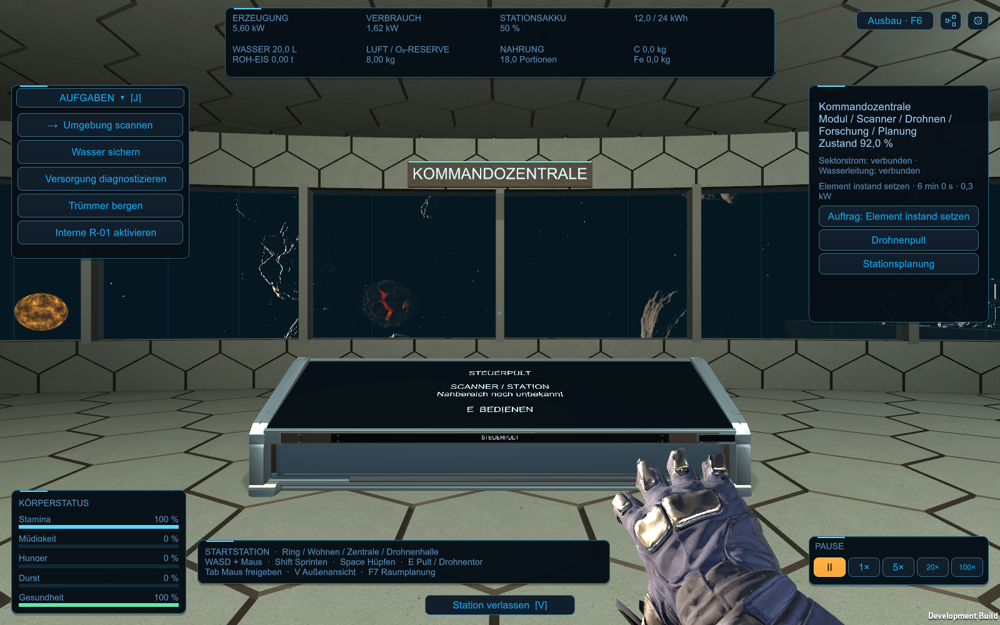

# Metallisch blaue Pulte und Arm von rechts

Nutzerkorrektur vom 26.10.2026: Die Pulte wirken im Spiel braun und sollen **metallisch blau** aussehen. Der Arm soll wieder **von rechts** ins Bild kommen; die große Oberkörperfläche entfällt. Diese ausdrückliche Vorgabe ersetzt die linke Darstellung mit Torso aus der ersten [R03-Integration](Operator-Arm-Spielintegration-2026-10-26.md).

## Darstellung

Die sechs R04-Pulte verwenden nun eine eigene dunkelblaue Farbpalette mit kühlem Titanrahmen. Der neue Atlas übernimmt Körnung, Kratzer und Gebrauchsspuren des ursprünglichen Atlas; UVs und Geometrie bleiben erhalten. Die vorhandenen Normal- und Metall-/Glanzkarten sind wieder vollständig angebunden. Am Metall bleiben Reflexe erhalten; die blau-schwarzen Display-/Plakettenflächen spiegeln weder die warme Außenumgebung noch deren direkten braunen Glanz. Eine dezente blaue Eigenbeleuchtung hält die aktive Glasfläche lesbar.

`tools/BuildTouchConsoleBluePalette.py` erzeugt den abgeleiteten Atlas reproduzierbar; `TouchConsoleBuild.Prepare()` bereitet Materialien und vorhandene Prefabs vor. Der ursprüngliche Atlas wird nicht überschrieben. Die übrige Stationsbeleuchtung bleibt erhalten.

Der Spielarm ist eine echte rechte Ableitung des angenommenen R03. Beim Unity-Import werden Meshpunkte, Normalen, Knochen- und Markerpositionen gespiegelt, Dreiecksrichtungen korrigiert und Tangenten neu berechnet. Objekt- und Knochenskalierungen bleiben positiv. Die native linke R03-Quelle und das vereinfachte Blender-Original bleiben erhalten. Ruhehaltung, Ellenbogenführung und der ausgewählte Touchbereich liegen rechts. Die drei Finger berühren weiterhin die tatsächliche Pultfläche vor dem Öffnen der Konsole.

Eine schmale Stofffortsetzung führt vom ursprünglichen Ärmelrand unten rechts aus dem Bild; der breite Torso ist entfernt. 45.000 Dreiecke/17 Knochen im R03-Arm plus 2.494 Dreiecke für den schmalen Ärmel, insgesamt 47.494. Der Stoffansatz folgt zunächst starr dem Originalbund und geht erst dahinter in die bewegliche Verlängerung über. Er nutzt einen eigenen matten Stoffwerkstoff mit demselben Farbatlas, ohne gestreckte Metall-/Normalreflexe. Arm und Stoff haben zusammen zwei Renderer und zwei Materialien. `SleeveProximalEnd` ersetzt den früheren Torso-Marker. Der Endpunkt folgt der Armansicht hinter dem Bildausschnitt; es wird keine vollständige Spielfigur dargestellt.

Beide Ärmelknochen verwenden dieselbe Hautrotation, damit die runde Verlängerung beim Ausstrecken nicht zu einem Band zusammenfällt. Während der Berührung bleibt die horizontale Blickrichtung erhalten; eine sanfte Neigung zur Fläche bleibt möglich. Der zuvor funktionierende rechte Oberarmanker und die realen Armlängen bleiben erhalten. Ein weiter nach rechts/unten versetzter Ansatz hatte die Eisannahme unerreichbar gemacht und wurde zurückgenommen; Terminalposition und Reichweitengrenze wurden nicht verändert.

## Import und Wiederaufbau

Mit Blender 4.5.14 `tools/BuildOperatorArmR03.py` und anschließend `tools/BuildOperatorArmSleeveR03.py` ausführen, falls die abgeleiteten Quellen neu erstellt werden sollen. Die gespeicherten Quellen genügen ansonsten. In der verbindlichen Unity 6000.6.5f1/3ff58d469c8a `SpaceMiner.Editor.OperatorArmBuild.Build()` ausführen; der Builder bereitet sowohl die blauen Pulte als auch den rechten Arm vor und baut die vorhandene Kampagnenszene als Development und Release.

Beim Verkleinern des Ärmel-Meshs blieb zunächst der frühere Vertexpuffer erhalten. Der Importer leert bestehende Meshes jetzt und schreibt ihre Vertex-/Index-/Haut-/Bindedaten ausdrücklich neu; die Asset-GUID bleibt erhalten. Die Prüfung verlangt die tatsächlich neuen 4.928 Ärmelvertices und 2.494 Dreiecke, eine geschlossene Naht und den außerhalb der Ansicht liegenden Abschluss. `SleeveCuffJoin` und `SleeveCuffJoinAxis` kennzeichnen die tatsächliche Naht; ihre 128 Punkte werden im Binderaum ermittelt und an der verformten Haut gemessen. Die 20-mm-Grenze bleibt erhalten. Ein erster 1,5-mm-Prüfbereich erfasste zusätzlich gebogene Stoffringe; die Auswahl ist jetzt präzise auf die ursprüngliche Naht begrenzt. Alte Bilder werden vor dem Aufnehmen entfernt, damit ein fehlgeschlagener Lauf keine älteren Aufnahmen als neue Ergebnisse verwenden kann.

## Prüfung

Finale Development- und Release-Builds mit der festgelegten Unityversion: **Exit0**. Im Development-Player **237+383+28=648 Prüfungen**, alle drei Läufe **Exit0**. Darunter neun abgeschlossene Touchvorgänge an sechs echten Pulten, Eisannahme, benachbartem Pult und bearbeitetem Raumplan sowie fünf Abbruchszenarien. Materialien, rechte Anatomie, positive Skalierungen, tatsächliche Haut-/Nahtpunkte, feste Armlängen, Sichtgrenzen, einmaliges Öffnen und Fenster-/Vollbildwechsel geprüft.

32 frische Framebufferbilder und drei Ergebnisberichte sind im [Nachweis](Pruefungen/Pult-Metallblau-und-Rechtsarm-2026-10-26.json) gesichert. Ruhehaltung, Haupt-/Nebenpultkontakt, Eisannahme, bearbeiteter Raumplan und Pultfarbe wurden visuell kontrolliert. Vier identische Glasbereiche wechselten von warmem Braun (beispielsweise RGB50/46/41) zu Blau-Schwarz (etwa RGB6/14/20); Gehäuse und Rahmen behalten ihre metallischen Reflexe.

238 Quell-/Konfigurationsdateien während Build und Tests unverändert. Die Kampagnenszene wurde nicht neu erzeugt. Projektversion, drei gespeicherte Nutzerraumpläne, beide nativen R03-Blenderquellen und ursprünglicher Pultatlas hashgleich. Die bisherigen normalen Windows-/WindowsRelease-Versionen wurden unter `Builds/*-before-blue-rightarm-*` gesichert, die neuen Ausgaben kopiert und sämtliche Dateien mit den geprüften Builds verglichen. Start weiterhin über `Start-Aufbauphase-01.cmd`.

Prüfgrenzen: automatisierte Controller- und Framebufferprüfung, keine neue manuelle OS-Tastatur-/Maus-, Komfort-, Headset- oder FPS-Abnahme. Release gebaut und ausgeliefert, nicht separat durchgespielt. Kein vollständiger Körper, neues Werkzeug oder funktionales Handgelenk-HUD. Die 616 Prüfungen der ersten linken Fassung bleiben historisch. Kein Commit/Push.

