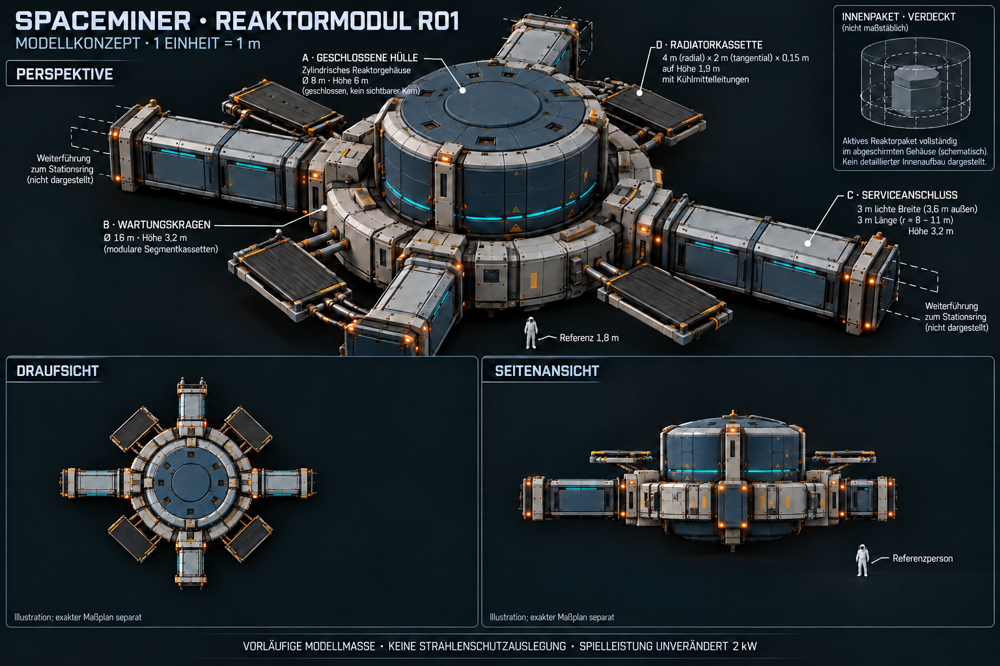
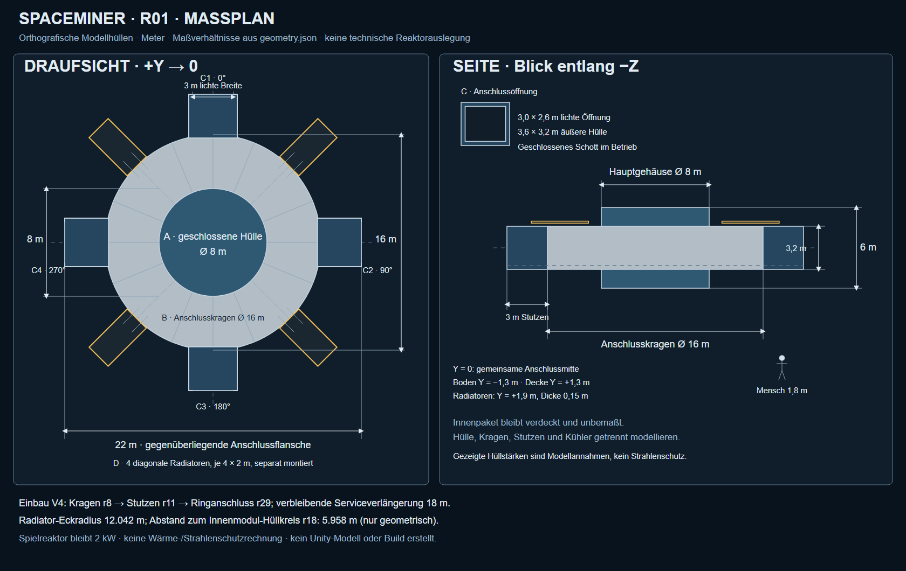

# Reaktormodul R01 – Konzept und Übergabe

Stand 24.10.2026. Auf Nutzerauftrag gestalteter Entwurf für die Mitte der bewohnten Ringstation. **Konzept, noch kein eingebautes 3D-Modell und keine Gestaltungsfreigabe.** Die Spielleistung bleibt unverändert bei 2 kW. Arbeitsmaße sind Modellvorgaben, keine nachgewiesene Strahlenschutz- oder Wärmeauslegung.

## Bild und maßhaltige Ansichten





- [Vektor-Maßplan](Art/Reaktor/Reaktor-R01-2026-10-24-massplan.svg): orthografische Hüllgeometrie, Hauptmaße, vier Anschlüsse, Anschlussquerschnitt und exakt 1,8 m hohe Referenzperson. Zoomfähig; Größenverhältnisse aus den numerischen Vorgaben.
- [Geometrieparameter](Art/Reaktor/Reaktor-R01-2026-10-24.geometry.json): Quelle für Modellierung und Plan. Bei abweichenden Bildproportionen gelten die Zahlen und der Vektorplan. Die Nebenansichten im generierten Konzeptbild sind ausdrücklich illustrativ; missverständliche generierte Maßpfeile wurden entfernt.
- [Plan-Generator](../tools/CreateReactorConceptPlan.py): `python tools/CreateReactorConceptPlan.py` schreibt den SVG neu und prüft die unten beschriebenen Hüllbeziehungen. Er erstellt kein Unity-Modell.

Stilreferenz ist das [Stationskonzept V4](Stationskonzept-V4-2026-10-24.md) mit [Referenzbild](Art/Station/Station-Erste-Ausbaustufe-2026-10-24-v4.png). Vorbereitung: AGENTS.md, Projektübergabe, Spielidee, Projektmemory und insbesondere [Reaktor-Designbrief](Reaktor-Designbrief.md) gelesen.

## Entwurf und Baugruppen

Gedämpfte dunkelblaue Kassetten, helle Metallbänder und dunkle Unterkonstruktion führen den Stationsstil fort. Kleine cyanfarbene Statusstreifen, gelbe Wartungsmarkierungen, verschraubte Fugen, Hebepunkte und leichte Kantenabnutzung. Keine aufgerissene Abschirmung, gläserne Kernkammer oder leuchtenden Brennelemente. Radiale Stützen und Technik bleiben geometrisch einfach und gezielt wiederholbar.

1. **Aktives Reaktorpaket:** eigener, vollständig geschlossener innerer Einsatz. Im Außenbild verborgen, nur im kleinen Prinzip-Inset schematisch gezeigt. Abmessungen, Reaktortyp, Abschirmmaterialien und innere Schichten bleiben offen; die Silhouette des Insets ist keine Bauvorlage für einen Kern.
2. **Abschirm-/Technikhülle A:** geschlossener Zylinder mit abgesetzten Außenpaneelen, vier verstärkten Rippen und verschraubtem oberen Servicedeckel. Paneele, Deckel, Rippen und Befestigungen innerhalb der vorgegebenen Außenhülle halten. Technische Abschirmung und äußerer Lack sind getrennte Funktionen; das Bild beweist keine bestimmte Schutzwirkung.
3. **Wartungs-/Anschlusskragen B:** eigenständige annular angeordnete Technikkassetten, Kabeltrassen und geschützte Kühlmittelverteiler um die Hülle. Vorschlag: 16 wiederholbare Segmente und vier Anschlussadapter. Kein frei begehbares Aufenthaltsdeck am laufenden Kern; Wartungsfreigabe und sichere Betriebszustände bleiben zu entwickeln.
4. **Serviceanschlüsse C1–C4:** vier gleiche geschlossene Stutzen mit umlaufendem Flansch und geschlossenem Schott, im gleichen Höhenniveau. Jeweils zwei getrennte elektrische/kommunikative Trassen sowie getrennt erkennbare Kühlmittelwege als Gestaltungsprinzip, noch keine funktionale Leitungsplanung. Keine direkte offen sichtbare Durchführung zum aktiven Paket; sichere Durchführung/Abschirmung ist gesondert auszulegen.
5. **Radiatoren D1–D4:** vier voneinander austauschbare flache Kassetten zwischen den Serviceachsen. Dunkle Wärmeabgabeflächen mit parallelen Kühlmittelwegen, Randrahmen, kleinen Haltern und paarigen Vor-/Rücklaufanschlüssen. Verschlossene Reserveanschlüsse für spätere Erweiterung. Keine Solarzellengitter. Erforderliche Strahlungsfläche, Temperatur, Fluid, Orientierung und Abschattung sind nicht berechnet.

## Arbeitsmaße

| Bestandteil | Modellmaß | Verbindlichkeit im Auftrag |
| --- | --- | --- |
| Geschlossene Haupt-Außenhülle | Ø8 m × 6 m Gesamthöhe | Nutzervorgabe, vorläufige Modellhülle |
| Kragen | Ø16 m außen | Nutzervorgabe |
| Kragenhöhe | 3,2 m, zentriert zur Anschlussmitte | Ergänzender Gestaltungsvorschlag |
| Serviceachsen | 0/90/180/270° | Nutzervorgabe |
| Servicegang | 3 m lichte Breite | Nutzervorgabe |
| Anschlussöffnung | 3 × 2,6 m lichte Breite/Höhe | Höhe als Gestaltungsvorschlag |
| Anschluss-Außenhülle | 3,6 m breit × 3,2 m hoch | Gestaltungsvorschlag; 0,3 m Hüllreserve je Seite, keine Schutzwandstärke |
| Sichtbarer Anschlussstutzen | 3 m radial, r8–11 m | Gestaltungsvorschlag; nicht die gesamte Verbindung zum Ring |
| Gegenüberliegende Anschlussenden | 22 m Abstand | Aus r11 abgeleitet |
| Radiatoren | vier Kassetten, je 4 m radial × 2 m tangential × 0,15 m dick | Austauschbarer Gestaltungs-/Einbauvorschlag |
| Radiatorlage | Mittelpunkte r10 m, 45/135/225/315°, Y=+1,9 m | Gestaltungsvorschlag |
| Menschliche Referenz | 1,8 m | Reine Größenreferenz, keine Aufenthaltsfreigabe |

Vier Radiatoren ergeben 32 m² geometrische Fläche pro gemeinsamer Panel-Seite. Das ist **keine** bestätigte effektive Abstrahlfläche oder Leistungsfähigkeit; beide Seiten, Sichtfaktoren, Verluste und Betriebsbedingungen sind offen. Die Panel-Hüll-Ecken reichen bis r12,042 m, während die achsparallele Gesamthülle durch die Stutzen 22 × 22 m beträgt. Hüllen-/Flansch- und Anschlussbereiche vor dem Modellbau abstimmen.

## Unity-Koordinaten und Integration durch MainDev

Einheit 1 m, Root-Ursprung im gemeinsamen Zentrum auf der Anschlussmittelebene. +Y oben; 0° entspricht +Z, positive Y-Drehung führt nach +X. Hauptkörper Y=−3 bis +3 m, Kragen und Stutzen Y=−1,6 bis +1,6 m. Die vorläufige lichte Gangöffnung reicht von Y=−1,3 bis +1,3 m. Bei der späteren Integration die gesamte Baugruppe auf die tatsächliche Gangbodenhöhe verschieben; keine individuelle Skalierung der Anschlüsse oder der menschlichen Referenz.

```text
ReactorModule_R01                 localScale = (1,1,1)
  ActivePackage_Closed           innen / Maße und Technik noch offen
  ShieldHousing_A                Ø8 × 6 m, Mitte (0,0,0)
    UpperServiceLid / Cladding / StructuralRibs
  MaintenanceCollar_B             Ø16 × 3,2 m, Mitte (0,0,0)
    CollarSector_01..16 / CoolantManifolds / CableTrays
  Service_C1..C4                 Mittelpunkte r9,5 m, Y=0
    AdapterSaddle / Flange / ClosedBulkhead
  Radiator_D1..D4                 Mittelpunkte r10 m, Y=1,9 m
    Panel / Brackets / SupplyReturn / BlankedExpansionPort
```

Der Kragen benötigt einen echten Ring-/Sektormesh mit freiem innerem Anschlussraum; kein überlagerter Vollzylinder. Kleine Adaptersättel dürfen innerhalb der nominalen r8-Schnittstelle überlappen, damit rechteckige Stutzen an der gekrümmten Kragenkante ohne Spalten anschließen. Diese mechanische Verbindung ist später im tatsächlichen Mesh zu prüfen. Das Reaktorpaket bleibt hinter einer unabhängigen geschlossenen Hülle, nicht bloß hinter abnehmbaren Lackpaneelen.

V4 sieht Ringbeginn r29 m und Innenmodule r18–29 m vor. Vom Kragen r8 bis zum Ring sind nominal 21 m Serviceverbindung nötig. Die dargestellten Stutzen belegen davon 3 m; **18 m Verlängerung von r11 bis r29** separat modellieren. Die vier freigehaltenen Serviceplätze nutzen. Radiator-Eckradius r12,042 bleibt geometrisch etwa 5,958 m innerhalb des r18-Innenmodul-Hüllkreises. Das ist eine Hüllraumprüfung, keine Aussage über Strahlungsabstand, Wartungsraum, Radiator-Sichtfaktoren oder sichere Gangbegehbarkeit.

Empfohlener nächster Schritt: isolierter Blender-/Unity-Blockout aus den numerischen Hüllen, Serviceboden mit der vorhandenen Station abgleichen, vier Anschlüsse und Radiatorhalter kontrollieren, erst danach sichtbare Details und tatsächliche Stationsintegration. Reaktorsimulation/Leistung, bestehende S02-Halle, aktuelle Bewegungskorrekturen, Spielstände und andere lokale Arbeit wurden in diesem Konzeptauftrag nicht verändert. Kein neuer Forschungsfortschritt oder Leistungsupgrade.

Während dieses Konzeptauftrags hat MainDev bereits die V4-Grundstruktur eingebaut; neueste Projektübergabe und `RingWalkthrough.BuildReactorService` wurden deshalb nochmals gelesen. Dort existieren bereits begehbare Gänge mit Boden Y=0, etwa 3,2 m freier Höhe und ein Kragen mit Decke bis Y=3,95 m; `StationVisual` setzt den Ø8/6-m-Blockout mittig auf Y=3 m. **R01 ist geometrisch kein unveränderter Ersatz dieser Höhenlage.** Unsere ergänzend vorgeschlagene 2,6-m-Öffnung und zentrierte 3,2-m-Kragenhöhe müssen vor dem Einbau mit MainDev abgestimmt werden. Bei Ausrichtung unseres Gangbodens auf Y=0 liegt der R01-Root auf Y=+1,3 m und die Hauptgehäusehülle reicht von Y=−1,7 bis +4,3 m. Alternativ die ergänzenden Höhenparameter überarbeiten und Plan/Bild aktualisieren. Bestehende begehbare Kragenhülle nicht mit der neuen Technikkragenhülle überlagern; Wartungszugang und Betriebsfreigabe sind getrennt zu klären. Der aktuelle Build wurde von diesem Chat nicht verändert.

## Erzeugung und tatsächlich erfolgte Prüfung

Bild mit eingebautem `image_gen`, nicht CLI/API, anhand der lokalen V4-Stilreferenz erzeugt. [Vollständiger Ausgangsprompt](Art/Reaktor/Reaktor-R01-2026-10-24.prompt.txt), [erste Korrektur](Art/Reaktor/Reaktor-R01-2026-10-24-revision.prompt.txt), [finale Bereinigung](Art/Reaktor/Reaktor-R01-2026-10-24-finalisierung.prompt.txt). Ausgewähltes finales PNG im Projekt gesichert; Zwischenfassungen sind keine separaten freigegebenen Varianten.

Sichtprüfung: geschlossene Hülle, vier Stationsanschlüsse, getrennte Radiatoren/Leitungswege, passende Metall-/Blaupalette, menschliche Größenreferenz und verdecktes Innenpaket. Generierte Ansichten sind nicht maßhaltig; deshalb maßhaltigen SVG separat aus JSON erzeugt und als PNG gerendert. Beim ersten SVG-Lesen kollidierende Port-/Maßbeschriftungen und Textkontrast korrigiert und erneut geprüft.

Geprüft: 8/6/16-m-Hüllmaße, vier Achsen, lichte Breite/Höhe, 22-m-Anschlussabstand, 3+18=21-m-Verbindung zum Ring, Abstand der diagonalen Panelhüllen von den Serviceachsen, 0,225 m Panel-Unterkante über der Servicehülle und Lage innerhalb r18. PNG-Signaturen, Pixelmaße, SHA256, JSON/XML sowie lokale Links geprüft. Nachweis: [Prüfbericht](Pruefungen/Reaktor-Konzept-R01-2026-10-24.json). Kein Unity-/Blender-Modell, Build, Laufzeit-, Wärme-, Strahlenschutz-, Material-/Massen- oder Festigkeitstest durchgeführt. Bestehende Änderungen anderer Chats erhalten; kein Commit/Push.
