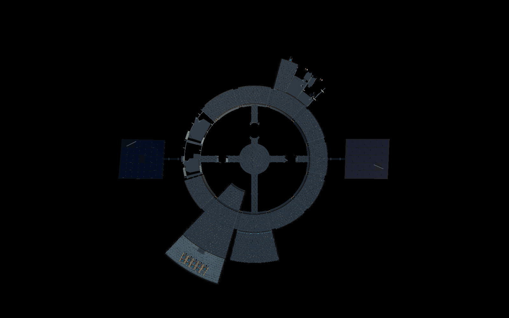
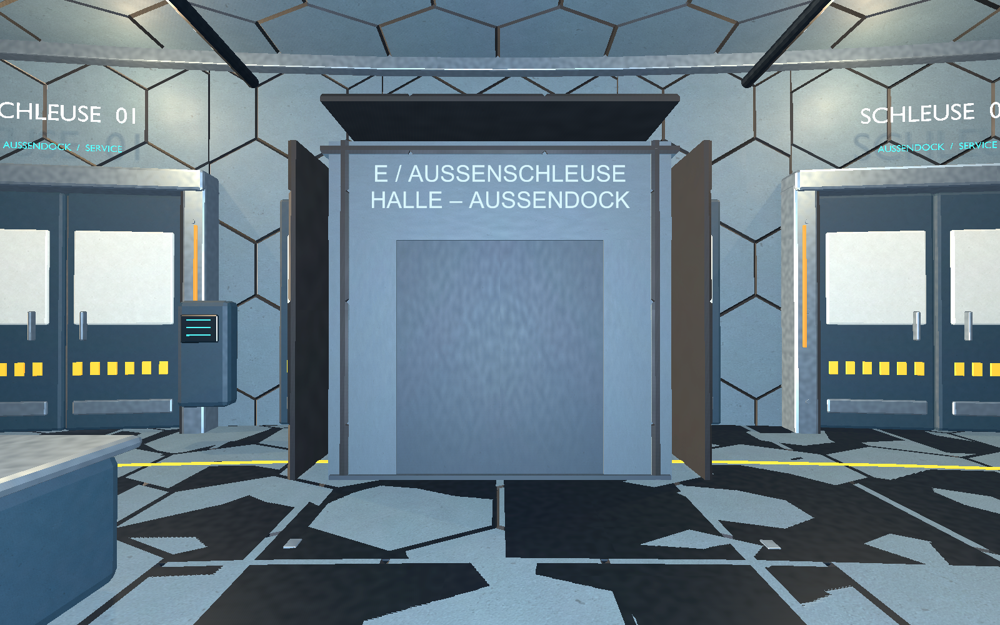

# Startstation: Keilmodule, Havarie und Bay-Schleuse

**Nachfolgestand desselben Tages:** [Stationsrahmen und detaillierte Außendrohnen](Stationsrahmen-und-Drohnenflotte-2026-10-25.md) ergänzt massive integrierte Anschlüsse, sichtbare Hüllstützen und ursprüngliche Halleninnenpaneele. Alle zehn Außendrohnen inzwischen mit ausgearbeitetem Tripo-Modell samt Ladeaufnahme, ausschließlich01 aktiv, Layoutrevision9. Die folgenden Modell-/Prüfangaben dokumentieren den zuvor abgenommenen Revision8-Stand.

Umgesetzt25.10.2026 nach bestätigtem [Gesamtkonzept V5](Stationskonzept-Keilmodule-V5-2026-10-25.md) und anschließendem Auftrag für Zweischichtigkeit, weitere linke Ringschäden, Tore/Schleuse, einfache Bay-Oberflächen und nur eine aktive Drohne.

**Start:** `Start-Station-Keilmodule.cmd` öffnet den Development-Spielbuild vor der Drohnenhalle. WASD/Maus, Shift, E für Schotten und Schleusenanforderung, V für Innen-/Außenansicht, F11 für Vollbild. Dieser Einstieg verwendet eigene Einstellungen unter `Logs/KeilStation-settings` und Spielstände unter `Logs/KeilPreview/Saves`; normale Einstiege und Kampagnenspeicher bleiben getrennt.

## Gebauter Umfang

- **Wasserlager S08:** drei benachbarte, nach außen breitere Keile auf200/210/220°, r38–54m, je nominal10° mit schmalen Montagefugen.01 intakt und begehbar,02/03 unterschiedlich beschädigt und gesperrt. Gemeinsame Seitenebenen, acht sichtbare Rahmenkupplungen, große unregelmäßige Hüllenreste und gerissene Tankhäute. Der aktive Materialanschluss liegt an der freien Stirnseite bei r54,8m/200°, nicht zwischen Nachbarn. Der Wasserauftrag entlädt dort; die beiden anderen Anschlüsse sind offline.200L-Testkapazität unverändert.
- **Linke Ringhavarie:** S04/S05 auf90/120° besitzen unterschiedliche Hüllen-/Bodenlücken und erhaltene Strukturstücke. Geschlossene Not-Schotten begrenzen die unzugänglichen Bereiche. Aufenthalts- und Speicherflächen schließen sie aus. Diese Achsen liegen links im gespeicherten Grundriss; freies Drehen der Kamera ändert die Bildschirmseite.
- **Zweilagige Hülle:** getrennte Druck- und Außenschutzlage an intakten Flächen und versetzte Lagenrisse an Wrackresten. Geometrisches Wabenraster bleibt. Neue UVs und Materialien übernehmen einfache lackierte Metalloberflächen aus dem Ressourcenprefab der ausgearbeiteten Drohnenhalle. Kein neuer externer Texturdownload.
- **Anschlüsse:** drei gekappte Anbaurahmen an jedem gesunden freien äußeren Ringsegment; breite vorhandene Sonderräume bleiben. Keine komplett vorgebaute nächste Außenringstufe. Die restliche Startbelegung mit Kommando, Halle/offenem Bay, zwei Solarfeldern, einer inneren Werkstatt und vier Reaktorachsen bleibt erhalten; weiterhin nur ein Reaktorgang vollständig.

## Schotten und Außenschleuse bedienen

Ring- und Modulübergänge besitzen elektrische Druckschotten. Gesunde interne Übergänge starten offen und lassen sich mit **E** schließen/öffnen. Feste Schultern enthalten die seitlichen Türtaschen; Belegungsschutz verhindert Schließen auf dem Spieler. Havariegrenzen bleiben verriegelt. Reaktorbruchenden behalten ihre festen Notverschlüsse.

Zur offenen Drohnenbay führt eine **physische Kammer mit zwei Türen** bei r51,6m und57,1m auf30°. Vor der inneren Tür E drücken, hineinlaufen und warten: Eingang schließt, kurzer dargestellter Druckausgleich, Ausgang öffnet. Anschließend hinausgehen; die Tür schließt wieder. Rückweg ebenso mit E von außen. Beide Türen können nicht gleichzeitig offen sein; ein Besucher im Türbereich löst Wiederöffnen aus. Die zwei seitlichen Hallentore sind als Vakuumgrenze geschlossen gesperrt, das bisherige Mitteltor liegt offen innerhalb der neuen Kammer. Außen nicht die Seitentore als Umgehung öffnen.

## Flotte und Spielstände

Alle zehn Kampagnendrohnen verwenden denselben vorhandenen `MiningDroneVisual`-Modellaufbau, mit dezenten Oberflächen-/Farbvarianten. **Nur01 ist einsatzfähig**;02–10 stehen im Zustand `Disabled`, auch nach Laden älterer Spielstände mit früher versorgbarer zweiter Drohne. Gespeicherte Energie wird beim Sperren nicht gelöscht. R-01 in der inneren Werkstatt ist eine verkleinerte passive Kopie derselben Geometrie ohne Flug-/Auftragssteuerung und mit dunklem Statuslicht. Die separaten historischen Tripo-/Bauproben sind dadurch nicht auf neue Modelle umgestellt.

Layoutrevision8 nutzt die bestehende Freiraummigration: entfernte Lagerflächen und neu beschädigte Ringbereiche werden beim Laden zum Pult umgesetzt, freie Positionen bleiben erhalten. Aktuelle Bay-Schleusenzustände werden gespeichert; Zyklen älterer Layouts werden nicht fälschlich in die neue Kammer übernommen. Neue normale Innenschottzustände werden noch nicht einzeln gespeichert und beginnen beim Neuaufbau wieder in ihrem Grundzustand.

## Dateien und Prüfung

Geometrie in `RingWalkthrough.cs` und neuem `RingWalkthrough.Expansion.cs`; Materialien/UVs in `StationSurfaceMaterials.cs`/`HoneycombHull.cs`. `StationPressureGate.cs`, `StationAirlock.cs`, `StationDroneHall.cs` und `StationInteriorMode.cs` steuern Übergänge und Bedienung. `StationInteriorLayout.cs`/`SaveGameStore.cs` sichern Flächen/Zustände; `StationVisual.cs` versetzt die tatsächlichen Tankanschlüsse; `WaterScenario.cs`, `DroneAgent.cs` und `MiningDroneVisual.cs` setzen die Flottenregel um. Neue Skripte samt `.meta` enthalten.

Finaler **Development-Build6000.6.4f1**, unveränderte Quellprojektversion6000.4.7f1, Build Exit0. **133 Stationsprüfungen und29 bestehende Vitals-/Bewegungs-/Speicherprüfungen derselben Binärdatei Exit0**. Echte CharacterController-Blockade/Passage, beide Schleusenrichtungen/Interlock, gesperrte Aufenthaltsflächen, alte Saves, inaktive Flotte, Pultscan und vollständiger Wasserflug mit dicht ausgerichtetem Entladen am neuen Anschluss geprüft. Erste Testfassung fehlte der vorbereitende Scan; korrigiert. Bildkontrolle führte zu Türtaschen statt herausragenden offenen Flügeln, korrekter Beschriftungsrichtung und tatsächlicher linker Havarieanordnung. Finale sieben direkte Renderbilder visuell geprüft.

40 Quell-/Metadateien zur Buildkopie und247 übernommene Builddateien SHA256-identisch. [Nachweis mit Manifesten und Prüfgrenzen](Pruefungen/Keilmodule-Station-2026-10-25.json), Ergebnis-/Bilddateien und gefilterte Zusammenfassungen im gleichnamigen Verzeichnis. Ungefilterte lokale Logs bleiben unter `Logs/keil-v5-*-release-candidate.log`; „release-candidate“ im Dateinamen bezeichnet keinen Release-Build. Der Standardparameter `-startStationCheck` führt jetzt denselben aktuellen Abnahmelauf wie `-stationKeilCheck` aus; die alten217-Prüfungsannahmen sind überholt.

Neuer normaler Spielordner `Builds/Windows`; Vorgänger `Builds/Windows-before-keilmodule-20261025` erhalten. Keine neue manuelle GUI-/Eingabeabnahme, kein Release-/Leistungscheck, keine vollständige Tripo-/Bauprobenabnahme. Druckausgleich ist weiterhin ein verriegelter zeitgesteuerter Ablauf, keine Gas-/Sauerstoffsimulation; seitliche Kupplungen haben keine berechnete Tragfähigkeit. Fremde Reaktorarbeit erhalten, kein Commit/Push.
