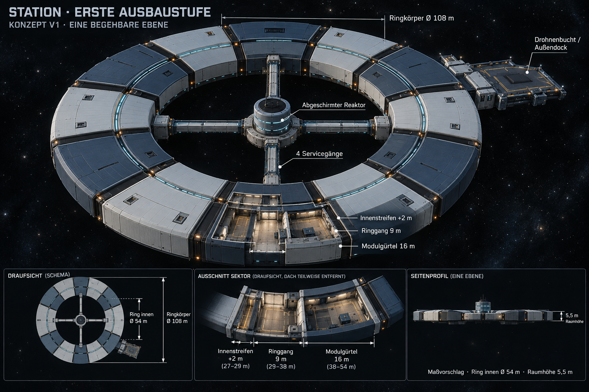

# Stationskonzept V1 — erste Ausbaustufe

Aktueller Entwurf: [V4 mit radial nach innen wachsenden Ringsektoren](Stationskonzept-V4-2026-10-24.md). Diese ältere Fassung bleibt als Verlauf erhalten.

Historischer V1-Entwurf. Aktuell: [V2 mit11m tiefen Innenräumen zwischen den Servicegängen](Stationskonzept-V2-2026-10-24.md). Die unten vorgeschlagenen2m/Ø54m sind durch V2 ersetzt.

Stand24.10.2026. Auf Nutzerauftrag zunächst ein Konzeptbild erstellen, das mit dem bestehenden Unity-Aufbau umsetzbar ist. Bild und folgende konkreten Maße sind **Diskussionsentwurf, keine bereits freigegebene oder implementierte neue Station**. Der laufende Developer-Build behält seine Geometrie.

## Ausgangspunkt und Interpretation

Der Nutzer möchte den Ring auf die erste anzubauende Ebene/Stufe begrenzen, den Innenteil zunächst nahe am heutigen Ring halten, höchstens etwas vertiefen, und eine saubere Verbindung zum Reaktor. „Erste Ebene“ wird für V1 als erste **radiale äußere Ausbaustufe auf einem begehbaren Deck** interpretiert. Ein zusätzliches Stockwerk ist darin nicht vorgesehen. Diese Interpretation und die konkrete Ringgröße sind noch zu bestätigen.

Der heutige Code hat zwölf30°-Segmente, Ring-Innenradius29m, Außenradius38m und16m Modultiefe. Einzelne bestehende Außenarme reichen über mehrere Stufen; zwei innere Keilräume reichen weit nach innen. V1 ersetzt im Entwurf diese Silhouette durch einen zusammenhängenden ersten Modulgürtel und einen schmalen inneren Rand. Der vorhandene Basisring wird nicht mit einer zusätzlichen großen Innenringanlage aufgefüllt.

## Konzeptbild

- [Gesichertes Ausgangsbild des Nutzers](Art/Station/Station-Ausgangsstand-2026-10-24.png)
- [Vollständiger Generierungsprompt](Art/Station/Station-Erste-Ausbaustufe-2026-10-24-v1.prompt.txt)
- Erstellung mit eingebautem ImageGen, Ausgangsbild als Referenz; keine CLI/API-Fallbackausführung. Bild nach Sichtprüfung im Repository gesichert.

Die Perspektive und ihre kleinen Inset-Ansichten sind illustrative Konzeptdarstellungen. Für Modellierung, Segmentanzahl und Bemaßung gelten die folgenden Textparameter; keine Strecken aus dem generierten Bild abmessen. Die Ø108m-Angabe bezieht sich auf den Ringkörper, nicht auf die zusätzliche Dockplattform. Pfeile und dekorative Paneelfugen sind keine technischen Schnitt-/Fertigungsmaße.

## Umsetzbare Maßvorschläge

| Bereich | V1-Geometrie | Einordnung |
| --- | --- | --- |
| Begehbare Decks | Eines, Bodenhöhe der heutigen Station | Kein zusätzlicher Wohn-/Forschungsring darüber oder darunter |
| Bestehender Ringgang | Radius29–38m,9m radiale Tiefe | Codebasis übernehmen |
| Äußerer Modulgürtel | Radius38–54m,16m radial | Erste heutige Modultiefe zu einem umlaufenden Gürtel schließen |
| Innerer Zusatzstreifen | Radius27–29m,2m radial | Vorschlag für geringe zusätzliche Tiefe, keine großen inneren Keilhallen |
| Ringkörper außen | Ø108m | Gegenüber dem bisherigen reinen Ringkörper Ø76m; heutige lange Arme sind darin nicht enthalten |
| Freie Ringöffnung | Ø54m vor Abzug von Reaktor/Gängen | Öffnung nach innen durch den2m-Streifen kleiner als heutige Ø58m |
| Innenraumhöhe |5,5m frei | Bestehende Hallen-/Ringhöhe als Ziel; Struktur und Boden unterhalb zusätzlich modellieren |
| Hauptsegmente | Zwölf Sektoren à30° | Bestehendes Segmentraster und Kopplungen erhalten |
| Reaktorgehäuse | Zylinder, Radius4m | Neuer Größen-/Gestaltungsvorschlag für ein geschlossenes abgeschirmtes Gehäuse |
| Wartungskragen | Außenradius8m | Kompakte Servicezone, keine große bewohnte Mittelscheibe |
| Reaktorverbindungen | Vier radiale geschlossene Gänge,3m lichte Breite, Achsen0/90/180/270° | Zwischen Wartungskragen r8m und Innenrand r27m; nominell19m freie Ganglänge vor Einrechnung von Anschlussüberlappungen |
| Äußere Drohnenbucht | Vorhandener S02-Sektor im Gürtel r38–54m | Detaillierte Halle und Ringanschluss erhalten/anpassen |
| Außendock | Vorhandener Bereich r54–70m mit zehn Plätzen | Eigenständige offene Plattform außerhalb des Ringkörperdurchmessers; Platzanzahl aus dem aktuellen Spiel, nicht aus Bildsymbolen ableiten |

Die Übergänge der Reaktorgänge bekommen vollständig geschlossene Wände, Dächer und Böden, mechanische Anschlusskragen und eine abtrennbare Wartungs-Vorkammer. Sichtbare Energie-/Kühlleitungen werden entlang oder unter dem Gang geführt. Der zugängliche Weg endet außerhalb des abgeschirmten Reaktorgehäuses; kein frei begehbarer offener Reaktorkern. Das sind Geometrie-/Funktionsvorschläge, keine bereits ausgelegte Strahlenschutz-, Kühl- oder Drucksimulation.

## Anschluss an die bestehende Umsetzung

1. `RingWalkthrough` um eine klar getrennte V1-Layoutkonfiguration ergänzen. Vorhandene9m-Ringgeometrie und zwölf Segmente erhalten; die äußere Bühnenzahl je Sektor auf genau eine begrenzen und die bisherigen tiefen Innenkeile durch den2m-Streifen ersetzen. Namen, Portale und Aufgabenräume vor einem Umbau den neuen Sektoren zuordnen. Es werden nicht allein Konstanten blind geändert.
2. `DetailedDroneHall.prefab` im S02-Sektor beibehalten: das Modell belegt bereits die erste16m-Stufe. Außendock, zehn tatsächliche Drohnenanker, Tankkupplung und Flugwege anhand ihrer bestehenden Koordinaten prüfen. Der aktuelle Dockbereich bleibt außerhalb des neuen umlaufenden Körpers.
3. Eigene modulare Reaktor-Serviceverbindung aus Gangsegmenten, Türen, Anschlusskragen, Leitungen und zentralem Wartungskragen bauen. Das bisher sichtbare Kernobjekt an ein gemeinsames Stationskoordinatensystem anbinden; Gangenden überlappen konstruktiv mit Ring/Wartungszone, damit keine sichtbaren oder physischen Lücken bleiben.
4. Kollisionen und Charakterdurchgänge einschließlich vier Ringöffnungen prüfen. Segmentfugen, Türbreiten, Podeste, Bodenhöhe und Reaktorzugang vor feiner Oberflächengestaltung abnehmen. Beleuchtung, Materialsprache und wiederholbare Paneele orientieren sich an der detaillierten Drohnenhalle.
5. Layoutrevision und Freiraumprüfung für alte Spielstände anpassen. Kameraübersicht und Ausbausimulator auf dieses neue Layout ausrichten, ohne die bereits vorhandene größere Zweiring-Probe versehentlich zu überschreiben. Wasserauftrag, Flug-/Dockrückkehr und Speicher-/Ladepositionen erneut testen.

Das aktuelle9m-Ringband ist ein großzügiger begehbarer Raum; die funktionale Trennung zwischen Verkehrsweg, Service und nutzbarer Modulfläche muss bei der Innenraumplanung noch festgelegt werden. Weitere offene Punkte: genaue Sektorbelegung, Lage des Reaktor-Wartungseingangs, Türsystem/Druckhaltung, Bemessung von Abschirmung/Kühlung und äußerer Ausbau nach dieser Stufe. Weder neue Produktionsmechanik noch eine funktionierende Reaktorsimulation wird allein durch die Geometrie erzeugt.

## Prüfung und Grenzen dieser Arbeit

Screenshot, vorhandene Ring-/Dockparameter und Hallenintegration gelesen; Konzeptbild visuell auf flachen Ring, geringe innere Vertiefung, durchgängige Verbindungen, erkennbares Außendock und konsistente Grundform geprüft. Bild, Prompt und Ausgangsreferenz im Projekt gesichert. Keine Unity-Geometrie, Szene oder Laufzeitmechanik in dieser Konzeptaufgabe geändert; kein neuer Build oder Laufzeittest. Konkrete Maße und V1-Aufteilung sind noch ein Vorschlag. Die zuvor eingerichtete schnellere Developer-Bewegung bleibt erhalten.
