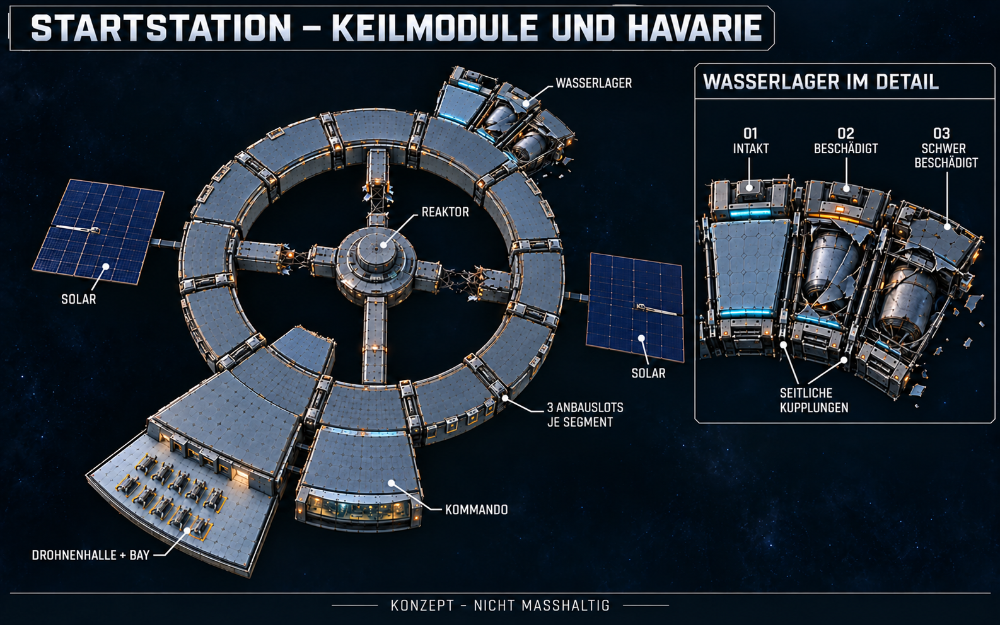

# Gesamtstation mit Keilmodulen und Havarie

Nach anschließendem Nutzerauftrag am25.10.2026 [im Spiel umgesetzt](Station-Keilmodule-Umsetzung-2026-10-25.md), einschließlich zusätzlicher linker Ringhavarie, Schotten/Bay-Schleuse und Ein-Drohnen-Flotte. Die folgenden Abschnitte dokumentieren den ursprünglichen Konzeptschritt.

Stand25.10.2026. Nutzer bestätigt die passgenaue Keilform aus V4 und beauftragt ihre Einbindung in das **Gesamtkonzept**, mit Modul01 intakt und02/03 beschädigt. Konzeptstand, keine neue Unity-Umsetzung.

[Vollständiges Bildpromptset](Art/Station/Station-Gesamtkonzept-Keilmodule-2026-10-25-v5.prompt.txt) · [Bestätigte Modulform und Verbindungen V4](Anbauslots-Keilmodule-V4-2026-10-25.md)

## Eingebundener Aufbau

Die reduzierte Startbelegung bleibt Grundlage: ein Verkehrsring, zentrale Reaktorkapsel, vier Serviceachsen, Kommandozentrale neben der Drohnenhalle, daran anschließend das offene Außendock, zwei gegenüberliegende große Solarfelder und eine einzige innere Reparaturwerkstatt. Nur eine Reaktorverbindung ist vollständig; drei haben unterschiedliche echte Brüche. Die innere Werkstatt ist am Ring angeschlossen und besitzt keinen zusätzlichen fünften Reaktorgang.

Das Wasserlager liegt wie bisher der Drohnenhalle gegenüber. Sein übergeordnetes Ringsegment trägt **drei nebeneinanderliegende Keile**, alle direkt an derselben Ringgrenze angeschlossen. Nach außen breitere Grundrisse schließen mit schmalen gemeinsamen Seitenfugen und Rahmenkupplungen aneinander. Die Grafik zeigt diese Gruppe sowohl in der Gesamtstation als auch vergrößert. Freie Ringsegmente erhalten symbolisch drei geschlossene Anbauslots je Segment; weitere Außenringstufen sind nicht vorab vollständig gebaut. Große vorhandene Sonderräume wie Halle/Kommando bleiben als breite Räume erhalten und dürfen im späteren Raster mehrere Slots belegen.

## Startzustand der drei Lagerkeile

| Modul | Zustand im Konzept | Sichtbare Gestaltung |
| --- | --- | --- |
| 01 | Intakt | Vollständige Druck- und Schutzhaut, geschlossenes Dach, brauchbarer Anschluss |
| 02 | Beschädigt/gesperrt | Größere noch befestigte Dachreste, örtlich aufgeschälte Hülle, freigelegter beschädigter Tank und verformte Rahmen |
| 03 | Stärker beschädigt/gesperrt | Andere großflächige Dach-/Eckverluste, stärker gerissene Tankhülle, verdrehte Reststruktur und wenige nahe Trümmer |

Seitliche Anbindungen bleiben an erhaltenen Rahmenabschnitten erkennbar. Die Druckgrenzen zum Ring und zum intakten Nachbarn müssen geschlossen sein; kein offener Weg aus01 ins Vakuum. Einzelne Leuchtstreifen sind im Bild illustrativ und kein Nachweis einer Betriebs-/Drucksimulation. Materialanschlüsse gehören an erreichbare Außenflächen; Fachdetaillierung und Flugräume werden erst beim tatsächlichen Umbau geprüft.

## Maß- und Umsetzungsgrenzen

V4 bleibt die geometrische Ausarbeitung: drei nominal10°-Keile im30°-Segment, vorläufig r38–54m; der9m-Ringgang bei r29–38m und ein Deck bleiben. Winkel, genaue lichte Modulmaße, Kupplungskonstruktion und Tragfähigkeit sind damit nicht neu als technisch geprüfte Auslegung bestätigt. Das Bild ist eine nicht maßhaltige Zusammenführung der bisherigen Station und der bestätigten Modulform. Reaktordetail R01 aus dem anderen Chat nicht neu integriert; keine neue Kapazitäts-, Druck-, Bau- oder Reparatursimulation.

## Prüfung

Finale PNG1586×992 Pixel, SHA256 `30C8D35EE8E9D23150C498EDEFB0FC1AB9CCC684E68F458B5974659BBB5F4A9E`. Lokale V4/V5-Konzeptlinks und Dokumentdiff auf Leerraumfehler geprüft.

Eingebautes ImageGen mit zwei aktuellen Stations-Renderbildern und V4-Keilkonzept als Referenzen. Gesamtbild und Lagerdetail visuell auf reduzierte Startbelegung, gegenüberliegende Halle/Lager, drei anliegende Lagerkeile mit Zuständen01/02/03, zwei vollständig gerahmte Solarfelder und vier Serviceachsen geprüft. Einen versehentlich generierten fünften diagonalen Reaktorsteg gezielt entfernt; Statusmarkierung am beschädigten02-Anschluss überarbeitet. Bilddatei im Projekt gesichert; PNG-Abmessungen/Hash und lokale Dokumentverweise geprüft. Keine Unity-Quellen geändert, kein neuer Build/Laufzeittest, kein Commit/Push; vorhandener Build und fremde Reaktorarbeit erhalten.
