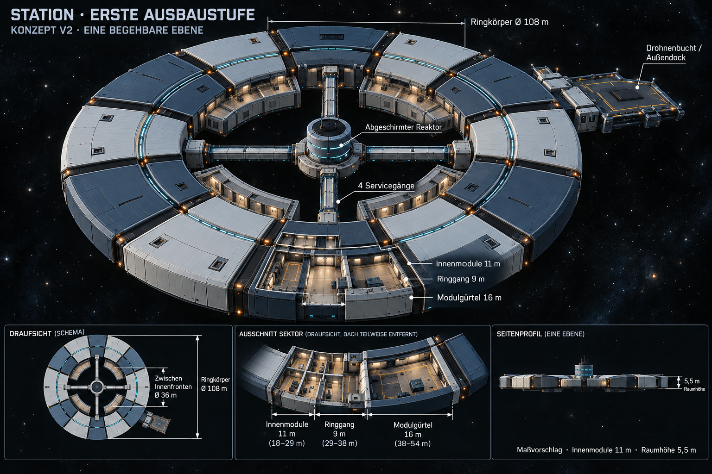

# Stationskonzept V2 — innere Räume mit11m Tiefe

Aktueller Entwurf: [V4 mit radial nach innen wachsenden Ringsektoren](Stationskonzept-V4-2026-10-24.md). Diese ältere Fassung bleibt als Verlauf erhalten.

Stand24.10.2026. Nutzer findet V1 gut und wünscht zusätzliche nach innen gerichtete Räume dort, wo keine Servicegänge verlaufen, mit11m Tiefe, etwas tiefer als der9m-Ringgang. **Die11m-Innenraumtiefe ist damit Nutzerentscheidung.** V2 aktualisiert zunächst das Konzeptbild; keine Unity-Geometrie oder Spielmechanik ist dadurch schon umgebaut. Die übrigen Maße und die konkrete Sektoraufteilung bleiben der bisherige Layoutvorschlag.

[Vollständiger ImageGen-Änderungsprompt](Art/Station/Station-Erste-Ausbaustufe-2026-10-24-v2.prompt.txt) · [V1 und bisheriger Umsetzungsplan](Stationskonzept-2026-10-24.md)

## Änderung gegenüber V1

Die optionalen2m von V1 werden durch **insgesamt11m** tiefe Innenräume ersetzt; keine Addition auf13m. Gemessen wird radial ab der bestehenden Innenkante des Ringgangs bei r29m, also nach innen bis r18m. Die Räume sind ebenerdig zum Ring, nicht ein tiefer gelegenes Stockwerk. Vier gekrümmte Raumgruppen liegen zwischen den vier Reaktor-Serviceachsen. Türen und Zwischenwände in der Bilddarstellung sind illustrative Platzhalter, keine bereits festgelegte Raumnutzung.

| Bereich | Aktueller V2-Vorschlag | Änderung |
| --- | --- | --- |
| Innenräume | Radius18–29m;11m radiale Tiefe | Ersetzt V1-Streifen r27–29m |
| Ringgang | Radius29–38m;9m radial | Unverändert |
| Äußerer Modulgürtel | Radius38–54m;16m radial | Unverändert |
| Ringkörper außen | Ø108m | Unverändert, Außendock nicht eingerechnet |
| Gegenüberliegende Innenfronten | Ø36m | V1 sah Ø54m vor; Reaktor/Gänge belegen Teile dieser Öffnung |
| Reaktorgehäuse/Wartungskragen | Radius4m/8m | Unverändert |
| Servicegänge | Vier,3m lichte Breite | Achsen bleiben frei und vollständig mit Ring und Reaktorkragen verbunden |
| Servicegangverlauf | r8–29m; nominell21m vor Anschlussüberlappungen | Am Ringende an die r29m-Kante anpassen; vorheriger V1-Endpunkt r27m war der alte Innenstreifen |
| Sichtbar freier Gangabschnitt zum Kern | r8–18m; etwa10m | Außen daneben stehen die neuen Innenräume |
| Decks und Raumhöhe | Ein begehbares Deck;5,5m lichte Höhe | Unverändert |
| S02-Drohnenbucht und Außendock | Vorhandene Funktion/zehn Außenplätze beibehalten | Nicht durch Innenräume überbaut |

## Baubare Abgrenzung der Servicegänge

Die11m-Innenräume dürfen die vier Gänge weder queren noch mit Wänden/Türen abschneiden. Als geometrischer Vorschlag bleiben je8° auf beiden Seiten der vier Achsen frei. Die inneren Raumsektoren liegen dann bei8–82°,98–172°,188–262° und278–352°. Am inneren Radius18m ist dieser Freiraum etwa5m quer zur Achse breit und bietet Platz für den3m-Gang, Wände und Anschlusskragen. Winkel und endgültige Tür-/Wandstärken sind Umsetzungsdetails, keine neue Nutzerfestlegung.

Die Innenräume können weiterhin aus bogenförmigen beziehungsweise facettierten Segmenten auf dem vorhandenen zwölfteiligen Raster aufgebaut werden. An den Gangachsen wird die Innenraumgeometrie ausgespart. Die bisherigen V1-Schritte für Kopplungen, Hallen-/Dockanschlüsse, Kollisionen und Save-Freiraumprüfung gelten weiterhin. Neue Innenräume verändern die nutzbare Grundfläche; konkrete Belegung, Versorgung, Türen/Druckhaltung und Rezept-/Produktionssysteme bleiben offen.

## Herkunft und Prüfung

V1 im eingebauten ImageGen-Tool gezielt bearbeitet; Ergebnis und vollständiger Prompt als eigene V2 gesichert. V1 bleibt erhalten. Sichtprüfung: erkennbare neue Innenraumgruppen in Hauptansicht und Draufsicht, vier freie Reaktorachsen,11m/9m/16m-Beschriftung, aktualisierte36m-Innenfronten und ein Deck. Renderings sind keine maßgenauen Konstruktionszeichnungen; für Modellierung gelten die Textparameter. PNG/Abmessungen/Hash, Maßarithmetik und lokale Links separat geprüft. Keine Unity-Implementierung, kein Build/Laufzeittest, kein Commit/Push in diesem Konzeptschritt.
