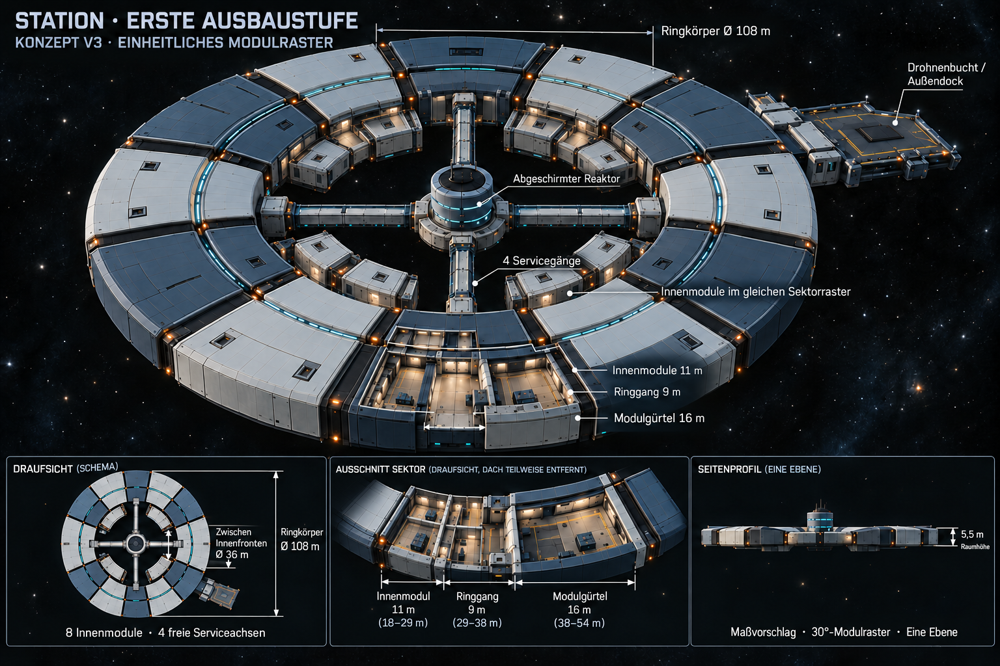

# Stationskonzept V3 — einzeln angedockte Innenmodule

Aktueller Entwurf: [V4 mit radial nach innen wachsenden Ringsektoren](Stationskonzept-V4-2026-10-24.md). V3 bleibt als Verlauf erhalten.

Stand24.10.2026. Nutzer möchte die inneren Räume jeweils wie die äußeren Module andocken, in deren Modulgröße/-einheiten. V3 übernimmt dafür das gleiche30°-Sektorraster, dieselben Achsen und die sichtbare Bauweise mit eigenen Hüllen und Anschlusskupplungen. Die zuvor verlangte11m-Innentiefe bleibt erhalten. „Gleiche Größe“ wird damit als gleiche Modul-/Sektoreinheit interpretiert, nicht als neue16m-Innentiefe oder identische Quadratmeterzahl: bei kleinerem Radius ist die Innenfront eines Keilmoduls geometrisch schmaler.

[Vollständiger ImageGen-Änderungsprompt](Art/Station/Station-Erste-Ausbaustufe-2026-10-24-v3.prompt.txt) · [Vorherige11m-Geometrie V2](Stationskonzept-V2-2026-10-24.md) · [Grundlage und Umsetzungsweg V1](Stationskonzept-2026-10-24.md)

## Änderung zu V2

- Statt vier langer zusammenhängender Innenbögen einzelne geschlossene Keilmodule, jeweils mit eigenem Dach, Stirnwänden und erkennbarer Andockkupplung zum begehbaren Ring.
- Außen zwölf30°-Sektoren; auf den vier Serviceachsen kein Innenmodul. Daraus folgt im aktuellen Vorschlag eine Belegung mit acht Innenmodulen, zwei je Quadrant.
- Innenmodule auf den Achsen30/60/120/150/210/240/300/330°. Nominell jeweils30°, gleicher radialer Achsbezug zum passenden Außenmodul. Ein zurückgesetzter Körper von beispielsweise27° lässt Platz für Fugen/Kupplungen; konkrete Fugenmaße bleiben Ausarbeitung.
- Die vier ganzen Sektorplätze um0/90/180/270° bleiben für Reaktor-Serviceverbindungen frei. Das ersetzt die ältere V2-Annahme eines nur8° breiten Freiraums je Achsseite.
- Tiefe11m bei Radius18–29m, Ringgang9m bei29–38m und Außenmodule16m bei38–54m. Ein Deck, vorgeschlagener Ringkörper Ø108m und36m zwischen Innenfronten bleiben.
- Eigene Montage-/Drucktür am Ringende jedes Innenmoduls; keine neue Querverbindung durch einen Reaktorgang. Physische Ausführung/Druckhaltung und konkrete Raumnutzung noch offen.

S02-Drohnenbucht, Außendock/zehn reale Plätze, Reaktorgehäuse und vier geschlossene Servicegänge bleiben als Entwurfsgrundlage erhalten. Kleinere Innenradien bedeuten kleinere Grundfläche als bei äußeren Modulen trotz gleichen Winkelrasters. Eine verbindliche identische Innen-/Außen-Grundfläche ist damit nicht behauptet.

## Umsetzung und Prüfung

Im späteren Unity-Umbau können Innen- und Außenmodule denselben Sektorindex und dieselbe zentrale Andockachse verwenden. Innenmodulraster: `0..11` mit dreißig Grad je Index; Indizes0/3/6/9 für Servicegänge freilassen. Die übrigen acht Indizes instanziieren einzelne Innenhüllen mit11m Tiefe. Türen/Kollisionen, Gangfreiraum, begehbare Fugen und Save-Freiraumprüfung müssen anschließend real getestet werden.

Das Bild wurde mit eingebautem ImageGen aus V2 bearbeitet und visuell auf einzelne Innenhüllen/Kupplungen, freie Gänge und erhaltene11/9/16m-Aufteilung geprüft. PNG/Hash/Abmessungen, acht Rasterplätze/Serviceaussparungen und Links geprüft. Die Renderdarstellung ist illustrativ; die Textparameter geben die Modellierungsgeometrie vor. V1/V2 bleiben als historische Entwürfe erhalten. Noch keine Änderung der Unity-Station, kein Build/Laufzeittest oder Commit/Push für diesen Konzeptschritt.
