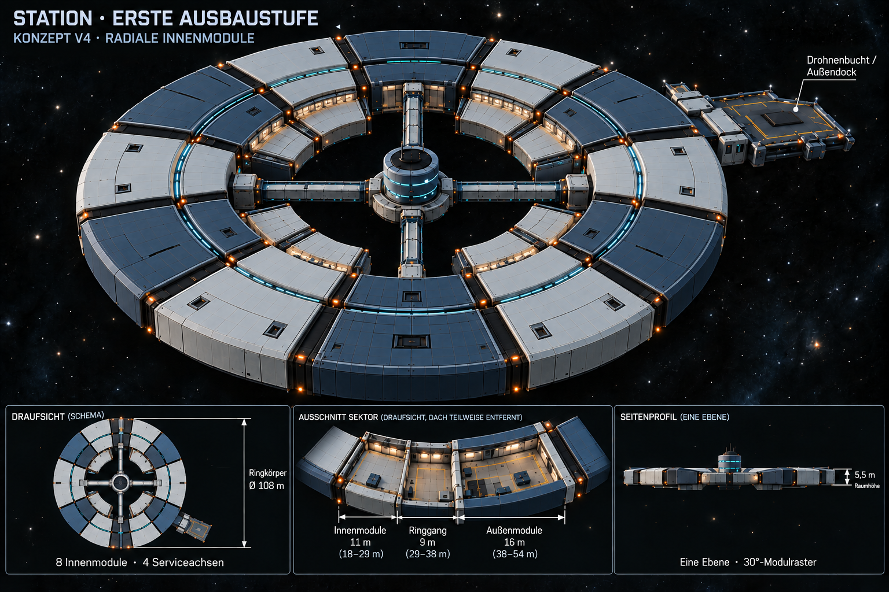

# Stationskonzept V4 – radial wachsende Innenmodule

Umsetzung24.10.2026 nach anschließendem Nutzerauftrag: [V4-Grundstruktur jetzt im Hauptspiel](Ringstation-Ausbau.md#v4-grundstruktur-im-hauptspiel-24102026), Layoutrevision5,178+29 Laufzeitprüfungen/Exit0. Die folgenden Abschnitte halten den ursprünglichen Konzeptschritt und seine damaligen Prüfgrenzen fest; aktueller [Umsetzungsnachweis](Pruefungen/Stationsumbau-V4-2026-10-24.json).

Stand 24.10.2026. Nutzer präzisiert: Innenmodule sollen genauso angepasst nach innen wachsen wie die weiteren Module nach außen. Damit ist die radiale Sektorform die Vorgabe, nicht nur eine gemeinsame Andockachse. Die bereits beauftragten 11 m Innentiefe bleiben. Weiterhin Konzeptstand; noch kein Umbau der Unity-Station.

[Vollständiger Bildprompt](Art/Station/Station-Erste-Ausbaustufe-2026-10-24-v4.prompt.txt) · [Vorherige Fassung V3](Stationskonzept-V3-2026-10-24.md) · [Reaktorgrößen und Modellauftrag](Reaktor-Designbrief.md)

## Geometrie für die spätere Umsetzung

Innen- und Außenmodule verwenden dieselben radialen Seitenebenen eines nominalen 30°-Sektors. Beim äußeren Ausbau wird das Modul mit steigendem Radius breiter; beim inneren Ausbau verjüngt es sich zum Zentrum. Die äußere Seite des Innenmoduls schließt über die gesamte Sektorbreite an den Ring an. Eigene Hülle und Kupplungsfugen bleiben; keine kleinen rechteckigen Behälter an einer schmalen Halsverbindung.

| Bereich | Radius | Radiale Tiefe |
| --- | --- | --- |
| Innenmodul | 18–29 m | 11 m |
| Ringgang | 29–38 m | 9 m |
| Äußere erste Modulstufe | 38–54 m | 16 m |

Bei nominell 30° beträgt die Sehnenbreite des Innenmoduls am Ring etwa 15,01 m und an seiner inneren Stirnseite 9,32 m (`2*r*sin(15°)`). Das sind Hüllrastermaße vor Fugen/Wänden, keine lichten Raum- oder Türbreiten. Für Fugen kann die Hülle leicht innerhalb der Sektorgrenzen zurückgesetzt werden. Größere Radien ergeben außen entsprechend breitere Module; gleiche Bauweise bedeutet keine identische Grundfläche.

Vorschlag beibehalten: zwölf Sektorplätze, acht Innenmodule auf 30/60/120/150/210/240/300/330°, vier freie Serviceplätze auf 0/90/180/270°. Ein Deck. Vier geschlossene Serviceverbindungen und die vorhandene S02-Drohnenhalle mit Außendock erhalten. Ein weiteres volles 11-m-Innenband wäre keine automatische Wiederholung: r7–18 m überschneidet sich mit dem vorgeschlagenen Wartungskragen bis r8 und benötigt eine neue Kollisions-/Raumplanung.

Umsetzung: ein gemeinsamer Sektormesh-Generator mit Innenradius, Außenradius, Winkel und Höhe. Für Innenmodule Radien 18/29 statt Außenmodule 38/54 verwenden; Winkelgrenzen und Anschlussachsen bleiben gleich. Drucktüren, Kapselkollisionen, Übergänge und Spielstandpositionen erst beim tatsächlichen Umbau prüfen.

## Prüfung und Grenzen

V3 mit eingebautem ImageGen gezielt bearbeitet; V4 visuell auf breitere zusammenhängende Innenkeile mit verjüngten Stirnseiten, vier freie Serviceachsen und ein Deck geprüft. Hauptbild und kleine Schnittbilder sind illustrativ, keine maßhaltige CAD-Zeichnung; die Tabelle ist maßgeblich. PNG-Signatur/Abmessungen/Hash, Rasterarithmetik und lokale Links geprüft: [Nachweis](Pruefungen/Stationskonzept-V4-2026-10-24.json). Vorversionen erhalten. Keine Unity-Änderung, kein neuer Build/Laufzeittest, kein Commit/Push.
