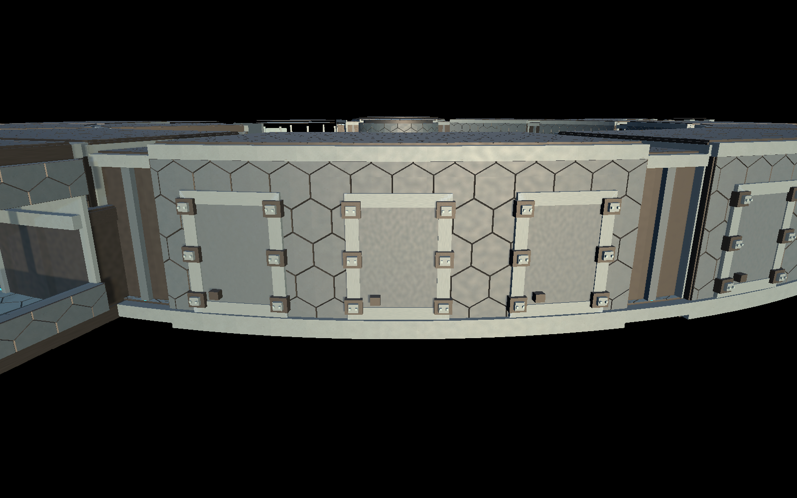
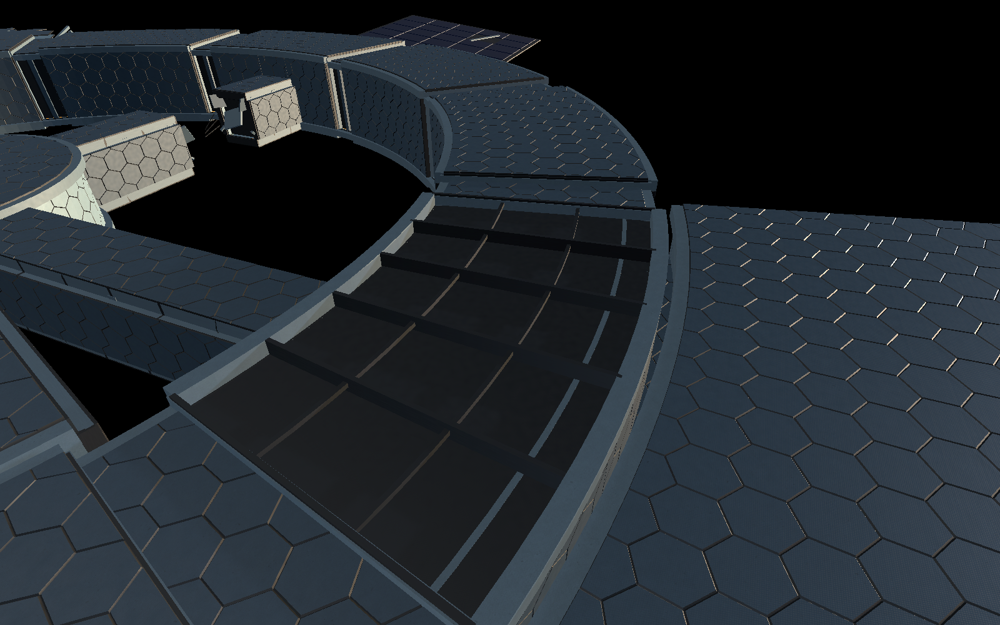
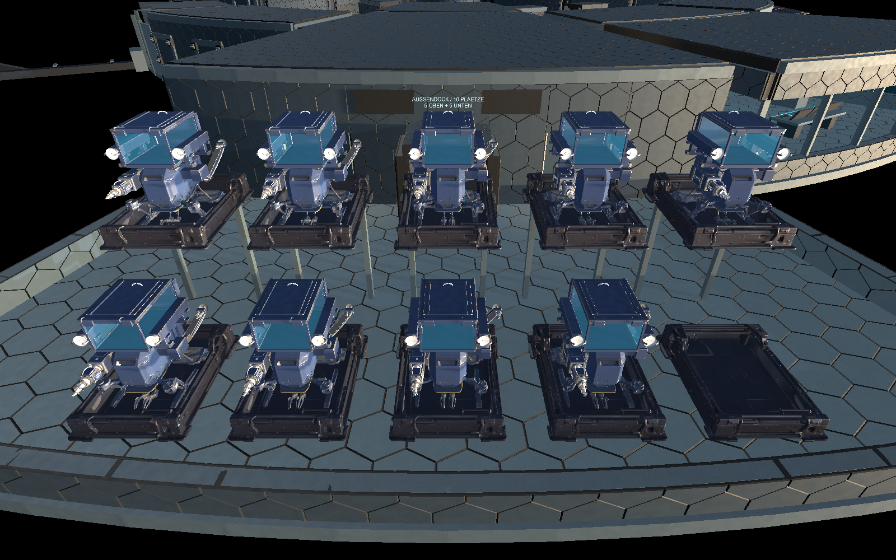

# Stationsrahmen und detaillierte Außendrohnen

Aktueller Folgestand25.10.2026: [Aufbauphase mit Versorgung/Arbeitsplätzen und erster Optimierung](Stationsversorgung-Architektur.md), [384 Prüfungen/Messgrenzen](Pruefungen/Aufbauphase-01-2026-10-25.json). Die zehn Modelle erhalten jetzt LODs; starre Werkzeugflächen werden gebündelt, Oberflächentexturen geteilt. Nur01 startet aktiv,02 wird über R-01/Ressourcen/Reserven freigeschaltet und tatsächlich geladen. Die folgenden Angaben ohne Flotten-LOD/passiver R-01 beschreiben den Ausgangsstand. Neuer Direkteinstieg `Start-Aufbauphase-01.cmd`; Rahmenformen bleiben erhalten.

Umsetzung vom25.10.2026 auf ausdrücklichen Nutzerwunsch: kräftige integrierte Andockrahmen, ein sichtbar getragenes zweischichtiges Schutzsystem, wieder verkleidete Halleninnenflächen und das bereits ausgearbeitete Drohnenmodell an allen zehn Außenplätzen.

**Start:** `Start-Station-Keilmodule.cmd` öffnet den aktuellen Development-Spielbuild vor der Drohnenhalle. WASD/Maus, Shift zum schnellen Developer-Rundgang ohne Ausdauerverbrauch, E an Schotten/Schleuse, V für Innen-/Außenansicht und F11 für Vollbild. Eigene Einstellungen unter `Logs/KeilStation-settings`, Spielstände unter `Logs/KeilPreview/Saves`.

## Anschlüsse und Hülle

Nachkorrektur25.10.2026 nach Nutzerbild: Die beiden äußeren Anbaurahmen der freien Ringsegmente liegen jetzt bei ±8,5° statt ±10° zur Segmentachse. Das versetzt jeden um rund1m zur Mitte; der mittlere Rahmen bleibt auf der Achse. Dies ist das korrigierte Anschlussraster für die später daran ausgerichteten Anbaumodule. Bereits gebaute Lagerkeile behalten ihre Form. Nur die Montagezentren verschoben, keine neue Layoutrevision oder Spielstandmigration. [Prüfung/Nahansicht](Pruefungen/Anbaurahmen-Zentrierung-2026-10-25.json).

Die drei gekappten Anschlussstellen je freiem gesundem Ringsegment besitzen nun kräftige Rahmenprofile, je sechs verankerte Tragknoten mit Verriegelungsbacken und Bolzen sowie eine geschlossene eingesetzte Druckkappe. Die Profile schneiden in den Wandkörper ein; die bisherigen geschlossenen Wandkollisionen bleiben bestehen. Eine spätere Öffnung/Montage ist noch kein Bauauftragssystem. Die seitlichen Rahmenkupplungen der Lagerkeile sind ebenfalls verstärkt.

Zwischen Druckhülle und Außenschutz befinden sich sichtbare Abstandsrippen und Umfangsgurte. Deck- und Wandränder erhalten Abschlüsse, damit die Schutzlage nicht frei schwebt. Die Rahmen sind Darstellung des konstruktiven Aufbaus; ihre Tragfähigkeit wurde nicht berechnet. Havarieformen und vorhandene Zugangsgrenzen bleiben erhalten.

Die ausgearbeitete Drohnenhalle zeigt innen wieder ihre eigenen Metallpaneele an Boden, Wänden und Decke. Die Wabenverkleidung bleibt dort außen; die innere Zusatzlage wird auf diesen bereits modellierten Flächen ausgelassen. Zweitür-Schleuse und gesperrte seitliche Außentore bleiben.

## Zehn Außenplätze mit dem ausgearbeiteten Modell

Die Hauptkampagne nutzt jetzt an allen zehn Außenplätzen den importierten Tripo-Rumpf mit vorhandenem Mining-Aufbau (`TripoMiningDroneVisual`): Bohrwerkzeug, Dach-Frachtkammer, Greifer, Verankerungen und Heckentladung. Alle erhalten das zugehörige importierte Ladedock, dezente Lack-/Helligkeitsvarianten und passende Auswahlcollider. Die Plätze sind seitlich3,9m versetzt; fünf stehen unten und fünf oben, mit erhaltenen oberen Dockträgern und Nummern.

**Nur Drohne01 bleibt einsatzfähig.**02–10 behalten den gesperrten Zustand auch nach Laden älterer Spielstände. Diese Entscheidung ändert keine gespeicherten Vorräte. Die kleine interne R-01 bleibt vorerst ihre bisherige passive Modellkopie; der aktuelle Auftrag betrifft die Außendrohnen.

Die aktive Drohne verwendet ihre vollständige Modellhülle für die vorhandene Flugwegplanung. Der Wasseranschluss an Lagerkeil01 erhält den ausgearbeiteten geschlossenen Entladekanal. Vor der Hecköffnung legt die Ansaugmanschette an; danach erfolgen Entladung, Verschließen und Abdocken über den bestehenden Ablauf. Die Stirnöffnung wurde auf diesen Kanal erweitert.200L-Testkapazität und Ressourcenbilanz bleiben erhalten.

**Layoutrevision9** migriert alte Drohnenposen auf die neuen Platzabstände. Gültige Spielerorte bleiben erhalten; die bisherige Freiraumprüfung und Schleusenpersistenz ab Revision8 gelten weiter. Beim Laden rekonstruiert die Frachtanzeige den Füllstand; feine Greifer-/Einzelstückanimationen werden nicht als eigener Spielzustand gespeichert. Die separate Mining-Demo verwendet weiterhin ihren isolierten Ablauf und erhält keine doppelte Kampagnenflotte.

## Implementierung und Prüfung

### Leistungsbefund25.10.2026 nach gemeldeten Rucklern

Die Integration ist funktional geprüft, aber noch nicht für zehn detaillierte Drohnen samt Ladeaufnahmen leistungsoptimiert. Statische Code-/Assetprüfung dieser Sitzung: `CampaignDroneFleet` lädt pro Platz das vollständige Originalmodell und Ladedock; dort und in den verwendeten Prefabs gibt es keine distanzabhängigen LOD-Gruppen. Nur01 wird laufend durch `Advance` animiert, die neun deaktivierten Drohnen werden trotzdem vollständig gerendert, soweit sichtbar. Werkzeuganbauten erzeugen eigene Materialien und zahlreiche Einzelmeshes; die Ladeaufnahmen nutzen komplexe MeshCollider. Die Flugwegplanung verwendet zwar einen Routencache, kann beim erstmaligen Planen viele Physikabfragen ausführen.

Der vorhandene [Unity-Importbericht vom11.10.2026](Pruefungen/Tripo-Unityimport-2026-10-11.json) zählt501.518 Dreiecke für den Originalrumpf und502.036 für die Ladeaufnahme. Bei zehn vollständig sichtbaren Paaren entspricht das10.035.540 Instanz-Dreiecken allein dieser beiden Originalmeshes, ohne Werkzeuge/Station und zusätzliche Renderdurchgänge. Das ist keine heutige Neuvermessung und keine Aussage über tatsächlich pro Frame gezeichnete Dreiecke oder zehnfachen Mesh-Speicher. Texturimport ist bereits teilweise auf2048px begrenzt; das ersetzt keine Geometrie-/Renderoptimierung.

**Offen:** aktuelle Laufzeitmessung mit Framezeiten/CPU/GPU/Allokationen, um Renderlast und etwaige Lastspitzen der Wegplanung zu unterscheiden. Danach LODs/vereinfachte geparkte Darstellung sowie geteilte Meshes/Materialien und Collider gezielt angehen. In dieser Befundaufnahme keine Laufzeitmessung, Codeänderung, neue Optimierung, Build oder Abnahme durchgeführt; Rucklerursache noch nicht bewiesen.

Neue Dateien `RingWalkthrough.HullFrames.cs` und `CampaignDroneFleet.cs` samt `.meta`. Geometrieintegration in `RingWalkthrough.cs`/`RingWalkthrough.Expansion.cs`, Installation/Revision in `StationInteriorLayout.cs`, Modell-/Speicheranbindung in `WaterScenario.cs`, `DroneAgent.cs` und `TripoMiningDroneVisual.cs`. `TripoMiningShowcase.cs` berücksichtigt die bereits aus vier Wandstücken gebaute Keilöffnung; ältere Abschlusswände behalten ihren Ausschnitt-Fallback. Nach dem ersten sichtbaren Start wurde außerdem die Lackvariation mit `Material.HasProperty` abgesichert: Der separate Frachtglasshader besitzt keine Haupttextur und erzeugt beim Start damit keine entsprechenden Materialwarnungen mehr.

Finaler Development-Build6000.6.4f1 bei unveränderter Quellprojektversion6000.4.7f1, Build Exit0. **156 Stations-,29 Vitals-/Bewegungs-/Speicher- und78 Miningprüfungen derselben Binärdatei Exit0**. Hauptspiel: reale Schotten-/Schleusenpassagen mit CharacterController, Migration, zehn detaillierte Modelle/nur01 aktiv, vollständiger Wasserauftrag, Platzfreiraum und echter Manschettenkontakt. Separate Mining-Demo: zwölf Greiferablagen,12kg abgebaut und9,6L geliefert; neun freie Strahlen durch den Kanal, vollständige Ausfahrt/Rückkehr. Eine frühe Prüffassung suchte die alte Lagerwand; auf die vorhandene Keilöffnung korrigiert, Randprofile von der Kanal-Freifläche unterschieden und neu bestanden.

Neun direkte Stationsrenders; relevante Nahansichten von Flotte, Halle, Montageanschlüssen und aufgeschnittener Hülle visuell geprüft. [Prüfbericht mit Quellen-/Buildmanifest und Grenzen](Pruefungen/Rahmen-und-Drohnenflotte-2026-10-25.json). Aktueller Build unter `Builds/Windows`, Vorgänger unter `Builds/Windows-before-hullframes-20261025`. Keine neue manuelle GUI-/Eingabe-, Release- oder Leistungsabnahme, keine Gas-/Tragwerksimulation und keine allgemeine Mehrdrohnen-Verkehrssteuerung. Die Bauprobe wurde nicht erneut abgenommen. Fremde Reaktorarbeit bleibt erhalten; kein Commit/Push beauftragt.
