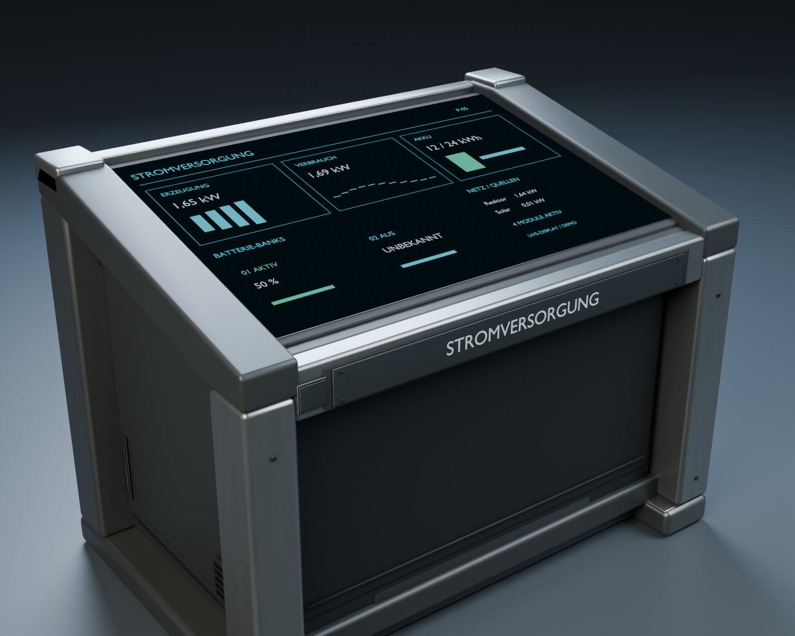

# Touch-Steuerpult: Blender-Modell — 26.10.2026

## Überarbeitung R02 auf Nutzerkritik — 26.10.2026

Neue separate Fassung unter `Design/Models/TouchConsole/Revision-R02`: `TouchConsole-R02.blend` als sauberes Gehäuse, `TouchConsole-R02-DisplayPreview-Final.blend` mit ausdrücklich beispielhafter Anzeige, `TouchConsole-R02.glb` für den Viewer und `TouchConsole-R02.png`. Generator `tools/RefineTouchConsoleR02.py` verwendet die unveränderte erste Blenderquelle. Neu: facettierte segmentierte Metallwangen, kräftige abgesetzte Fußkappen, Wartungsdetails und Lüftung, kürzere Frontplakette/Serienkennung, zusätzliche gezeichnete Displaypiktogramme. Rauheitszuweisung korrigiert: ursprüngliche Alpha-Auswertung durch passenden Roughness-Kanal ersetzt; dezentes prozedurales Mikrorelief im nativen Blender-Material. Das prozedurale Mikrorelief wird nicht als fertig gebackene GLB-Normalmap behauptet.

Vorhandene Three.js-Technik in eigener Touchpultansicht wiederverwendet, ohne den parallel bearbeiteten I75-Viewer zu ändern. `tools/ServeConsoleViewer.py` startet ausschließlich lokal auf `http://127.0.0.1:8770/`; HTML/JS unter `ConsoleViewer`, Bibliotheken aus dem vorhandenen I75-vendor. Dort Drehen, Zoomen, Verschieben, Ansichtsbuttons und Drahtgitter. Server erlaubt nur explizite Viewer-/Modellpfade und vendor-Dateien, keine Verzeichnislisten. Start mit vorhandenem Python und diesem Skript; keine neue Installation oder Modelluploads.

Tatsächlich geprüft: finaler Blender4.5.14-Lauf Exit0 (`Logs/console-r02-final.log`), Render visuell kontrolliert; anfangs verdeckte Frontschrift korrigiert. GLB mit32.617 Dreiecken und etwa1,502×1,139×1,003m Hüllmaß. Im rechten In-App-Browser tatsächliches texturiertes GLB samt lesbarer Frontschrift/Anzeige sichtbar geprüft und offengelassen. Erster Sandboxexport scheiterte an temporärem Bildschreiben; Wiederholung ausserhalb Sandbox. Zwischenspeicherung der Vorschau scheiterte an Blender-@-Datei, final unter neuem Dateinamen erfolgreich. Ursprungsmodell, bestehende Unity-FBXs, Raumpläne und fremde Arbeit bewahrt. Keine neue Unity-Zuweisung, LOD-/FPS-/Ergonomieabnahme, kein Build/Commit/Push. Gestaltung weiterhin zur Nutzerbeurteilung; keine exakte Übereinstimmung mit dem Konzept behauptet.

## Auftrag und Lieferumfang

Der Nutzer hat das [Touch-Konzept V2](Steuerpult-Konzept-2026-10-26.md) zur möglichst getreuen Umsetzung freigegeben. Anschließend präzisiert: **zuerst in Blender gestalten und rechts zeigen**. Daher wird zunächst das tatsächliche Modell samt Materialvorschau geliefert; die Einbindung in die Kommandoraum-Pulte folgt gesondert. Bestehende Laufzeitoberflächen, Raumpläne und Spielbuilds werden durch diesen Modellschritt nicht umgebaut.

Die Bauform übernimmt die niedrige, nach hinten ansteigende Touchfläche, helle tragende Metallwangen, Graphitverkleidung, zurückgesetzten Fußraum, Wartungsflächen, kleine Befestigungen und die Frontbeschriftung. Keine physischen Knöpfe, Tasten oder Drehregler. PBR-Oberflächen mit gebürstetem Metall, matter Lackierung und dezenten Gebrauchsspuren sind selbst erzeugt; das KI-Konzept ist die Gestaltungsreferenz, keine auf das Objekt geklebte Textur.

## Native Quelle und Vorschau

[Gerenderte Vorderansicht](../Design/Models/TouchConsole/Renders/05-demo-front-fixture-not-gameplay.png) · [gerenderte Seitenansicht](../Design/Models/TouchConsole/Renders/06-demo-side-fixture-not-gameplay.png).

| Datei | Zweck |
| --- | --- |
| `Design/Models/TouchConsole/TouchConsole.blend` | Bearbeitbares Grundmodell, ohne vorgetäuschte Liveanzeigen |
| `Design/Models/TouchConsole/TouchConsole-Preview.blend` | Beleuchtete Vorschau mit separatem beispielhaftem Touchscreen |
| `tools/CreateTouchConsole.py` | Reproduzierbare Geometrie-, UV-, PBR- und Exporterzeugung |
| `Design/Models/TouchConsole/model-report.json` | Maße, Materialgruppen, Anker, LOD-Zahlen und Exportprüfungen |
| `Design/Models/TouchConsole/Renders/` | Echte Blender-Renderings des Modells |
| `Assets/SpaceMiner/Resources/TouchConsole/` | Vorbereitete FBX-/PBR-Exporte samt Metas; noch keinem Spielpult zugewiesen |

Die nativen `.blend`-Dateien bleiben außerhalb von `Assets`. Ein späterer Unity-Import der FBX-Exporte setzt daher keine lokal installierte Blender-Version voraus. Das gemeinsame Material benutzt einen 2048²-PBR-Atlas; Glas und Frontplakette sind getrennt ansprechbar.

## Modellaufbau

Hüllmaß **1,50 × 1,14 × 1,00 m** (Breite × Gesamthöhe × Tiefe). Die Glasfläche steigt um **12°** nach hinten an. Nutzbare Bildschirmfläche etwa **1,23 × 0,79 m**. Vorderseite ist Unity-lokal **−Z**, Ursprung ist der Bodenmittelpunkt. Der technische Bericht enthält die genauen Glas-/Beschriftungsanker für die spätere Integration.

Sechs Meshgruppen in LOD0: `Chassis`, `AlloyFrame`, `ServicePanels`, `Fasteners`, `TouchGlass`, `FrontPlaque`. LOD2 lässt die einzelnen Befestigungen weg. Drei vorbereitete Detailstufen: **17.268 / 3.232 / 472 Dreiecke**. Das ist eine geometrische Vorsorge, noch kein Laufzeitnachweis für Distanzwechsel oder Spielleistung.

Das Exportglas und die Frontplakette bleiben blank, damit im Spiel echte Daten und die jeweilige Funktion erscheinen können. Die getrennte Blender-Vorschau darf die Beschriftung **STROMVERSORGUNG** und eine beispielhafte Oberfläche zeigen. Deren 50-%-Akku und ausgeschaltete Reserve sind bewusst gewählte Vorschauwerte, keine aus einem laufenden Spiel gemessenen Daten. Die Vorschau-UI wird nicht in die FBX-Geometrie exportiert. Andere Pultfunktionen können später dieselbe Modellquelle nutzen.

## Prüfung und Grenzen

Abgeschlossen mit Blender **4.5.14 LTS**: alle drei FBX-Dateien erneut importiert und endliche Koordinaten, erhaltene Hüllmaße, UV-Schichten und Dreieckszahlen geprüft. Die **31** im endgültigen Modellbericht protokollierten Dateien wurden in dieser Sitzung erneut per SHA256 abgeglichen. Keine Abweichung. Native Modell- und Vorschaudatei sind komprimiert gespeichert; Texturen bleiben enthalten. [Prüfnachweis](Pruefungen/Steuerpult-Blender-2026-10-26.json), [detaillierter Modellbericht](../Design/Models/TouchConsole/model-report.json).

Die endgültigen Blender-Ansichten 04, 05 und 06 wurden visuell geprüft: dunkel durchgehende, flache Touchanzeige ohne Plattenwirkung, richtig lesbare Frontbeschriftung, helle Metallfassung und geschlossener Unterbau. Beim Vorschauabgleich korrigiert wurden ein zu hoch liegender verdeckter Chassisdeckel, gespiegelte Vorschautexte und die zunächst zu reflektierende/erhabene Demo-UI. Die korrigierte Vorschau verwendet flache selbstleuchtende UI-Flächen; ihre Daten bleiben ausdrücklich Beispiele. Echte PBR-Materialien des Grundmodells bleiben separat erhalten.

Keine Unity-Build-, Spiel-, Kamera-Ergonomie-, Eingabe- oder FPS-Abnahme für dieses Modell. Noch keine Live-UI und kein Umbau der fünf vorhandenen Nebenpulte. Ein vorbereiteter, unintegrierter Checkentwurf wurde vollständig außerhalb von `Assets` unter `work/TouchConsoleDeferred` abgelegt; er beeinflusst die Unity-Kompilation nicht. Kein Commit/Push.

## Proportionen R03 — 26.10.2026

Nutzer wünscht niedrigere Front, geknickten Seitenrahmen und längere, durchgehend ebene Displayfläche nach Konzept. Separate Revision-R03 mit tools/RefineTouchConsoleR03.py aus erhaltenem R02 erzeugt. Glas entlang der12-Grad-Ebene von0,79 auf0,94m verlängert, Mitte bei1,00m, vordere/hintere Glaskante ungefähr0,90/1,10m; nominelles Gehäuse1,50m breit,1,00m tief,1,14m hoch. Vordere Rahmenpartie abgesenkt, kurzer Knick bleibt; Display nicht geknickt. Native Gehäuse-/Vorschaudateien, GLB, PNG und report.json im neuen Ordner. Finaler Blenderlauf Exit0 (Logs/console-r03.log); tatsächliches GLB rechts unter http://127.0.0.1:8771/ sichtbar geprüft,32.617 Dreiecke. Nutzerfeedback sehr gut bestätigt die Gestaltungsrichtung; mangels eindeutiger Zuordnung des beigefügten alten8770-Tabs ist damit keine separate geometrische Endabnahme aller R03-Details behauptet. Keine Spielintegration/Unityprüfung, kein Commit/Push; ältere Varianten erhalten.

## Niedrige Bedienkante R04 — 26.10.2026

Nutzer präzisiert vorne ungefähr60cm; diese ausdrückliche Höhenvorgabe hat Vorrang vor dem mehrdeutigen Ausdruck20Prozent. Separate Revision-R04 mit RefineTouchConsoleR04.py aus R03. Hintere Bedienkante bleibt ungefähr1,10m; Display eben, entsprechend deutlich steiler (rund29Grad), vorderes Gehäuse/Seitenschulter abgesenkt, vorhandener kurzer Rahmenknick nachgeführt. Grundfläche/ältere Quellen erhalten. Blenderlauf Exit0 (Logs/console-r04.log), GLB tatsächlich rechts8772 texturiert sichtbar geprüft;32.617Dreiecke. Native Blenderquelle/Displayvorschau,GLB,PNG und gemessene Höhen im report.json. Keine neue Unity-Integration oder Ergonomie-/Leistungsprüfung; kein Commit/Push.

## Variantenvergleich — 26.10.2026

Nutzer wünscht R01/R02/R03 neben R04 auswählbar. ServeConsoleViewer.py bietet alle vier GLBs in einer Auswahl, R04 vorausgewählt; gemeinsamer Vergleich unter http://127.0.0.1:8773/. R01 aus erhaltener erster TouchConsole-Preview.blend separat mit ExportTouchConsoleR01.py exportiert, Ursprungsdatei unverändert. Viewerpfade explizit auf vier Revisionen begrenzt. Kein Drohnenviewerumbau, Unitybuild oder Modell-Neuentwurf.

Viewerreparatur26.10.: Nutzer blieb auf8770; gemeinsames aktualisiertes JS traf dort auf alten Server ohne /models/R0x.glb-Routen. Fehler im Browser reproduziert. Ausschliesslich verifizierten ServeConsoleViewer-Prozess134316 ersetzt, aktueller Variantenserver wieder auf8770. R04 und Wechsel zu R01 im Browser geladen geprüft. Künftig gemeinsamer Standardlink http://127.0.0.1:8770/ für R01–R04;8773 war Zwischenlösung. Keine Modelländerung/Unityprüfung.

## Nutzerfreigabe R04 — 26.10.2026

Nutzer bestätigt ausdrücklich: R04 gefällt mir sehr. Damit ist Revision-R04 die freigegebene gestalterische Modellgrundlage für die Bedienpulte: vordere Glaskante ca60cm, hintere ca1,11m, durchgehend ebene steilere Anzeige, geknickter Seitenrahmen. Frühere R01–R03 bleiben zum Vergleich erhalten. Diese Freigabe startet noch keine Unity-Integration und ist keine ergonomische oder technische Laufzeitabnahme. Heute nur Dokumentation, keine neuen Modelländerungen/Tests/Builds/Commit/Push.

## R04 im normalen Spiel integriert — 26.10.2026

Nach ausdrücklichem Folgeauftrag jetzt fünf Funktionspulte und4,40m breites Hauptpult integriert; regulärer Player Builds/Windows aktualisiert, Vorgänger erhalten. Blender-/Viewerabschnitte oben beschreiben die jeweilige historische Vorschau. Aktuelle Umsetzung und Grenzen: Touchpulte-R04-Spielintegration-2026-10-26.md. Unity6000.6.5f1 Development Exit0;1237Checks in drei finalen Läufen bestanden, Haupt-/Strompultansichten visuell geprüft. Kein Commit/Push.
