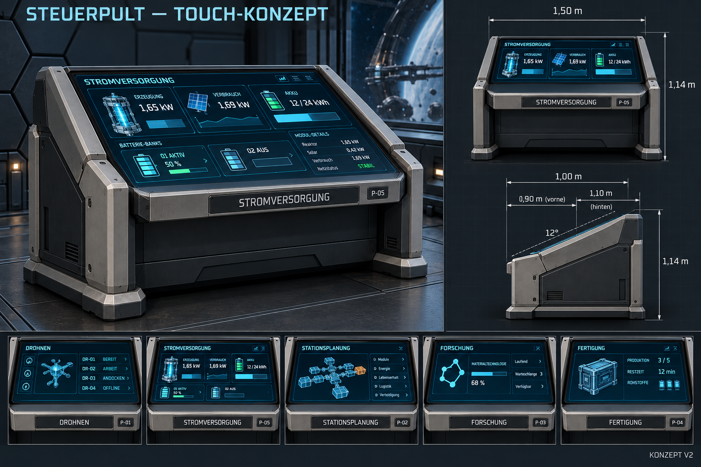

# Einheitliches Touch-Steuerpult — Konzept vom 26.10.2026

## Nutzerentscheidungen und Stand

**Umsetzungsfreigabe, anschließend Blender-Vorschau zuerst — 26.10.2026:** Nutzer möchte die Form und Texturen möglichst getreu übernehmen, zunächst das reale Blender-Modell rechts ansehen. [Modell, native Quelle und tatsächlicher Prüfstand](Steuerpult-Blender-2026-10-26.md). Einbau in die vorhandenen Spielpulte erfolgt erst nach diesem Vorschau-Schritt; die folgenden Konzeptnotizen bleiben als Entwurfsgrundlage erhalten.

Die Steuerpulte in der Kommandozentrale sollen dieselbe Gestaltung erhalten. Dem Nutzer gefällt die industrielle Grundform des ersten Bildes; gewünscht sind eine vorne niedrigere, leicht nach hinten ansteigende Bedienfläche und ein bereits sichtbares Display. Alle Bedienelemente sind **Touchscreen**: keine physischen Tasten, Knöpfe oder Drehregler. Die Beschriftung an der unteren Vorderkante bleibt. Ein kleiner wiederholter Schriftzug hinten ist optional.

**V2 ist ein überarbeiteter Konzeptvorschlag, noch kein fertiges Unity-Modell und keine freigegebene Maßzeichnung.** Die erste V1 mit physischen Bedienelementen wird nur als Entwurfsgeschichte erhalten. Die späteren Nutzerpräzisierungen haben Vorrang.

## Gemeinsame Bauform

Ein geschlossener graphitfarbener Unterbau trägt eine flache, durchgehende Glasfläche. Helle metallische Seitenwangen, zurückgesetzter Fußraum, wenige Wartungsfugen und verdeckte Strom-/Datenzuführung im Boden übernehmen die Sprache des ersten Entwurfs. Das Display ist bündig eingelassen und durch einen schmalen Rahmen geschützt. Dezent cyanfarbene UI und gut lesbare weiße Schrift passen zur bisherigen Station; Statusfarben ergänzen Text und Symbole.

| Abmessung | Vorläufiger Vorschlag |
| --- | --- |
| Breite | 1,50 m |
| Tiefe | 1,00 m |
| Bedienkante vorne | etwa 0,90 m über Boden |
| Bedienfläche hinten | etwa 1,10 m über Boden |
| Neigung | ungefähr 12° |
| Gesamthöhe einschließlich Rahmen | etwa 1,14 m |

Die Maße dienen der nächsten Modellierungsprobe. Die KI-generierten Ansichten und Maßlinien sind nicht verbindlich maßstäblich; insbesondere Höhenangaben in der Seitenansicht sind keine korrekten vertikalen Konstruktionsbemaßungen. Ergonomie, Blickwinkel aus der echten First-Person-Kamera, Displaygröße und freie Wege müssen im Spiel geprüft werden. Vor der Front zunächst mindestens etwa 0,90 m Bedienfläche vorsehen; Lauf- und Drohnenwege zusätzlich freihalten.

## Funktionen und sichtbares Display

Drohnen, Stromversorgung, Stationsplanung, Forschung und Fertigung verwenden das gleiche Gehäuse, die gleiche Glasfläche und die gleiche Position der Frontbeschriftung. Nur Name, Symbol und Inhalte wechseln. Das große mittige Hauptpult kann später aus derselben Gestaltung als breitere Variante entstehen; nicht einfach alle Bedienelemente verzerren. Materialdrucker und Nahrungssynthese sind eigene Anlagen und werden durch diesen Pultvorschlag nicht neu gestaltet.

Die Raumansicht soll bereits die tatsächliche Funktionsoberfläche auf dem Pult zeigen. **E** vergrößert dieselbe Oberfläche zur ausführlichen Bedienung. Für eine spätere Umsetzung eine gemeinsame UI-Datenquelle und möglichst dieselbe Layout-/Rendergrundlage verwenden, statt zwei voneinander abweichende Oberflächen oder das Konzeptbild als statische Bildschirmtextur einzubauen. Touch bezeichnet die Gestaltung des Geräts; Maus/Zeiger und E bleiben zunächst die vorhandene PC-Bedienung. Handanimation und echte direkte Oberflächeninteraktion sind gesondert auszuarbeiten.

Die im Bild sichtbaren Zahlen, Grafiken, Gerätenamen und Zustände sind illustrative Bildgenerierungsinhalte, keine aktuelle Stationsmessung und keine neue Leistungsentscheidung. In Unity müssen Strompult und dessen Raumdisplay auf die vorhandenen echten Telemetriewerte zugreifen; die ausgeschaltete Reserve behält unbekannte Ladung. Im V2-Bild ist der genaue UI-Inhalt noch nicht durchgehend konsistent. Die bestätigte gemeinsame Gehäuseidee ist davon unabhängig.

## Spätere Integration

Bestehende Raumpositionen, Drehungen und stabile Kennungen erhalten, insbesondere `battery` für das Strompult. Detaillierte Modelle nicht beliebig mit den frei skalierbaren Planboxen verzerren: feste Gehäusevarianten beziehungsweise nachvollziehbare Größenregeln entwerfen und gespeicherte Raumpläne nicht stillschweigend überschreiben. Vorderseite bleibt die vorhandene lokale −Z-Richtung; E-Bedienpunkt und Drehwerkzeug folgen ihr.

Dieses Konzept verändert weder Unity-Quellen noch Raumpläne, Spielstände, Kapazitäten oder den laufenden Build. Die Akkuposition bleibt nach der jüngeren Nutzerkorrektur direkt über den Ringgang gegenüber dem Zentraleneingang; eine neue Platzierung ist nicht Teil dieses Entwurfs.

## Dateien und Prüfung

- Aktueller Entwurf: [V2 Touch](Art/Station/Steuerpult-Touch-2026-10-26-v2.png), [vollständiger V2-Bildprompt](Art/Station/Steuerpult-Touch-2026-10-26-v2.prompt.txt).
- Historische Ausgangsform: [V1](Art/Station/Steuerpult-Einheitlich-2026-10-26-v1.png), [V1-Bildprompt](Art/Station/Steuerpult-Einheitlich-2026-10-26-v1.prompt.txt).
- Grundlagen: [Kommando-Raumplanung](Raumplanung-Kommandozentrale.md), [vorhandenes Strompult](Stromversorgung-Steuerpult-2026-10-25.md).

Erstellt mit dem eingebauten Imagegen-Werkzeug; V2 bearbeitet das erzeugte V1-Bild. Beide Bilder in dieser Sitzung visuell geprüft: gleiche Gehäusesprache, fünf Funktionsvarianten, erhaltene Frontbeschriftung und V2 ohne physische Bedienelemente. Endgültige Spielkamera-/Ergonomie-/Lesbarkeitsabnahme und Modell-/Laufzeitprüfung stehen aus. Keine Builds oder Spieltests für diese reine Konzeptaufgabe ausgeführt; kein Commit/Push.
