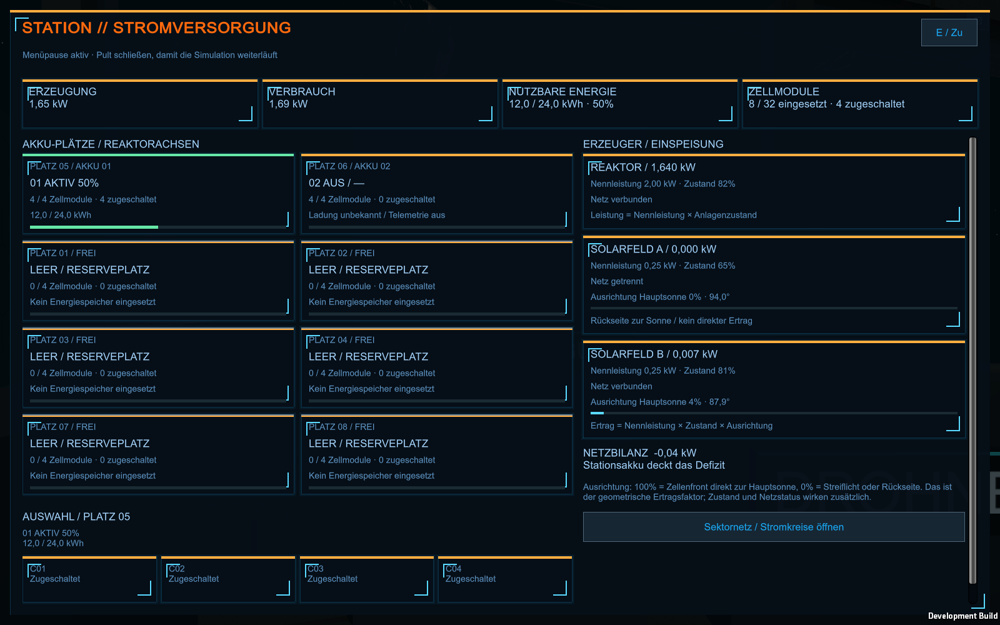

# Stromversorgung: Steuerpult und Akkutelemetrie — 25.10.2026

**Neue Oberfläche, 26.10.2026:** Das freigegebene Konzept ist mit tatsächlichen Ingame-Modellvorschauen, anklickbarer Station, Leistungsverlauf, Trends, Verbraucherbilanz und rechten Anlageninspektoren umgesetzt. [Aktuelle Bedienung, Dateien und Grenzen](Stromversorgung-UI-2026-10-26.md), [finaler Prüfnachweis](Pruefungen/Stromversorgung-UI-2026-10-26.json). Die Bestands-/Solarberechnung unten gilt weiterhin; die alte reine Kartenanordnung und frühere Buildnachweise beschreiben den Vorgänger.

Die Kommandozentrale besitzt ein zusätzliches **STROMVERSORGUNG**-Pult. Es ersetzt den bisherigen Akku-Platzhalter. Die echten Akkus stehen seit der Nutzerkorrektur vom 25.10.2026 bei **0° direkt gegenüber dem Eingang der Zentrale, über den Ringgang hinweg**: vom Ring aus gesehen links **01 aktiv**, rechts **02 ausgeschaltet**. Die sechs weiteren Buchten bleiben leer. [Fahrprobe und Platzierungskorrektur](Innendrohnen-Fahrprobe-2026-10-25.md).

## Bedienung und Anzeigen

Zum beschrifteten Pult in der Kommandozentrale gehen und beim Hinweis **E** drücken. Das Pult zeigt die gemeinsame Strombilanz, sämtliche Akkuplätze und die drei Erzeuger. **E / Zu** beziehungsweise Escape schließen es wieder. Bei eingeschalteter Menüpause läuft die Simulation nach dem Schließen weiter.

Oben stehen Erzeugung und Verbrauch in **kW**, nutzbare Energie in **kWh** mit Ladeprozent sowie die Anzahl eingesetzter und zugeschalteter Zellmodule. Darunter zeigen acht anklickbare Platzkarten den jeweiligen Einbau- und Ladestatus. Die ausgewählte Karte öffnet die Detailansicht mit vier Modulpositionen. Ein **Zellmodul** bezeichnet hier eine sichtbare Batteriekassette; einzelne elektrochemische Zellen werden nicht simuliert.

| Bestand | Anzeige und Bedeutung |
| --- | --- |
| Aktive Bank 01, Platz 01 / interner Index 0 | Vier Kassetten eingesetzt und zugeschaltet; gemeinsamer Speicher mit 24 kWh Kapazität |
| Reservebank 02, Platz 02 / interner Index 1 | Vier Kassetten eingesetzt, ausgeschaltet und elektrisch getrennt; Ladung unbekannt |
| Sechs übrige Plätze | Je vier freie Modulpositionen, keine eingesetzten Kassetten |
| Gesamt | Acht eingesetzte Kassetten, davon vier zugeschaltet, bei 32 möglichen Modulpositionen |

Die Beschriftung der echten Bank und ihre Platzkarte verwenden denselben Ladezustand: beispielsweise **01 AKTIV 50%** bei 12 von 24 kWh. **97%** erscheint nur bei entsprechendem echten Bestand; das Prüfbild mit 97% verwendet eine ausdrücklich ausgewiesene, anschließend zurückgesetzte Anzeigefixture. Die Reserve zeigt **02 AUS / —** und bekommt keinen erfundenen Ladewert. Sie liefert weder Energie noch zusätzliche nutzbare Kapazität. Ihre spätere Inbetriebnahme bleibt ein eigener Entwicklungsschritt.

Die Erzeugerkarten zeigen Nennleistung, aktuellen Zustand, Netzverbindung und tatsächliche Einspeisung. Bei Solarfeldern kommen Ausrichtung zur Hauptsonne, Winkel und ein Ausrichtungsbalken hinzu. **Sektornetz / Stromkreise öffnen** führt zur bestehenden Sektorversorgung. Das Pult passt Karten und Text an die Fensterbreite und Schriftgröße an; längere Inhalte lassen sich scrollen.

## Solarertrag und Leistungsbilanz

Simulation und Anzeige verwenden dieselbe Berechnung. Die Normale der realen Panelgeometrie ist `panel.up`; die Richtung zur Hauptsonne ist `-RenderSettings.sun.transform.forward`. Vor Installation der Sonnenleuchte dient die bestehende Weltrichtung als Startwert.

```text
Ausrichtungsfaktor = max(0, dot(normierte Panelnormale, normierte Sonnenrichtung))
Solarpotenzial    = Nennleistung × Anlagenzustand × Ausrichtungsfaktor
Solareinspeisung   = bei Netzverbindung das Potenzial, sonst 0
Reaktoreinspeisung = bei Netzverbindung Nennleistung × Anlagenzustand, sonst 0
```

**100% Ausrichtung** bedeutet, dass die Zellfront direkt zur Sonne zeigt. **0%** bedeutet Streiflicht oder Rückseite. Dieser Wert beschreibt den geometrischen Ertragsfaktor; er ist kein gemessener Photovoltaik-Wirkungsgrad. Zustand und Netzstatus wirken zusätzlich. Nicht verfügbare oder ungültige Richtungen liefern keine erfundene Ausrichtung und keinen Ertrag.

Die vorhandenen Speicherkennungen bleiben erhalten: **Solarfeld A** ist der rechte Flügel bei 90° / Sektor 3 (`solar-a`); **Solarfeld B** der linke Flügel bei 270° / Sektor 9 (`solar-b`). Die Aufteilung wird nicht durch Umbenennen alter Spielstände vertauscht.

Im unveränderten Startzustand liefert der Reaktor bei 2 kW Nennleistung und 82% Zustand **1,64 kW**. Solarfeld A ist vom Netz getrennt. Das angeschlossene Feld B steht nahezu im Streiflicht: rund **3,6% Ausrichtungsfaktor** ergeben mit seinem Anlagenzustand etwa **0,00735 kW**. Die geringe Einspeisung folgt somit der tatsächlichen Ausgangsstellung. Eine automatische Sonnennachführung wurde nicht eingebaut.

Das Modell berechnet direkte Einstrahlung aus der Hauptsonnenrichtung. Eigenverschattung, Finsternisse, thermische Regelung und einzelne Zellkennlinien gehören noch nicht dazu. Auch die Reaktor- und Speicherwerte bleiben die vorhandenen Spielwerte.

## Raumplan und Reparatur

Der Raumplan behält acht Elemente. Der bisherige Eintrag mit der stabilen Kennung **`battery`** bezeichnet dort künftig das Strompult. Beim Laden einer alten Schema-1-Datei werden dessen Position, Größe und Drehung übernommen; nur die bekannte Beschriftung wird im Arbeitsspeicher zu **STROMVERSORGUNG**. Die Datei wird dadurch nicht automatisch gespeichert oder umgeschrieben. F7 kann dieses Pult wie die anderen Boxen verschieben, skalieren und drehen; sein E-Bedienpunkt folgt mit.

Die Plan-ID ist von der Kampagnen-ID **`battery`** zu unterscheiden: Letztere bezeichnet weiterhin den echten 24-kWh-Stationsakku. Es bestehen jetzt fünf funktionierende Kommandoterminals sowie das lokale Pult der Eisannahme. Der zentrale Scanner bleibt zusätzlich vorhanden.

Ein R-01-Reparaturauftrag für `battery` führt zur Wartungsfront der aktiven Bank bei **0°**. Die Route folgt dem intakten Ring von 30° über 20° und 10° nach 0°, anschließend seitlich in die eigene Akkunische. Der gesperrte Ringbereich und das geschlossene zentrale Reaktorschott werden umgangen. Zehn-Grad-Wegstücke und Kollisionsprüfungen in höchstens 40-cm-Teilstücken verhindern Abkürzungen über den freien Zentralraum bei großen Simulationsschritten. Die Rückfahrt führt denselben Weg zum geplanten Heimdock. Neue echte Auftragsprüfung: **360 Spielsekunden, rund 75,22 m Hin- und Rückweg**, zwei Teile verbraucht, Servicepunkt erreicht und Heimkehr. Die folgenden älteren Strompult-Nachweise mit 180° und 284,45 m beschreiben den Vorgängerstand.

## Technischer Aufbau

- `StationBatteryTelemetry.cs`: unveränderliche `StationBatteryBayView`-Beobachtungen aus dem bestehenden gemeinsamen Energiespeicher; Einbau, Modulzahl, Telemetrie und Beschriftung besitzen keinen eigenen Vorrat.
- `StationPowerReadModel.cs`: `StationGeneratorView` und `StationGenerationSnapshot` trennen Erzeugerdaten und Leistungsrechnung von der Oberfläche. Anlagenzustand und Ausrichtungsfaktor sind auf 0–1 begrenzt; ungültige Zahlen und Richtungsvektoren werden abgefangen.
- `StationOperations.Power.cs`: ordnet reale Solargeometrie und bestehende Erzeugerkennungen zu. Die Strombilanz und das Pult lesen dieselbe Berechnung.
- `StationOperations.PowerConsole.cs`: physischer Pultzugang, Karten, Moduldetails, Größenanpassung, Scrollen und Übergang zum Sektornetz.
- `CommandRoomLayout.cs` / `StationOperations.RoomPlan.cs`: stabile Plan-ID, kanonische Beschriftung und mitbewegte Bedienpunkte; Schema und gespeicherte Nutzeranordnung bleiben erhalten.
- `StationOperations.Navigation.cs`: realer Akku-Servicepunkt und gezielte R-01-Route; die anderen Arbeitsrouten behalten ihre bisherigen Abläufe.

Kampagnenformat 1, Raumplanschema 1 und Innenlayout 15 bleiben bestehen. Es gibt keine zusätzlichen gespeicherten Energiebestände oder eine Migration, die Vorräte auffüllt.

## Prüfstatus

`power-console-build-05` unter `Builds/Windows`, Start `Start-Aufbauphase-01.cmd`; Vorgänger `Builds/Windows-before-power-console-20261025` gesichert. Quelle Unity 6000.4.7f1, getrennte Buildkopie 6000.6.4f1. Innenlayout 15, Kampagnenformat 1 und Raumplanschema 1 erhalten. Kein Commit/Push. Acht grafische Prüfläufe bestanden: 2978 Assertions / alle Exit 0, 50 gesicherte Bilder. Vier Läufe auf finalem Build05; vier auf Build04 nachgewiesen und nach strengem Quellvergleich übernommen: ausschließlich der isolierte Raumplan-Testcontroller wurde geändert, um das separate Eispult aus der Kommandopultprüfung auszunehmen. Alle Spiel-, UI-, Modell-, Solar-, Save- und Auftragsquellen identisch. 323 Quellen-/Metadateien und 247 ausgelieferte Dateien SHA256-geprüft; alle drei Nutzerraumpläne unverändert. Der gezielte Strompultcheck besteht 253 Assertions und sieben native Framebufferaufnahmen. [Nachweis und Quellvergleich](Pruefungen/Strompult-2026-10-25.json).

Die tatsächliche R-01-Reparatur wurde dabei mit einer deklarierten Helfer-/Forschungs-/Drei-Teile-Fixture und ursprünglichem Energiebestand ausgeführt: rund **284,45 m Hin- und Rückweg in 360 Spielsekunden**, Erreichen des echten Servicepunkts, bodengestützte und kollisionsfreie Teilstrecken, zwei verbrauchte Reparaturteile und Rückkehr zum Heimdock. Anschließend wurde die ursprüngliche Kampagne wiederhergestellt. Die Prüfung tastet die reale Bewegung alle 0,25 Spielsekunden ab.

Geprüfte Bereiche: Strompult/Solar/Banken, Akkubuchten, Vier-Raum-Planung, Stationsbetrieb, Kommando-Raumplaner, Taktik, vollständige Eisannahme/Aufbereitung und natürlicher erster Wasserauftrag. [Stromübersicht 1600×1000](Pruefungen/Strompult-2026-10-25/power/03-stromuebersicht-1600x1000.png), [echter 50-%-Ladestand](Pruefungen/Strompult-2026-10-25/power/01-gegenueber-zentrale-echte-50-prozent.png).



Das sind automatisierte Controller-/API-/Framebufferprüfungen. Eine native Maus-/Tastatur-Komfortabnahme, Release-, Headset-, Langzeit- oder FPS-Abnahme ist darin nicht enthalten. Kein Commit/Push.
