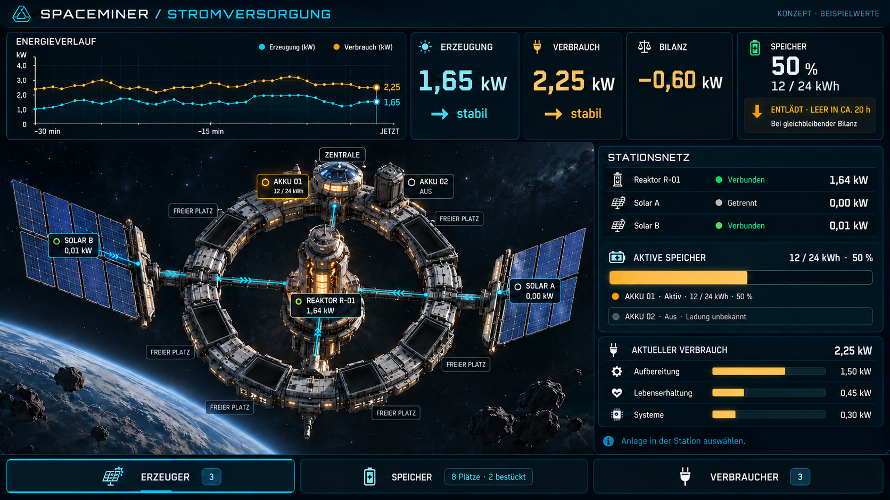
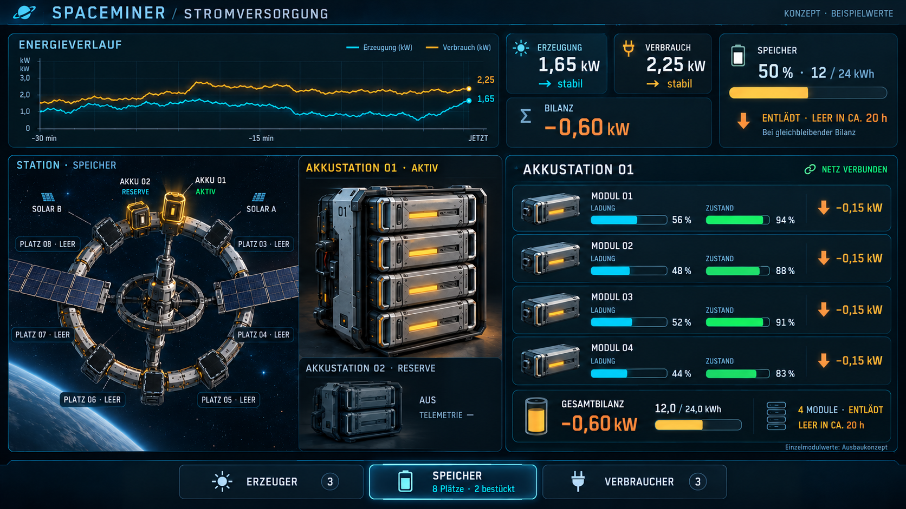
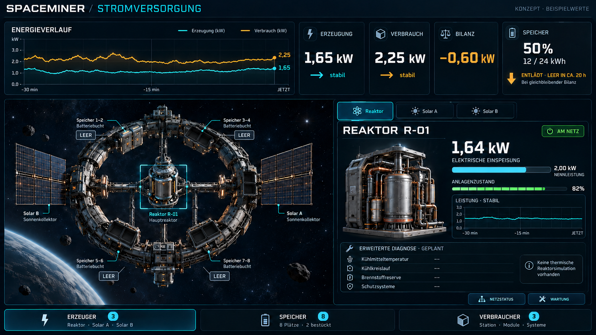
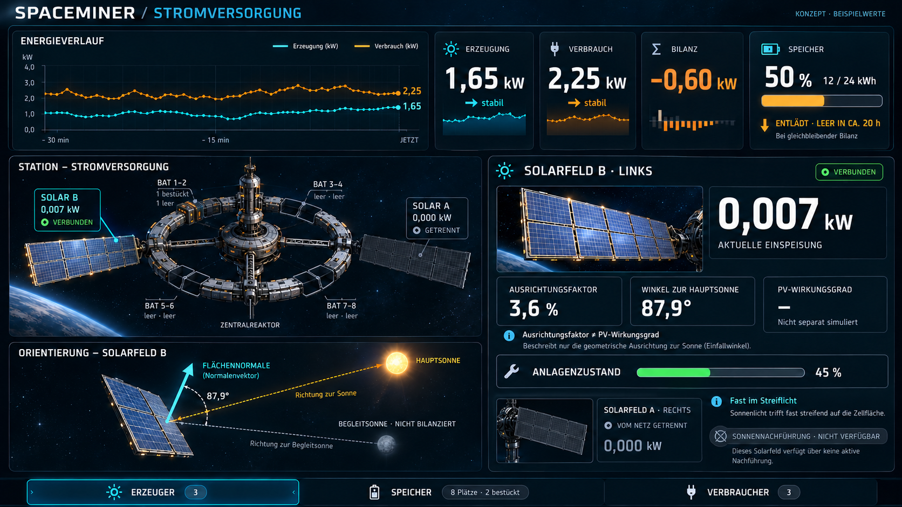

# Stromversorgung: neues UI-Konzept — 25.10.2026

Vier Bildentwürfe auf Nutzerauftrag. Am 26.10.2026 zur Umsetzung freigegeben, mit ausdrücklicher Vorgabe, in der Oberfläche die tatsächlichen Ingame-Modelle von Station, Akkustationen, Reaktor und Solarpanelen zu verwenden. Die moderne, futuristische Oberfläche kombiniert eine kleine auswählbare Stationsübersicht, einen dauerhaft sichtbaren Energieverlauf und eine Detailspalte rechts. Dunkles Navy, Cyan für System/Erzeugung, Amber für Verbrauch und Energiebilanz; Ladung und Anlagenzustand werden getrennt dargestellt. Bild-Beispielwerte sind keine neuen Simulationswerte. Umsetzung und tatsächlich erfolgte Prüfungen: [Stromversorgungs-UI](Stromversorgung-UI-2026-10-26.md).

## Konzeptbilder

1. [Stationsübersicht](Art/Interface/Stromversorgung-2026-10-25/01-stationsuebersicht.png): Ringstation mit auswählbarem Reaktor, zwei Solarflügeln und Akkubuchten; rechts Netzbilanz und Beispielverbraucher.
2. [Akkustation](Art/Interface/Stromversorgung-2026-10-25/02-akkustation.png): vier einzelne Kassetten mit Ladezustand, Zustand/Qualität und Lade-/Entladeleistung; darunter die Gesamtbilanz der ausgewählten Bank. Reserve getrennt und ohne erfundene Ladung.
3. [Reaktor](Art/Interface/Stromversorgung-2026-10-25/03-reaktor.png): elektrische Einspeisung, Nennleistung, Anlagenzustand, Netzstatus und vorgesehene Diagnosefelder für Kühlung, Brennstoff und Schutzsysteme.
4. [Solarfelder](Art/Interface/Stromversorgung-2026-10-25/04-solarfelder.png): Einspeisung, Anlagenzustand, Ausrichtung zur Hauptsonne und getrennte Kennzeichnung der Begleitsonne. A rechts, B links; Ausrichtung ist kein PV-Wirkungsgrad.

## Vorgesehene Bedienung

Oben bleiben Verbrauch und Erzeugung als gemeinsame kW-Kurven sowie aktuelle Leistungswerte sichtbar. Eigene Trendpfeile zeigen steigend/stabil/fallend; die Speicherbilanz zeigt unabhängig davon Laden/Entladen. Bei Überschuss erscheint eine Voll-Prognose, bei Defizit eine Leer-Prognose, jeweils ausdrücklich bei gleichbleibender Bilanz. Bei ausgeglichener Bilanz, unbekannten Daten oder einer bereits erreichten Grenze wird keine endliche Restzeit erfunden. Prognosen beziehen sich auf Spielzeit, nicht ungekennzeichnet auf reale Wartezeit bei Zeitraffer.

Anlagen lassen sich über die Stationsdarstellung oder die Kategorien Erzeuger, Speicher und Verbraucher wählen. Kategorien zeigen Anzahl und zusammengefasste Leistung beziehungsweise nutzbare Kapazität; bei Speichern werden Plätze, bestückte und aktive Banken unterschieden. Die rechte Spalte zeigt immer das ausgewählte Element. Die Gesamtbilanz bleibt beim Wechsel erhalten. Verbraucher sollen später die tatsächlichen vorhandenen Abnehmer zeigen, keine dekorativen Fantasieverbräuche.

## Beispielwerte und vorhandenes Modell

Die Bilder verwenden gerundete Beispielwerte: 1,65 kW Erzeugung, 2,25 kW Verbrauch, −0,60 kW Bilanz, 12 von 24 kWh gespeichert. Daraus ergeben sich rund 20 Spielstunden bis leer, ohne zusätzliche Verluste oder wechselnde Lasten. Drei Verbraucher mit 1,50/0,45/0,30 kW und ihre Anzahl sind reine Layoutbeispiele. Die grafischen Kurven sind generierte Illustrationen, keine gemessene Historie oder präzise Diagrammspezifikation.

Aktueller Implementierungsstand laut [Strompult-Fachdokumentation](Stromversorgung-Steuerpult-2026-10-25.md): acht Plätze, aktive Bank 01 mit vier Kassetten und gemeinsamem 24-kWh-Speicher, Reserve 02 getrennt mit unbekannter Ladung, sechs freie Plätze. Die neuere Platzierungskorrektur gilt: bestücktes Paar bei 0° direkt über den Gang gegenüber dem Zentraleneingang, nicht bei 180°. Die generierten Perspektiven sind Gestaltungsvorschläge, keine verbindlichen Geometrie-/Bestückungspläne.

Separate Kassetten-Lade-/Gesundheitswerte sind ein gewünschtes Ausbauziel. Die Zahlen 56/48/52/44 Prozent Ladung und 94/88/91/83 Prozent Zustand sind ausschließlich Illustrationen. Aktuell existiert keine solche unabhängige Kassettensimulation. Reaktor-Kühlung, Temperatur, Brennstoff und Schutztelemetrie werden noch nicht simuliert und stehen im Entwurf deshalb als geplante, nicht verfügbare Felder. Keine neuen Betriebsgrenzen oder Reaktorbauart beschlossen.

Die aktuelle Solarberechnung berücksichtigt die Hauptsonnenrichtung, Panelnormale, Anlagenzustand und Netzstatus. Begleitsonne, PV-Wirkungsgrad, thermisches Verhalten und Sonnennachführung sind keine neu implementierten Messgrößen. Ein Winkel von ungefähr 87,9 Grad zwischen Panelnormaler und Sonnenrichtung entspricht rund 3,6 Prozent geometrischem Ausrichtungsfaktor. Die entsprechende Bildskizze ist illustrativ. Vorhandene Erzeugerwerte bleiben unverändert.

## Erstellung und Prüfung

Mit dem eingebauten Imagegen-Werkzeug erstellt, vier eigenständige Generierungen und jeweils eine gezielte Bildkorrektur. [Vollständige Prompts](Art/Interface/Stromversorgung-2026-10-25/prompts.json). Alle finalen Bilder visuell kontrolliert und im Repository gesichert. Keine Spiel-/Szenen-/Assetänderung, keine neuen Builds oder Laufzeittests, kein Commit/Push. Grafiken und Beschriftungspositionen sind Konzeptkunst; eine Umsetzung benötigt exakte, datengetriebene UI-Komponenten.
