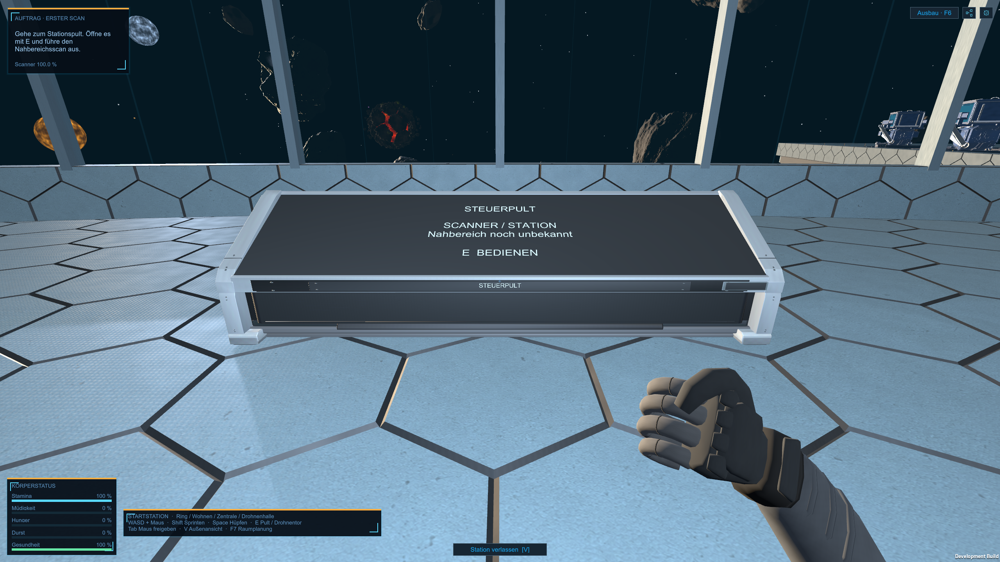

# R04-Touchpulte im Spiel — 26.10.2026

Nutzerauftrag: freigegebenes R04 auf alle Bedienpulte übernehmen, Hauptpult breiter gestalten. Fünf Funktionspulte (Drohnen, Stationsplanung, Mira/Forschung, Fertigung, Stromversorgung) und Hauptpult der Kommandozentrale verwenden nun dieselbe echte R04-Geometrie. Materialdrucker und Nahrungssynthese bleiben eigenständige Anlagen.

Standardgehäuse etwa1,50m breit,1,00m tief,1,14m hoch; vordere Glaskante etwa60cm, hinten1,11m. Hauptpult4,40m breit: mittlere Flächen verbreitert, seitliche Metallwangen und ihre Befestigungen seitlich versetzt statt durchgehend skaliert. Drei Mesh-/Materialgruppen mit zusammen23.772 Dreiecken je Fassung; keine neue LOD-/FPS-Abnahme. Die32.617 Dreiecke der Browseransicht enthalten zusätzlich deren Beispiel-UI, die nicht übernommen wird.

## Einbindung und Daten

`tools/ExportTouchConsoleRuntime.py` exportiert das saubere native R04-Blendergehäuse in kanonischen Unity-Koordinaten, ohne Beispielzahlen. Editorbuilder `TouchConsoleBuild.Prepare` erzeugt Standard-/Hauptpult-Prefabs und Mesh-/Materialassets unter Resources/TouchConsoleR04. Quelle unter Art/TouchConsoleR04; ursprüngliche Blender-/GLB-Varianten erhalten. Gemeinsamer vorhandener PBR-Atlas und Normalmap, einfache Standard-Materialfassung in Unity; keine identische Cycles-Beleuchtung oder Übernahme des prozeduralen Blender-Mikroreliefs behauptet.

`TouchConsoleVisual` ersetzt nur die sichtbaren Planungsboxen und führt zugehörige reale Kollisionen/Beschriftungen nach. `StationOperations.Geometry` bindet das Hauptpult ein; `.RoomPlan` bindet die fünf Nebenpulte ein. Kennungen, Funktionen, Wurzeln, Positionen und Drehungen bleiben erhalten, insbesondere `battery` für Stromversorgung. Raumplan-/Saveformate unverändert, keine gespeicherten Raumpläne durch den Builder neu erzeugt. Historische Planabmessungen bleiben Reservierungs-/Planungsdaten; das Hardwaregehäuse behält seine festen R04-Abmessungen und wird mit seiner Front an der bestehenden Bedienkante ausgerichtet. Ein Resize der alten Reservebox verzerrt das Gehäuse nicht. Eine spätere generelle Abstimmung der Planungsrechtecke auf feste Hardwarevarianten ist damit nicht als erledigt behauptet.

Die Displays zeigen kompakte echte Zustandsinformationen: Scannerwissen, Drohnenbestand, Auftragsanzahl sowie aktuelle Stromerzeugung/-verbrauch; Forschung und Planung mit Funktionshinweis. E öffnet die vorhandene ausführliche Oberfläche. Noch kein vollständiges Abbild der interaktiven Oberflächen auf dem Welt-Display und keine direkte Touch-/Handbedienung. Keine festen Konzeptwerte als Spieltelemetrie übernommen.

## Prüfung

Erster grafischer Lauf technisch bestanden, aber bei Bildkontrolle zu grosse Texte und falsche Kameraneigung erkannt. Text automatisch auf reale Fläche begrenzt, Prüfkameras korrigiert. Anschliessend finaler Development-Build mit Unity6000.6.5f1, bestehende Szene ohne Setup, Exit0 (`Logs/console-r04-game-acceptance-build.log`). Finale gezielte Pultprüfung37, bestehende Strompultregression477 und Raumplanerprüfung723: zusammen1237Checks, drei Läufe Exit0. Pultprüfung umfasst sechs Gehäuse, Hauptpultbreite, drei Materialgruppen, reale Collider und alle fünf physischen E-Anlaufpunkte/Panelöffnungen; Raumplaner prüft Verschieben/Drehen, isoliertes Speichern/Laden und die tatsächlichen Hardwarecollider statt alter Boxabmessungen. Haupt-/Strompultbilder visuell geprüft, sechs neue Aufnahmen bewahrt. Erster früher Prüflauf noch ohne eigene Settings-/Save-/Cinematic-Isolation; finale Fassung isoliert alle drei. Ergebnisse, Quellen- und Auslieferungshashes im [Prüfbericht](Pruefungen/Touchpulte-R04-Spielintegration-2026-10-26.json).

Geprüfter Development-Player nach Builds/Windows kopiert, ausgelieferte Dateien einzeln SHA256-gleich zur Prüffassung. Vorgänger vollständig unter Builds/Windows-before-touch-console-r04-20261026 erhalten. Kein neuer subjektiver Hörtest, Release-Lauf, vollständiger natürlicher Kampagnenlauf, Headset- oder Leistungsnachweis. Kein Commit/Push.

