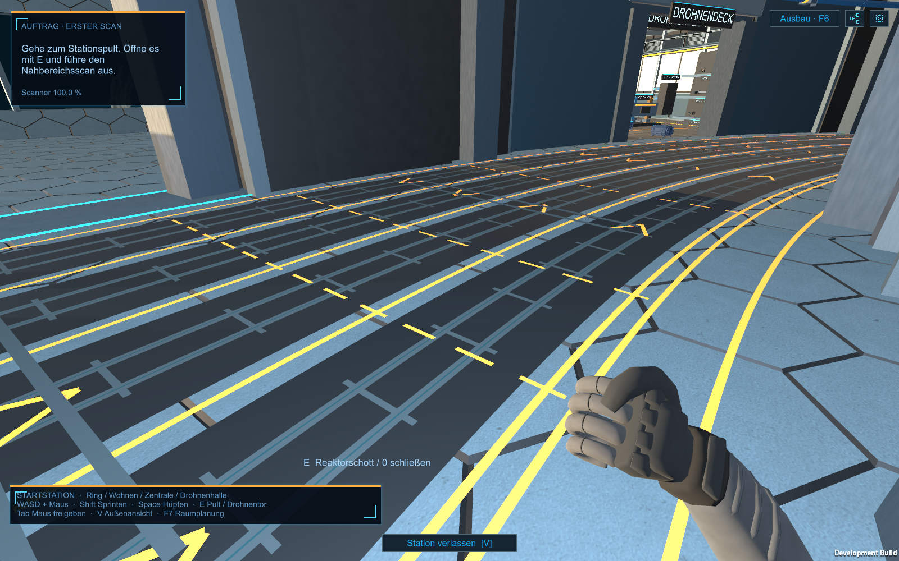

# Vier Magnetfahrspuren im Ringgang

**Aktualisierung nach Deadlockmeldung — 25.10.2026:** Die Fahrbahn bleibt erhalten. Aktuell **Build16** mit zentralen Wechselzonen-Freigaben und Rückwechsel erst nach Freigabe. 905 bestandene Checks, mindestens drei Runden aller zehn Drohnen, 334 Freigaben. [Aktuelle Steuerung und Prüfgrenzen](Innendrohnen-Deadlock-2026-10-25.md). Der unten dokumentierte Build14 ist der frühere Stand vor dieser Korrektur.

Nutzerentscheidung vom 25.10.2026: vier Spuren im vorhandenen Drohnenbereich, je zwei pro Richtung zum Überholen und Nebeneinanderfahren. Orange trennt die Flächen; flache Magnetleitungen sollen zu den Fußabständen der kleinen I75 passen und eine sichtbare Führung vermitteln. [Nutzervorlage](Art/Station/Vier-Magnetspuren-Nutzervorlage-2026-10-25.png).

## Maßaufteilung und Darstellung

Die bestehende sechs Meter breite Drohnenfahrbahn wird in **vier Spuren zu je 1,50 m** unterteilt. Fußgängerstreifen und Puffer bleiben an der inneren Ringseite. Alle Maße sind lokale Stationsmeter (eine Unity-Einheit = ein Meter).

| Spur, von innen nach außen | Grenzen / Mittelradius | Richtung | Zweck |
| --- | --- | --- | --- |
| 1 | r30,85–32,35 / 31,60 m | zunehmender Winkel | Fahrspur |
| 2 | r32,35–33,85 / 33,10 m | zunehmender Winkel | Überholen |
| 3 | r33,85–35,35 / 34,60 m | abnehmender Winkel | Überholen |
| 4 | r35,35–36,85 / 36,10 m | abnehmender Winkel | Fahrspur |

Sieben durchgehende orange Bögen begrenzen Fußgängerstreifen, Puffer und vier Drohnenspuren. Dunkle, 1,16 m breite Einlagen unterscheiden die Fahrspuren vom umgebenden Wabenboden. Je zwei metallische **8 cm breite Magnetleiter mit 35 cm Mittenabstand** sitzen pro Spur, ergänzt durch dezente cyanfarbene Statuslinien, flache Querverbinder und orange Richtungspfeile. Die Fahrbahn besteht aus Bodenmeshes ohne zusätzliche Collider oder erhöhte Hindernisse. Ihre Darstellung liegt wenige Millimeter über der Bodendeckschicht, höchstens 2,6 cm über der geometrischen Nullfläche.

Die Spurweite ist vom tatsächlich verwendeten Tripo-Smart-Mesh-V02 abgeleitet: nach Skalierung auf 75 cm Gesamtlänge ergeben die unteren Kontaktflächen näherungsweise x=−0,176 m und +0,173 m, also etwa **34,9 cm Abstand**. Das ist eine geometrische Näherung aus den unteren Meshvertices; das Rohmodell hat keine getrennten Fußobjekte. [Messdaten](Pruefungen/Vier-Magnetspuren-2026-10-25/foot-gauge.json).

## Fahrverhalten der zehn Testdrohnen

Die zehn Akteure aus [der I75-Fahrprobe](Innendrohnen-Fahrprobe-2026-10-25.md) behalten ihre Ziele und Rollen. Im Ring wird ihre Position direkt entlang der konzentrischen Magnetspuren geführt, mit sanftem radialem Wechsel zur Überholspur. Vor jedem eigenen Schritt prüfen sie andere aktuelle/prognostizierte Drohnenpositionen mit 0,95 m Mittelpunktabstand sowie feste Hindernisse. Bei Platzmangel halten sie an oder wechseln nur seitlich. Die bisherige Abkürzung über lange gerade Sehnen und das freie seitliche Wegdrücken aus der Fahrbahn entfallen. In Räumen und an Ein-/Ausfahrten arbeiten weiterhin echte NavMesh-Wege; diese freien Akteure geben der festen Spurführung Ausweichpriorität. Der Übergang zur Spurführung kann innerhalb von 1,15 m um einen Fahrbahn-Anschlusspunkt erfolgen, damit die Übergabestelle kein erzwungener Parkplatz im Durchgangsverkehr wird. Raumziele behalten ihre bisherige enge Ankunftstoleranz.

Schnellere Drohnen erkennen langsamere Fahrzeuge voraus, prüfen Platz auf der benachbarten Überholspur, wechseln dorthin und scheren mit Abstand hinter dem Überholvorgang wieder ein. Unterschiedliche Probetempi (0,72 bis 1,40 m/s bei 1×) machen das Verhalten sichtbar. Die beiden Ringgangpaare dürfen nebeneinander fahren. Native Ausweichradien wurden auf 48 cm vergrößert.

**Wechselzonen** an −60°/−20°/0°/10°/30°/45°/60° haben orange gestrichelte Quergrenzen und zusätzliche flache Querleiter. Dort können Raumzufahrten und Wendemanöver die Richtungspaare kreuzen. Die Zone reicht jeweils ±3,5° um den Anschlusswinkel. Build14 nutzte dort nur allgemeine Ausweichsteuerung. Seit Build16 gilt zusätzlich die [zentrale Freigabesteuerung](Innendrohnen-Deadlock-2026-10-25.md). Die strenge Prüfung des Richtungspaars gilt außerhalb dieser explizit markierten Zonen.

Das ist Softwareführung mit einer glaubwürdigen Magnetfahrbahn-Darstellung. Magnetische Regelkräfte, Leistungsübertragung, Schaltspulen, Nutzlastgrenzen oder ein abgesichertes Transportsystem sind nicht simuliert. Kein produktiver Drohnen-/Ressourcenzuwachs und keine Änderung der gemeinsamen 24-kWh-Batteriebilanz.

## Dateien, Start und Prüfung

- `StationRingLanes.cs`: gemeinsame Maße, Richtung und Spurzuordnung.
- `RingWalkthrough.MagneticLanes.cs`: Fahrbahneinlagen, Magnetleiter, Querverbinder, Richtungspfeile und orange Trennlinien.
- `StationIndoorTraffic.cs`: Führung auf Bögen, Überholen und Rückkehr in die Fahrspur.
- `StationIndoorTrafficCheck.cs` / `StationWorkshopCheck.CheckRoadOnly`: reale Fahrten, echte Markierungsmeshes, Schott-Kapsel-/CharacterController-Durchfahrten und Bilder.

Start weiterhin über **`Start-Innendrohnen-Fahrprobe.cmd`**. Die Bodengestaltung ist Teil der normalen Station; die zehn Probefahrzeuge werden nur mit der Fahrprobenoption angelegt. Innenlayoutrevision 15 bleibt erhalten, da keine Raumgrenzen oder stehenden Kollisionskörper versetzt werden.

**Historischer Prüflauf vor der Blockademeldung:** `indoor-traffic-build-14` unter `Builds/Windows`, Vorgänger in `Builds/Windows-before-four-magnet-lanes-20261025` erhalten. Der finale grafische Player-Lauf besteht **843 Checks**, Exit 0, **vier native Spielbilder**. 2.825 Bewegungssamples mit 10.553 einzeln geprüften Spurpositionen außerhalb der Wechselzonen; alle zehn Drohnen erreichen vollständige Routenrunden und ihre vorgesehenen Räume. Ein gezählter Überholvorgang mit Rückkehrsteuerung zur Fahrspur, rund 162–307 m pro Fahrzeug, kleinster gemessener Mittelpunktabstand **0,915 m**. Echte Schott-/CharacterController-/Kapseldurchfahrten und alle sieben Markierungsbögen sind im selben Lauf geprüft. Test mit Simulation 1× und `Time.timeScale=6` zur Beschleunigung; kein Nachweis linearer Fahrzeiten oder normalen Spiel-FPS daraus. 20×/100× sind nicht gesondert abgenommen.

[Prüfnachweis](Pruefungen/Vier-Magnetspuren-2026-10-25.json), [Spielbilder und Quellenmanifest](Pruefungen/Vier-Magnetspuren-2026-10-25/). Alle **247 ausgelieferten Builddateien** SHA256-abgeglichen, drei Nutzerraumpläne unverändert. 375 Dateien im Quellsnapshot dokumentiert, 366 identisch zum Arbeitsstand. Parallele Mira-Dateien bleiben erhalten; dieser Build verwendet dort den vorherigen Snapshot. Zwei nur in der älteren Buildkopie vorhandene Editor-Hilfsdateien sind separat gesichert; sie werden nicht in Playerassemblies ausgeliefert und wurden nicht aufgerufen.

Die alte vollständige `StationWorkshopCheck`-Suite wurde zunächst versucht und brach bei ihrer veralteten Forderung nach Layoutrevision 14 ab. Dieser Gesamtlauf gilt **nicht** als bestanden. Die für diese Änderung relevanten echten Durchfahrts- und Markierungsprüfungen werden über `CheckRoadOnly` gezielt im bestandenen finalen Fahrprobenlauf verwendet. Frühere Zwischenversuche und ihre Fehler werden nicht als bestanden übernommen.

Quellprojekt Unity 6000.4.7f1, getrennte Buildkopie 6000.6.4f1, Innenlayout 15. Keine neue Release-, manuelle Komfort-, native Eingabe-, Headset- oder FPS-Abnahme; kein Commit/Push.

