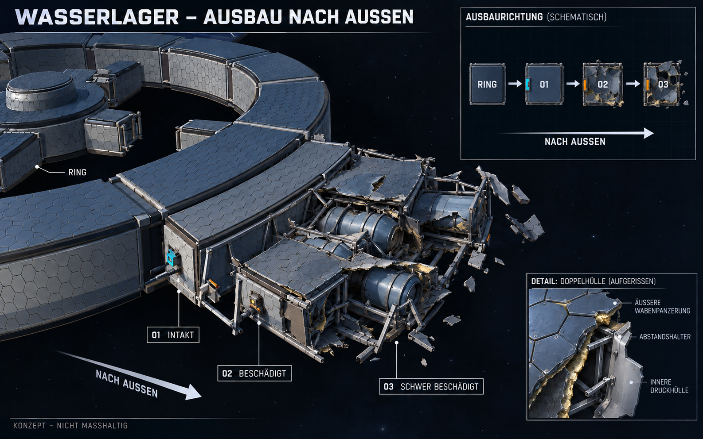

# Wasserlager: Ausbau nach außen und zusammenhängende Havarie

**Aktuell maßgeblich: [Konzept V3 mit drei benachbarten Anbauslots pro Ringsegment](Anbauslots-Konzept-V3-2026-10-25.md)** nach ausdrücklich beigefügter Nutzer-Draufsicht. Die nachfolgende Verweisung auf V2 ist historische Dokumentation; auch dessen lineare Raumkette ist inzwischen überholt.

**Durch Nutzerpräzisierung überholt:** Gewünscht ist die längliche Form wie im oberen rechten Schema. Das breite Hauptbild dieser Fassung trifft den Wunsch nicht. [Aktuelle Fassung V2](Wasserlager-Konzept-V2-2026-10-25.md) zeigt drei schmale Abschnitte hintereinander vom Ring weg. Nachfolgend bleibt V1 als historische Ausarbeitung dokumentiert.

Stand 25.10.2026. **Konzeptvorschlag, keine neue Unity-Umsetzung.** Nutzer präzisiert: „Ich meinte eher ein dritte nach aussen“ und wünscht natürlicheren, echteren Schaden; zunächst ein Konzept. Die konkrete bisherige Auslegung in drei 5,33-m-Stufen ist damit nicht als abschließend bestätigte Geometrie zu behandeln.

[Vollständiges Promptset](Art/Station/Wasserlager-Ausbau-Konzept-2026-10-25-v1.prompt.txt). Mit eingebautem ImageGen erzeugt, anschließend nur das fehlerhafte obere Einsatzdiagramm korrigiert. Grundlage war die [aktuelle Spielansicht](Pruefungen/Rohstofflager-Drittel-2026-10-25/Station/22-wasserlager-drei-stufen.png).

## Vorschlag für Anordnung und Ausbau

Vom Ring weg folgen **Ring → 01 intakt → 02 beschädigt → 03 schwer beschädigt** auf derselben radialen Ausbauachse. Der erste Abschnitt behält die volle Sektorbreite, wird aber in Ausbaurichtung kurz. Zwei weitere Abschnitte schließen außen an; die Seiten folgen den radialen Sektorgrenzen und werden außen breiter. Ein Deck; keine zusätzliche innere Erweiterung. Das obere Diagramm zeigt ausschließlich die Reihenfolge, keinen maßhaltigen Grundriss.

Als vorläufige Arbeitsmaße bleiben die bisherigen insgesamt 16 m Außentiefe mit drei etwa 5,33 m tiefen Abschnitten und 5,5 m lichter Höhe im Prompt. Diese Maße sind ein Vorschlag zur Gegenprüfung mit dem Nutzer, keine neue bestätigte Größenentscheidung. Gleich tiefe Sektorabschnitte haben unterschiedliche Grundflächen. Bildproportionen und Tankdarstellungen sind illustrativ, keine Kapazitätsauslegung.

Jeder Abschnitt erhält eine eigene seitliche Material-Andockstelle. Nur 01 ist nutzbar. Ein vollständiges geschlossenes Druckschott trennt den intakten Raum von den beiden drucklosen Wrackbereichen. Die Zeichnung schlägt keine neue Batterie- oder Reparaturmechanik vor.

## Schaden als zusammenhängendes Ereignis

- **01:** vollständige Druckhülle und Schutzlage, intakter Anschluss, geschützte Trennwand.
- **02:** größere noch befestigte Dach- und Wandflächen; einseitig aufgeschälte Kanten, örtlich geknickte kräftige Träger, sichtbar beschädigter Tank auf erhaltenen Halterungen. Der frühere geschlossene Raum bleibt erkennbar.
- **03:** anderes Bruchbild mit seitlich verdrehtem Bodenrahmen, ausgerissener Ecke, fehlender Dachpartie und stärker aufgerissenem Tank. Keine Wiederholung der gleichen Schäden aus 02.

Die beiden Hülllagen reißen versetzt. An wenigen Bruchstellen werden Abstandshalter und Dämmung sichtbar; überwiegend bleiben große Bauteile am Tragwerk befestigt. Nur wenige lose Trümmer, keine gleichmäßige Streuung, kein Feuer/Rauch und kein schwerkraftbedingtes Herunterhängen im freien Raum. Dies ist eine plausible visuelle Gestaltung, keine berechnete Unfall- oder Drucksimulation.

## Umsetzung nach dem Konzeptschritt

Separate Schadensmeshes für 02 und 03 statt regelmäßig verteilter dünner Stäbe: zusammenhängende Dachreste, aufgefaltete Seitenbleche, verformte Rahmen, eingerissene Tankhüllen und einzelne Leitungsenden. Wabenmaterial und zweilagiger Aufbau bleiben. Die geschlossene Nutzgrenze von 01 sowie freie Drohnenanflüge müssen beim tatsächlichen Umbau erneut geprüft werden. Keine Zusage eines neuen Reparatur-/Freischaltablaufs.

## Prüfung und Grenzen

Finales Bild visuell auf radiale Reihenfolge, intakte erste Hülle, unterschiedliche zusammenhängende Schäden und Doppelhüllendetail geprüft. Das ursprünglich falsche Einsatzbild zeigte die Abschnitte nebeneinander am Ring; gezielt durch das eindeutige Reihendiagramm ersetzt. PNG im Projekt gespeichert; 1586 × 992 Pixel, SHA256 `6A81D538FE583FE9A251E3B3D8639B82DBEA57881B7296CFDBDC74005ADAD004`. Lokale Dokumentverweise geprüft. Keine Unity-Quellen geändert, kein neuer Build oder Laufzeittest, kein Commit/Push. Vorhandene fremde Reaktorkonzepte und bisheriger Build erhalten.
