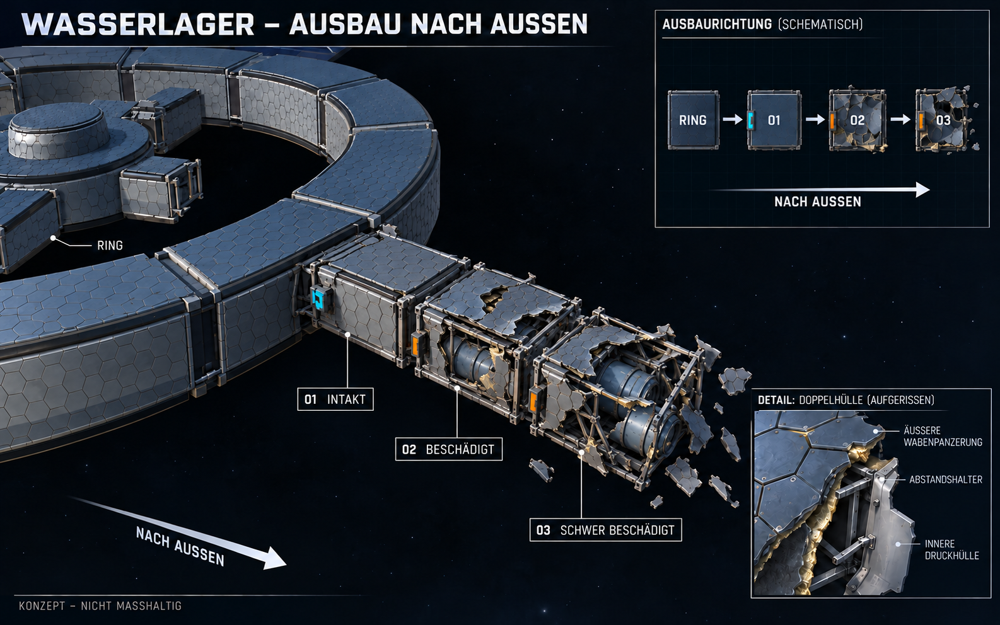

# Wasserlager V2: länglicher Anbau vom Ring weg

**Überholte Interpretation:** Die anschließend beigefügte Nutzer-Draufsicht legt drei benachbarte Anbauslots pro Ringsegment fest, jeweils mit eigenem Ringanschluss. Die hier beschriebene lineare Kette war eine Fehlinterpretation. Maßgeblich ist [Konzept V3](Anbauslots-Konzept-V3-2026-10-25.md). Der Rest dieser Datei ist historische Dokumentation.

Stand 25.10.2026. Nutzerpräzisierung: **„So wie der ausschnitt rechts oben also länglich so weg vom Ring“**. Maßgeblich ist die längliche Form mit drei Abschnitten hintereinander; das breite Hauptmotiv aus V1 trifft diesen Wunsch nicht. Weiterhin Konzeptschritt, noch kein Auftrag zur Unity-Umsetzung aus dieser Bildkorrektur abgeleitet.

[Bildprompt](Art/Station/Wasserlager-Ausbau-Konzept-2026-10-25-v2.prompt.txt) · [Historische Fassung V1](Wasserlager-Konzept-2026-10-25.md)

## Form und Verbindung

Ein schmaler länglicher Baukörper führt auf einer geraden radialen Achse vom Ring weg: **Ring → 01 intakt → 02 beschädigt → 03 schwer beschädigt**. Im Bild drei etwa quadratische Grundrisse hintereinander, mit geraden parallelen Seiten und gleicher Breite. Das Lager schließt nur an einen schmalen mittigen Teil der Ringaußenwand an. Der übrige Ringabschnitt bleibt geschlossen. Die bisherigen breiten gebogenen Lagerstreifen und ihre nach außen zunehmende Breite werden in diesem Konzept ersetzt. Andere Stationsmodule sind von dieser Präzisierung nicht pauschal betroffen.

Für die Bildproportionen wurden ungefähr **6 m Breite und insgesamt 16 m Länge**, verteilt auf dreimal etwa5,33m, bei5,5m lichter Höhe gewählt. Diese konkreten Maße und die gleichbleibende Breite sind die Ausarbeitung des länglichen Nutzerwunsches, keine bestätigte Maßvorgabe. Das Bild ist nicht maßhaltig; seine Tanks bestimmen keine neue Speicherkapazität. Vor einem Umbau wären Anschluss, Tankfreiraum, begehbarer Weg und Drohnenanflug zu prüfen.

## Erhaltene Gestaltung

01 ist vollständig geschlossen und durch ein Druckschott von den Wracks getrennt. 02 zeigt große befestigte Hüllenreste, örtliche Risse, verformte Rahmen und einen beschädigten Tank. 03 besitzt ein anderes, stärkeres Bruchbild mit aufgerissener Ecke und Tankhülle. Zwei getrennte Wabenhülllagen, an Risskanten sichtbare Abstandshalter/Dämmung und wenige nahe Trümmer bleiben. Je eine seitliche Material-Andockstelle auf derselben Längsseite, nur01 aktiv. Keine zusätzliche Batterie-, Druck- oder Reparatursimulation.

## Prüfung

Mit eingebautem ImageGen anhand des V1-Bildes erzeugt. Finales Bild visuell auf länglichen schmalen Baukörper, drei hintereinanderliegende Abschnitte, Ringanschluss, individuelle Schäden und erhaltenes Doppelhüllendetail geprüft. PNG im Projekt gespeichert,1586×992 Pixel; Hash und lokale Verweise geprüft. SHA256 `CFAA795CAA05E989E6B9351AE830FDA4C301F75FDD7AAA60693FF4649E512BEA`. V1 bleibt als historische Quelle erhalten. Keine Unity-Quellen geändert, kein neuer Build/Laufzeittest und kein Commit/Push; bestehender Build und fremde Reaktorarbeit erhalten.
